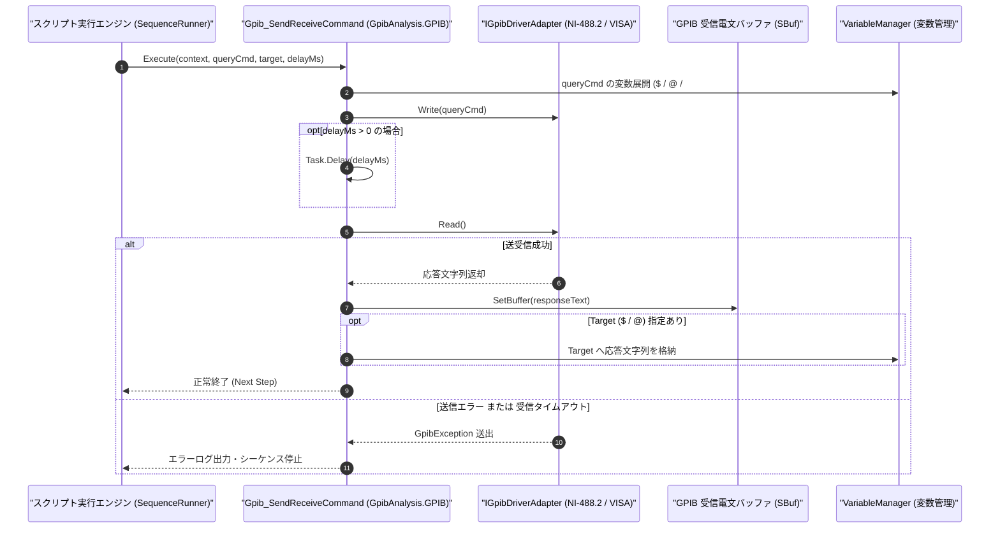

# コマンドリファレンス：Gpib_SendReceive

---

## 概要

**Gpib_SendReceive** は、オープン中の GPIB デバイスに対してクエリコマンド（`*IDN?`, `MEAS:VOLT?` 等）を送信し、引き続いてその応答電文を受信して内部受信バッファ（`SBuf`）および指定ターゲット変数（`$` / `@`）へ格納する送受信一体型コマンドです。

> 💡 **補足**: GPIB 測定器制御で最も頻繁に使用される Query（Send + Receive）操作を 1 ステップで記述できます。

---

## 💡 書式・パラメータ仕様

### コマンド構文

```csv
,SEQUENCE,Gpib_SendReceive, "<QueryCommand>", "[Target]", "[DelayMs: 0]"
```

### パラメータ（引数）一覧

| 引数位置 | パラメータ名 | 必須/任意 | 型・制約 | 説明 |
| :---: | :--- | :---: | :--- | :--- |
| 第1引数 | `QueryCommand` | **必須** | 文字列 | 送信するクエリコマンド文字列（例: `"*IDN?"`, `"READ?"`）を指定します。 |
| 第2引数 | `Target` | 任意 | 変数名（`$` / `@`） | 受信した応答文字列の格納先ターゲット変数を指定します。省略時は `SBuf` のみに格納されます。 |
| 第3引数 | `DelayMs` | 任意 | 整数（ミリ秒、既定値: `0`） | コマンド送信完了から受信開始までの間に挿入するウェイト時間（ミリ秒）を指定します。 |

---

## 🔄 特殊置換規約・分岐規約の適用

1. **送信クエリの変数展開と受信ターゲットへの格納**:
   - 第 1 引数には `"MEAS:VOLT? $CH"` のように変数を埋め込むことができ、第 2 引数には応答格納先の `$MEAS_VAL` または `@WORK_VAL` を指定できます。
2. **レガシー別名互換**:
   - 旧表記の `GpibSendReceive` や `GPIB_SENDRECEIVE` は内部正規化により本 `Gpib_SendReceive` コマンドへマッピングされます。

---

## 💡 動作例（正しい構文での記述例）

### スクリプト記述例

```csv
,PARAM,IDN_INFO,
,PARAM,DC_VOLT,0.0

,SEQUENCE,Gpib_Open, "3"
; 1. 機器識別情報(*IDN?)をクエリして $IDN_INFO へ格納
,SEQUENCE,Gpib_SendReceive, "*IDN?", "$IDN_INFO"

; 2. 100msの測定待ちを挟んでDC電圧測定値をクエリし $DC_VOLT へ格納
,SEQUENCE,Gpib_SendReceive, "MEAS:VOLT:DC?", "$DC_VOLT", "100"

,SEQUENCE,Gpib_Close
,SEQUENCE,Exit
```

### 実行時の挙動・変数変化

1. 1 回目の `Gpib_SendReceive` で `"*IDN?"` が送信され、返却されたメーカー・型番文字列が `$IDN_INFO` と `SBuf` に格納されます。
2. 2 回目の `Gpib_SendReceive` で `"MEAS:VOLT:DC?"` 送信後 100ms 待機してから応答が読み取られ、`$DC_VOLT` に格納されます。

---

## 🔄 動作フロー（シーケンス図）



---

## 🚫 エラーハンドリング・安全設計（仕様制限）

1. **送信失敗時の受信スキップ**:
   - クエリ送信段階でバスエラー（`ENOL` 等）が発生した場合は、無駄な受信タイムアウト待ちを行わず即座にエラーを送出します。
2. **クエリ文字列空指定の禁止**:
   - 第 1 引数 `QueryCommand` が空文字列の場合は `ArgumentException` を送出します。

---

## 🧪 ユニットテスト仕様

### テスト実行前提条件
- **対象クラス**: `GpibAnalysis.GPIB.Gpib_SendReceiveCommand`（`Gpib_SendReceiveCommand.cs`）
- **モック環境**: `IGpibDriverAdapter` モックが注入されていること。

### テストケース一覧

| テストID | テスト観点 | 入力スクリプト | 期待される動作・検証項目 |
| :--- | :--- | :--- | :--- |
| `UT-GPIB-SR-01` | 正常系（クエリ送受信） | `,SEQUENCE,Gpib_SendReceive, "*IDN?", "$ID"` | `"*IDN?"` が送信され、モック応答が `$ID` と `SBuf` に格納されること。 |
| `UT-GPIB-SR-02` | 正常系（ディレイ付き送受信） | `,SEQUENCE,Gpib_SendReceive, "READ?", "$VAL", "50"` | Write 後 50ms 以上経過してから Read が呼ばれること。 |
| `UT-GPIB-SR-03` | 異常系（クエリ空文字） | `,SEQUENCE,Gpib_SendReceive, ""` | `ArgumentException` が送出されること。 |

