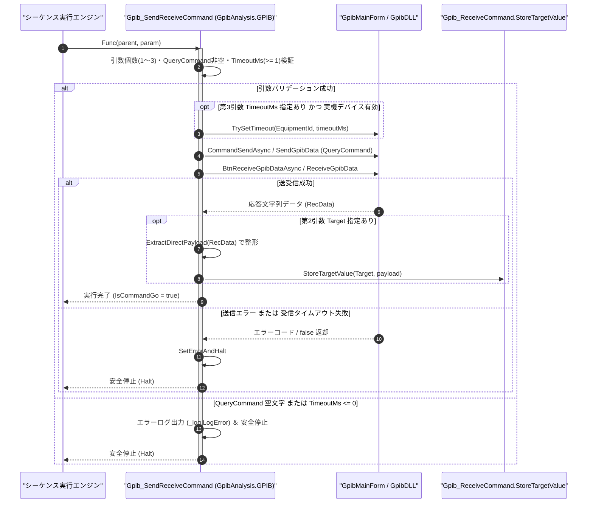

# コマンドリファレンス：Gpib_SendReceive

## 概要

**Gpib_SendReceive** は、接続中の GPIB デバイスに対してクエリコマンド（`*IDN?`, `MEAS:VOLT:DC?` 等）を送信し、直後にその応答電文を受信して内部受信バッファ（`RecData`）および指定ターゲット変数（`SBuf` / `Variables` / `PARAM`）へ格納する送受信一体型コマンドです。  
第 3 引数 `TimeoutMs` により、応答待ちの受信タイムアウト時間（ミリ秒）をクエリごとに指定できます。

> 💡 **補足**: GPIB 測定器制御で最も頻繁に使用される Query（コマンド送信＋応答受信＋変数格納）トランザクションを 1 ステップで完結できます。

---

## 💡 書式・パラメータ仕様

### コマンド構文

```csv
,SEQUENCE, [ステップキー], Gpib_SendReceive, "<QueryCommand>", "[Target]", "[TimeoutMs: 5000]"
```

### パラメータ（引数）一覧

| 引数位置 | 引数名 | 説明 | 指定方法 / 有効な入力値 |
| :--- | :--- | :--- | :--- |
| 引数1 | `QueryCommand` | 送信するクエリコマンド文字列（必須・空文字不可）。 | SCPI クエリ文字列（例: `"*IDN?"`, `"MEAS:VOLT:DC?"`）または `$PARAM$` 置換 |
| 引数2 | `Target` | 受信した応答文字列の格納先ターゲット変数・パラメータキー名（任意・省略時既定値: `""`）。省略時は内部受信バッファ（`RecData`）のみ更新されます。 | `PARAM` キー名または `$PARAM$` / `@` 指定（例: `"IDN_INFO"`, `"$DC_VOLT$"`） |
| 引数3 | `TimeoutMs` | 応答受信のタイムアウト時間［ミリ秒］（任意・省略時既定値: `5000`）。指定時は送受信前に `GpibDLL.TrySetTimeout` で対象機器へ適用されます。 | `1` 以上の整数（例: `"5000"`, `"10000"`）または `$PARAM$` 置換 |

---

## 🔄 特殊置換規約・分岐規約の適用

本コマンドの引数における特殊記法および解釈ルールです。
* **動的置換（`$`）**: 引数内で `$PARAMキー$` のように記述すると、実行時に変数プール（PARAM）の値へ動的置換されます。（適用可能な引数: 全引数対応）
* **ジャンプ先指定（`#`）**: 本コマンドはジャンプ制御を行わないため適用されません。（適用可能な引数: 非適用）
* **共通コマンド指定（`@`）**: 本コマンドは外部マクロを呼び出さないため適用されません。（適用可能な引数: 非適用）
* **カンマのエスケープ**: SCPI コマンド等、引数文字列自体にカンマを含める場合は、必ず `","` と二重引用符で囲んで記述します。
* **エイリアス（別名）**: `SendReceive`

---

## 💡 動作例（正しい構文での記述例）

### スクリプト記述例

※COMMAND ブロック配下の子要素行（PARAM, SEQUENCE）は必ず行頭カンマから開始し、スペースインデントや行末コメント（`;`）は記述しないでください。

```csv
COMMAND, "SAMPLE_GPIB_SENDRECEIVE", "DC_VOLT"
,PARAM, "IDN_INFO", Text, "機器識別情報", ""
,PARAM, "DC_VOLT", Text, "DC電圧測定値", "0.0"
,SEQUENCE, 010, Gpib_Open, "0"
; 1. 既定タイムアウト(5000ms)で機器識別情報(*IDN?)をクエリして IDN_INFO へ格納
,SEQUENCE, 020, Gpib_SendReceive, "*IDN?", "$IDN_INFO$"
; 2. 受信タイムアウト 10000ms を指定して高分解能DC電圧測定値をクエリし DC_VOLT へ格納
,SEQUENCE, 030, Gpib_SendReceive, "MEAS:VOLT:DC?", "$DC_VOLT$", "10000"
,SEQUENCE, 040, Gpib_Close, "0"
,SEQUENCE, 050, Exit
```

### 実行時の挙動・変数変化

* **実行前の状態**: GPIB ボードがオープンされ、`"IDN_INFO"` が `""`、`"DC_VOLT"` が `"0.0"` に設定されている状態。
* **実行後の状態**: ステップ `020` で `"*IDN?"` が送信され、既定タイムアウト（`5000` ms）で受信した識別情報文字列が `"IDN_INFO"` に格納されます。ステップ `030` では対象デバイスの受信タイムアウトが `10000` ms に設定された上で `"MEAS:VOLT:DC?"` の送受信が実行され、整形済みの測定値応答が `"DC_VOLT"` に格納されます。

---

## 🔄 動作フロー（シーケンス図）



---

## 🚫 エラーハンドリング・安全設計（仕様制限）

1. **空クエリ文字列および不正タイムアウト値（`TimeoutMs < 1`）の事前拒否**:
   - 第 1 引数 `QueryCommand` が空文字列（`allowEmpty: false`）の場合、または第 3 引数 `TimeoutMs` に `0` 以下の整数・非数値文字列が指定された場合は、バス送出前にエラーログを記録して安全停止します。
2. **送信失敗時の受信スキップと受信失敗時の安全停止**:
   - `GpibDLL.SendGpibData` で送信エラー（`sendRes != 0`）が発生した場合は無駄な受信待ちを行わず即座に `SetErrorAndHalt` で中断し、受信失敗・タイムアウト時も `SetErrorAndHalt(-1, ...)` でシーケンスを安全停止します。

---

## 🧪 ユニットテスト仕様

本コマンドクラス（`Gpib_SendReceiveCommand.cs`）に実装されている `RunUnitTest()` メソッドが検証するユニットテストの仕様です。

### テスト実行前提条件

* **実行トリガー**: `RunUnitTest()` メソッドの呼び出し
* **有効化条件**: システム全体の最小ログレベル（`ErrorLogger.MinimumLevel`）が `LogLevel.Test` であること（それ以外の場合は無効化ガードにより早期リターン）
* **検証結果出力**: `_log.LogTest` によるログ出力。検証失敗時は `_log.LogError`、予期せぬ例外発生時は `_log.LogCritical` で記録し、`finally` ブロックで `GpibDLL.DebugReceiveData` を元の状態へ復元します。

### テストケース一覧

| No | テストカテゴリ | テスト条件（入力値） | 期待される結果（出力値） | 検証の目的 / 観点 |
| :---: | :--- | :--- | :--- | :--- |
| **1** | 正常系 | `IsHeadless = true`・`DebugReceiveData = "MODEL-1000"` の下で `("*IDN?", "IDN_RES", "3000")` を指定して実行 | `!param.HasError` かつ `SBuf["IDN_RES"]` に `"MODEL-1000"` が格納される | クエリ送受信・`TimeoutMs` 指定・ターゲット格納の基本動作検証 |
| **2** | 異常系・状態復元 | 実行時の予期せぬ例外捕捉（`catch`）および終了時の `finally` クリーンアップ処理 | 例外時は `_log.LogCritical` で記録され、`finally` で `GpibDLL.DebugReceiveData` がテスト開始前の値へ確実に復元される | 例外クラッシュ防御およびグローバル疑似受信データの状態復元検証 |
