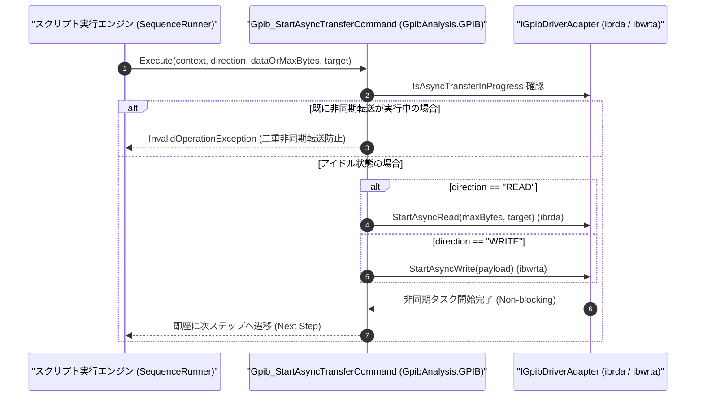

# コマンドリファレンス：Gpib_StartAsyncTransfer

---

## 概要

**Gpib_StartAsyncTransfer** は、大容量の測定データや波形データの GPIB 送受信（NI-488.2 `ibrda` / `ibwrta` 相当の非同期 DMA / バックグラウンド転送）をノンブロッキングで開始し、転送完了を待たずに即座に次のシーケンスステップへ制御を戻すコマンドです。

> 💡 **補足**: 非同期転送の完了待機および受信データの確定には、対になる [`Gpib_WaitAsyncTransfer`](./Gpib_WaitAsyncTransfer.Md) を使用します。転送中に別系統の制御や UI 更新を並行実行したい場合に使用します。

---

## 💡 書式・パラメータ仕様

### コマンド構文

```csv
,SEQUENCE,Gpib_StartAsyncTransfer, "<Direction: READ / WRITE>", "[DataOrMaxBytes]", "[Target]"
```

### パラメータ（引数）一覧

| 引数位置 | パラメータ名 | 必須/任意 | 型・制約 | 説明 |
| :---: | :--- | :---: | :--- | :--- |
| 第1引数 | `Direction` | **必須** | `READ` / `WRITE`（または `RECV` / `SEND`） | 非同期転送の方向（`READ`: 非同期受信 `ibrda`、`WRITE`: 非同期送信 `ibwrta`）を指定します。 |
| 第2引数 | `DataOrMaxBytes` | 任意 | 整数（READ時の最大バイト数）または 文字列（WRITE時の送信データ） | `READ` 時は読み取りバッファサイズ（既定 `65536`）、`WRITE` 時は送信するペイロード文字列を指定します。 |
| 第3引数 | `Target` | 任意 | 変数名（`$` / `@`） | `READ` 完了時（`Gpib_WaitAsyncTransfer` 完了時）に受信データを格納する予約ターゲット変数を指定します。 |

---

## 🔄 特殊置換規約・分岐規約の適用

1. **変数展開（`$` / `@` / `#`）**:
   - 各引数には変数を指定可能です（例: `"$ASYNC_PAYLOAD"`）。
2. **レガシー別名互換**:
   - 旧表記の `GpibStartAsyncTransfer` は内部正規化により本 `Gpib_StartAsyncTransfer` コマンドへマッピングされます。

---

## 💡 動作例（正しい構文での記述例）

### スクリプト記述例

```csv
,PARAM,TRACE_DATA,

,SEQUENCE,Gpib_Open, "18"
,SEQUENCE,Gpib_Send, "TRAC? TRACE1"

; 1. 大容量トレースデータの非同期受信(READ)をバックグラウンドで開始
,SEQUENCE,Gpib_StartAsyncTransfer, "READ", "65536", "$TRACE_DATA"

; 2. 転送中に並行して他のパラメータ計算などを実行可能
,SEQUENCE,Param_Set, "@STATUS_MSG", "波形データ転送中..."

; 3. 非同期転送の完了を待機して $TRACE_DATA への格納を確定
,SEQUENCE,Gpib_WaitAsyncTransfer, "10000"
,SEQUENCE,Gpib_Close
,SEQUENCE,Exit
```

### 実行時の挙動・変数変化

1. `Gpib_StartAsyncTransfer` はドライバに対して非同期読み取り（`ibrda`）を発行し、完了を待たずに次行の `Param_Set` へ進みます。
2. 後続の `Gpib_WaitAsyncTransfer` が完了した時点で、受信データが `SBuf` および `$TRACE_DATA` に格納されます。

---

## 🔄 動作フロー（シーケンス図）



---

## 🚫 エラーハンドリング・安全設計（仕様制限）

1. **二重非同期転送の排他防止**:
   - 先行する `Gpib_StartAsyncTransfer` がまだ `Gpib_WaitAsyncTransfer` で完了回収されていない状態で再度呼び出された場合は、`InvalidOperationException` を送出してドライバ競合（`EOIP`: I/O in progress エラー）を防止します。
2. **不正な転送方向キーワードの拒否**:
   - 第 1 引数に `READ` / `WRITE`（`RECV` / `SEND`）以外の文字列が指定された場合は `ArgumentException` を送出します。

---

## 🧪 ユニットテスト仕様

### テスト実行前提条件
- **対象クラス**: `GpibAnalysis.GPIB.Gpib_StartAsyncTransferCommand`（`Gpib_StartAsyncTransferCommand.cs`）
- **モック環境**: `IGpibDriverAdapter` モックが注入されていること。

### テストケース一覧

| テストID | テスト観点 | 入力スクリプト | 期待される動作・検証項目 |
| :--- | :--- | :--- | :--- |
| `UT-GPIB-ASYNCSTART-01` | 正常系（非同期READ開始） | `,SEQUENCE,Gpib_StartAsyncTransfer, "READ", "4096", "$BUF"` | `StartAsyncRead(4096, "$BUF")` が呼ばれ、ブロックせず即座に返ること。 |
| `UT-GPIB-ASYNCSTART-02` | 正常系（非同期WRITE開始） | `,SEQUENCE,Gpib_StartAsyncTransfer, "WRITE", "DATA_BLOCK"` | `StartAsyncWrite("DATA_BLOCK")` が呼ばれること。 |
| `UT-GPIB-ASYNCSTART-03` | 異常系（二重起動エラー） | 完了待機前に 2 回連続実行 | 2 回目で `InvalidOperationException` が送出されること。 |

