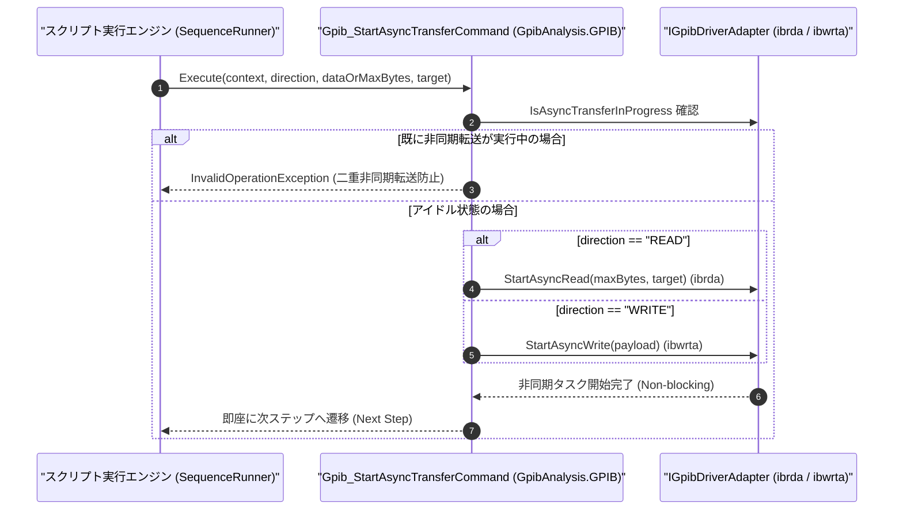

# コマンドリファレンス：Gpib_StartAsyncTransfer

## 概要

**Gpib_StartAsyncTransfer** は、大容量の測定データや波形データの GPIB 送受信（NI-488.2 `ibrda` / `ibwrta` 相当の非同期 DMA / バックグラウンド転送）をノンブロッキングで開始し、転送完了を待たずに即座に次のシーケンスステップへ制御を戻すコマンドです。

> 💡 **補足**: 非同期転送の完了待機および受信データの確定には、対になる [`Gpib_WaitAsyncTransfer`](./Gpib_WaitAsyncTransfer.Md) を使用します。転送中に別系統の制御や UI 更新を並行実行したい場合に使用します。

---

## 💡 書式・パラメータ仕様

### コマンド構文

```csv
,SEQUENCE, [ステップキー], Gpib_StartAsyncTransfer, "[AddressOrBoardId]", "[DirectionOrSize]", "[ByteCountOrTransferIdKey]", "[TargetOrSource]"
```

### パラメータ（引数）一覧

| 引数位置 | 引数名 | 説明 | 指定方法 / 有効な入力値 |
| :--- | :--- | :--- | :--- |
| 引数1 | `Address` / `BoardId` | 統一構文時は対象アドレス、ボード指定構文時は対象 GPIB ボード番号（必須）。 | 整数（例: `18`, `0`）または `$PARAM$` 置換 |
| 引数2 | `Direction` / `Size` | 転送方向（`"Send"` / `"Receive"`）または転送バイトサイズ（必須）。 | `"Send"`, `"Receive"`, または `1` 以上の整数 |
| 引数3 | `ByteCount` / `DestTransferIdKey` | 統一構文時は転送バイト数（`1` 以上）、ボード指定構文時は転送 ID 格納先キー（必須）。 | 正の整数（例: `65536`）または格納先 `PARAM` キー名 |
| 引数4 | `TargetOrSource` | 非同期完了時の受信データ格納先キーまたは送信元データキー（任意・省略可）。 | 格納先／参照元 `PARAM` キー名 |

---

## 🔄 特殊置換規約・分岐規約の適用

本コマンドの引数における特殊記法および解釈ルールです。
* **動的置換（`$`）**: 引数内で `$PARAMキー$` のように記述すると、実行時に変数プール（PARAM）の値へ動的置換されます。（適用可能な引数: 全引数対応）
* **ジャンプ先指定（`#`）**: 本コマンドはジャンプ制御を行わないため適用されません。（適用可能な引数: 非適用）
* **共通コマンド指定（`@`）**: 本コマンドは外部マクロを呼び出さないため適用されません。（適用可能な引数: 非適用）
* **カンマのエスケープ**: SCPI コマンド等、引数文字列自体にカンマを含める場合は、必ず `","` と二重引用符で囲んで記述します。
* **エイリアス（別名）**: `StartAsyncTransfer`, `GpibStartAsyncTransfer`

---

## 💡 動作例（正しい構文での記述例）

### スクリプト記述例

※COMMAND ブロック配下の子要素行（PARAM, SEQUENCE）は必ず行頭カンマから開始し、スペースインデントや行末コメント（;）は記述しないでください。

```csv
COMMAND, "SAMPLE_GPIB_STARTASYNCTRANSFER", ""
,PARAM, "TRACE_DATA", Text, "TRACE_DATA", ""
,SEQUENCE, 010, Gpib_Open, "18"
,SEQUENCE, 020, Gpib_Send, "TRAC? TRACE1"
; 1. 大容量トレースデータの非同期受信(READ)をバックグラウンドで開始
,SEQUENCE, 030, Gpib_StartAsyncTransfer, "READ", "65536", "$TRACE_DATA$"
; 2. 転送中に並行して他のパラメータ計算などを実行可能
,SEQUENCE, 040, Param_Set, "@STATUS_MSG", "波形データ転送中..."
; 3. 非同期転送の完了を待機して $TRACE_DATA への格納を確定
,SEQUENCE, 050, Gpib_WaitAsyncTransfer, "10000"
,SEQUENCE, 060, Gpib_Close
,SEQUENCE, 070, Exit
```

### 実行時の挙動・変数変化

* **実行前の状態**: GPIB 通信環境および対象コマンドの PARAM 初期値が設定され、ステップ実行待機中である状態。
* **実行後の状態**: `Gpib_StartAsyncTransfer` はドライバに対して非同期読み取り（`ibrda`）を発行し、完了を待たずに次行の `Param_Set` へ進みます。 後続の `Gpib_WaitAsyncTransfer` が完了した時点で、受信データが `SBuf` および `$TRACE_DATA` に格納されます。

---

## 🔄 動作フロー（シーケンス図）



---

## 🚫 エラーハンドリング・安全設計（仕様制限）

1. **二重非同期転送の排他防止**:
   - 先行する `Gpib_StartAsyncTransfer` がまだ `Gpib_WaitAsyncTransfer` で完了回収されていない状態で再度呼び出された場合は、`InvalidOperationException` を送出してドライバ競合（`EOIP`: I/O in progress エラー）を防止します。
2. **不正な転送方向キーワードの拒否**:
   - 第 1 引数に `READ` / `WRITE`（`RECV` / `SEND`）以外の文字列が指定された場合は `ArgumentException` を送出します。

---

## 🧪 ユニットテスト仕様

本コマンドクラス（`Gpib_StartAsyncTransferCommand.cs`）に実装されている `RunUnitTest()` メソッドが検証するユニットテストの仕様です。

### テスト実行前提条件

* **実行トリガー**: `RunUnitTest()` メソッドの呼び出し
* **有効化条件**: システム全体の最小ログレベル（`ErrorLogger.MinimumLevel`）が `LogLevel.Test` であること（それ以外の場合は無効化ガードにより早期リターン）
* **検証結果出力**: `_log.LogTest` によるログ出力。検証失敗時は `_log.LogError`、予期せぬ例外発生時は `_log.LogCritical` で記録し、`finally` ブロックでテスト確保した非同期転送バッファ（転送 ID `9999`）の解放と `LastTransferId`・`LastTargetKey`・`GpibDLL.DebugDLL`・`DebugReceiveData` の復元を行います。

### テストケース一覧

| No | テストカテゴリ | テスト条件（入力値） | 期待される結果（出力値） | 検証の目的 / 観点 |
| :---: | :--- | :--- | :--- | :--- |
| **1** | 正常系 | 3 引数構文 `("0", "256", "TID_KEY1")` および 4 引数統一構文 `("1", "Receive", "128", "TID_KEY2")` で `Func` を実行 | 両ケースとも `!HasError` となり、`Variables["TID_KEY1"]`・`Variables["TID_KEY2"]` に `"9999"`（`LastTransferId == 9999`）が格納される | ボード指定構文・統一構文双方での非同期転送開始および転送 ID 格納の検証 |
| **2** | 異常系 | 引数不足 `("0")`、サイズ範囲外 `("0", "0", "TID_ERR")`、および不正ボード ID `("INVALID", "256", "TID_ERR")` で `Func` を実行 | 3 ケースすべて `HasError == true` かつ `IsCommandGo == false` となり安全停止する | 引数個数（`3`〜`4`）・最小サイズ（`min: 1`）・ボード ID 型変換のバリデーション検証 |
