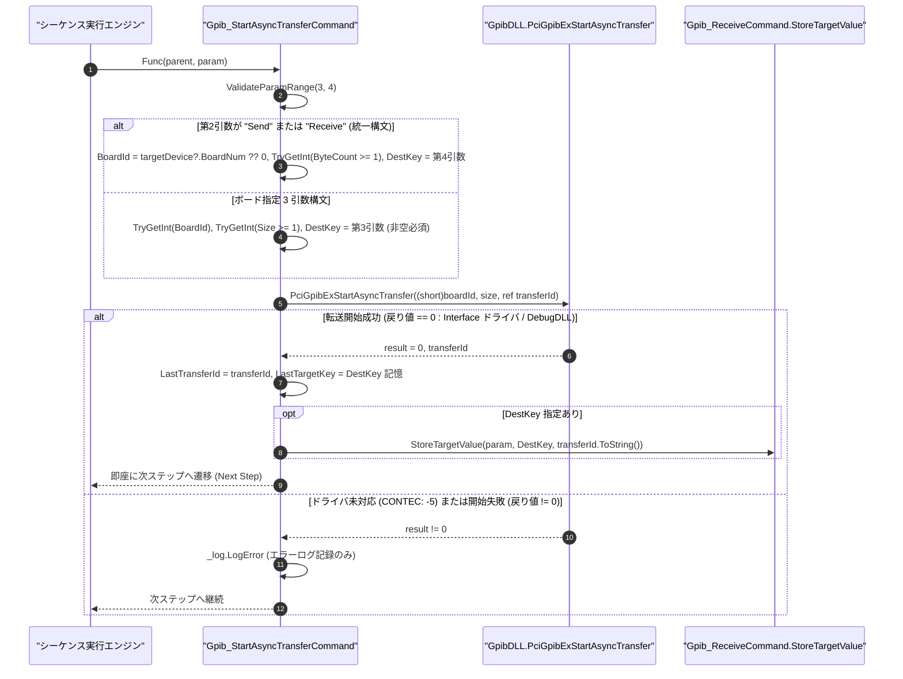

# コマンドリファレンス：Gpib_StartAsyncTransfer

## 概要

**Gpib_StartAsyncTransfer** は、 **Interface 社製 GPIB ドライバ（`gpc4304.dll`）専用** の非同期転送開始コマンドであり、大容量の測定データや波形データのバックグラウンド DMA／非同期バッファ転送（`GpibDLL.PciGpibExStartAsyncTransfer`）を開始し、転送完了を待たずに即座に次のシーケンスステップへ制御を戻します。

> 💡 **補足（ドライバメーカー制限と完了待機）**: 非同期転送の完了待機および受信データの確定には、対になる [`Gpib_WaitAsyncTransfer`](./Gpib_WaitAsyncTransfer.Md) を使用します。本コマンドは Interface 社製ドライバ（`gpc4304.dll`）およびデバッグシミュレーションモード（`DebugDLL == true`：疑似転送 ID `9999` を発行）に対応しており、CONTEC 社製ドライバ（`CGPIB.DLL`）選択時は未サポートエラー（`-5`）をログ出力して停止せず次ステップへ継続します。

---

## 💡 書式・パラメータ仕様

### コマンド構文

```csv
; ボード指定 3 引数構文（発行された転送 ID を DestTransferIdKey に格納）
,SEQUENCE, [ステップキー], Gpib_StartAsyncTransfer, <BoardId>, <Size>, "<DestTransferIdKey>"

; 統一 3〜4 引数構文（第 2 引数に "Send" または "Receive" を指定、カレント機器のボード番号を使用）
,SEQUENCE, [ステップキー], Gpib_StartAsyncTransfer, <Address>, "<Direction: Send / Receive>", <ByteCount>, "[TargetOrSource]"
```

### パラメータ（引数）一覧

| 引数位置 | 引数名 | 説明 | 指定方法 / 有効な入力値 |
| :--- | :--- | :--- | :--- |
| 引数1 | `BoardId` / `Address` | **ボード指定 3 引数構文時** ：対象 GPIB ボード番号（整数必須。非数値文字列は型変換エラーで安全停止）。<br> **統一 3〜4 引数構文時** ：対象アドレス指定（`ParameterSpec` 上の制約は `0` 以上の整数ですが、`Func` 実行時に第 2 引数が `"Send"` / `"Receive"` の場合はカレント機器の `BoardNum`［未設定時は `0`］が採用されます）。 | `0` 以上の整数（例: `0`, `18`）または `$PARAM$` 置換 |
| 引数2 | `Size` / `Direction` | **ボード指定 3 引数構文時** ：転送バイトサイズ（`1` 以上の整数）。<br> **統一構文時** ：転送方向キーワード（`"Send"` または `"Receive"`、大文字・小文字非区別）。 | `1` 以上の整数、または `"Send"` / `"Receive"` |
| 引数3 | `DestTransferIdKey` / `ByteCount` | **ボード指定 3 引数構文時** ：発行された転送 ID を格納するパラメータキー名（非空必須）。<br> **統一構文時** ：転送バイト数（`1` 以上の整数）。 | 格納先 `PARAM` キー名、または `1` 以上の整数（例: `65536`） |
| 引数4 | `TargetOrSource` | **統一 4 引数構文時** ：発行された転送 ID の即時格納先、かつ後続の [`Gpib_WaitAsyncTransfer`](./Gpib_WaitAsyncTransfer.Md)（短縮構文）完了時に受信データ本体を上書き格納する予約キー名（任意）。 | 格納先 `PARAM` キー名 |

---

## 🔄 特殊置換規約・分岐規約の適用

本コマンドの引数における特殊記法および解釈ルールです。
* **動的置換（`$`）**: 引数内で `$PARAMキー$` のように記述すると、実行時に変数プール（PARAM）の値へ動的置換されます。（適用可能な引数: 全引数対応）
* **ジャンプ先指定（`#`）**: 本コマンドはジャンプ制御を行わないため適用されません。（適用可能な引数: 非適用）
* **共通コマンド指定（`@`）**: 本コマンドは外部マクロを呼び出さないため適用されません。（適用可能な引数: 非適用）
* **カンマのエスケープ**: SCPI コマンド等、引数文字列自体にカンマを含める場合は、必ず `","` と二重引用符で囲んで記述します。
* **エイリアス（別名）**: `StartAsyncTransfer`, `GpibStartAsyncTransfer`

---

## 💡 動作例（正しい構文での記述例）

### スクリプト記述例

※COMMAND ブロック配下の子要素行（PARAM, SEQUENCE）は必ず行頭カンマ（`,`）から開始してください（行頭スペースのみでは認識されません）。なお、`;` で始まる行やクォート外の `;` 以降はコメントとして自動除去されます。

```csv
COMMAND, "SAMPLE_GPIB_STARTASYNCTRANSFER", "TRACE_DATA"
,PARAM, "TRACE_DATA", Text, "波形トレースデータ", ""
,PARAM, "STATUS_MSG", Work, "進捗メッセージ", ""
,SEQUENCE, 010, Gpib_Open, 0
,SEQUENCE, 020, Gpib_Send, "TRAC? TRACE1"
; 1. アドレス 18 に対し統一 4 引数構文で大容量データの非同期受信("Receive")を開始 (Interface 専用)
,SEQUENCE, 030, Gpib_StartAsyncTransfer, 18, "Receive", 65536, "TRACE_DATA"
; 2. 転送中に並行して他のパラメータ更新などを実行可能
,SEQUENCE, 040, Param_Set, "SAMPLE_GPIB_STARTASYNCTRANSFER", "波形データ転送中...", "STATUS_MSG"
; 3. 非同期転送の完了を待機して TRACE_DATA への受信データ格納を確定
,SEQUENCE, 050, Gpib_WaitAsyncTransfer, 10000
,SEQUENCE, 060, Gpib_Close
,SEQUENCE, 070, Exit
```

### 実行時の挙動・変数変化

* **実行前の状態**: GPIB ボードがオープンされ、対象測定器へ波形出力クエリを送信した直後の状態。
* **実行後の状態**: `Gpib_StartAsyncTransfer` はドライバに対して非同期バッファ転送（`PciGpibExStartAsyncTransfer`）を開始して `LastTransferId` と `LastTargetKey`（`"TRACE_DATA"`）を記録し、完了を待たずに次行の `Param_Set` へ進みます。後続の `Gpib_WaitAsyncTransfer` が完了した時点で、受信データが `"TRACE_DATA"` に格納されます。

---

## 🔄 動作フロー（シーケンス図）



---

## 🚫 エラーハンドリング・安全設計（仕様制限）

1. **引数個数（`3`〜`4`）・ボード指定構文の `BoardId`・転送サイズ（`1` 以上）の事前検証**:
   - `ValidateParamRange(3, 4)` 違反、ボード指定構文時に第 1 引数 `BoardId` へ非数値文字列や第 3 引数 `DestTransferIdKey` へ空文字列を指定した場合、または転送バイトサイズ（`Size` / `ByteCount`）に `0` 以下の整数・非数値を指定した場合は、`SetErrorAndHalt` によりエラーログを記録して安全停止します。
2. **CONTEC ドライバ環境および物理転送開始失敗時の非停止ログ記録**:
   - CONTEC ドライバ選択時（`-5`）やドライバ側のバッファ確保・範囲外ボード ID エラーにより `PciGpibExStartAsyncTransfer` が `0` 以外のエラーコードを返した場合は、`_log.LogError` を記録して強制停止せず次ステップへ継続します。

---

## 🧪 ユニットテスト仕様

本コマンドクラス（`Gpib_StartAsyncTransferCommand.cs`）に実装されている `RunUnitTest()` メソッドが検証するユニットテストの仕様です。

### テスト実行前提条件

* **実行トリガー**: `RunUnitTest()` メソッドの呼び出し
* **有効化条件**: システム全体の最小ログレベル（`ErrorLogger.MinimumLevel`）が `LogLevel.Test` であること（それ以外の場合は無効化ガードにより早期リターン）
* **検証結果出力**: `_log.LogTest` によるログ出力。検証失敗時は `_log.LogError`、予期せぬ例外発生時は `_log.LogCritical` で記録し、`finally` ブロックでテスト確保した非同期転送バッファ（転送 ID `9999`）の解放と `LastTransferId`・`LastTargetKey`・`GpibDLL.DebugDLL`・`DebugReceiveData` の復元を行います。

### テストケース一覧

| No | テストカテゴリ | テスト条件（入力値） | 期待される結果（出力値） | 検証の目的 / 観点 |
| :---: | :--- | :--- | :--- | :--- |
| **1** | 正常系 | 3 引数構文 `("0", "256", "TID_KEY1")` および 4 引数統一構文 `("1", "Receive", "128", "TID_KEY2")` で `Func` を実行 | 両ケースとも `!HasError` となり、`Variables["TID_KEY1"]`・`Variables["TID_KEY2"]` に `"9999"`（`LastTransferId == 9999`）が格納される | ボード指定構文・統一構文双方での非同期転送開始および転送 ID 格納の検証 |
| **2** | 異常系 | 引数不足 `("0")`、サイズ範囲外 `("0", "0", "TID_ERR")`、および不正ボード ID `("INVALID", "256", "TID_ERR")` で `Func` を実行 | 3 ケースすべて `HasError == true` かつ `IsCommandGo == false` となり安全停止する | 引数個数（`3`〜`4`）・最小サイズ（`min: 1`）・ボード ID 型変換のバリデーション検証 |
