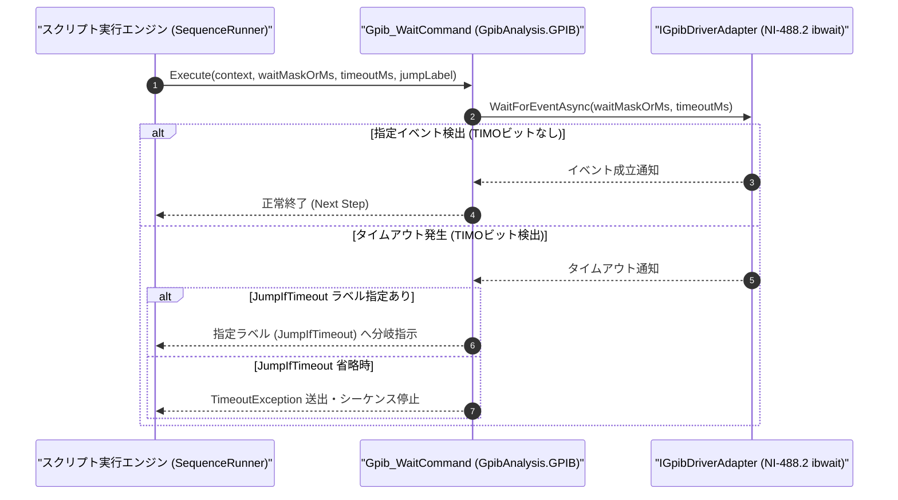

# コマンドリファレンス：Gpib_Wait

## 概要

**Gpib_Wait** は、GPIB バス上の指定イベント（SRQ: サービスリクエスト発生、CMPL: 非同期 I/O 完了、LACS: リスナー指定、TACS: トーカー指定等、NI-488.2 `ibwait` ステータスマスク）が発生するまで、または指定された待機時間（ミリ秒）が経過するまで待機するコマンドです。

> 💡 **補足**: 測定器のスイープ完了通知（SRQ）を待つイベント駆動同期や、GPIB バスタイミング調整の双方に対応しています。

---

## 💡 書式・パラメータ仕様

### コマンド構文

```csv
,SEQUENCE, [ステップキー], Gpib_Wait, "[EventMask]", "[TimeoutMs: 5000]"
```

### パラメータ（引数）一覧

| 引数位置 | 引数名 | 説明 | 指定方法 / 有効な入力値 |
| :--- | :--- | :--- | :--- |
| 引数1 | `EventMask` | 待機する GPIB バスイベント名または 16 進イベントマスク値（必須）。 | `"SRQ"`, `"CMPL"`, `"RQS"` または 16 進マスク（例: `"0x1000"`） |
| 引数2 | `TimeoutMs` | イベント発生を待機する最大タイムアウト時間［ミリ秒］（任意・省略時既定値: `5000`）。 | `0` 以上の整数（例: `5000`, `10000`）または `$PARAM$` 置換 |

---

## 🔄 特殊置換規約・分岐規約の適用

本コマンドの引数における特殊記法および解釈ルールです。
* **動的置換（`$`）**: 引数内で `$PARAMキー$` のように記述すると、実行時に変数プール（PARAM）の値へ動的置換されます。（適用可能な引数: 全引数対応）
* **ジャンプ先指定（`#`）**: 本コマンドはジャンプ制御を行わないため適用されません。（適用可能な引数: 非適用）
* **共通コマンド指定（`@`）**: 本コマンドは外部マクロを呼び出さないため適用されません。（適用可能な引数: 非適用）
* **カンマのエスケープ**: SCPI コマンド等、引数文字列自体にカンマを含める場合は、必ず `","` と二重引用符で囲んで記述します。
* **エイリアス（別名）**: `GpibWait`

---

## 💡 動作例（正しい構文での記述例）

### スクリプト記述例

※COMMAND ブロック配下の子要素行（PARAM, SEQUENCE）は必ず行頭カンマから開始し、スペースインデントや行末コメント（`;`）は記述しないでください。

```csv
COMMAND, "WAIT_SRQ_SWEEP", "PEAK_LVL"
,PARAM, "STB_VAL", Work, "ステータスバイト", ""
,PARAM, "PEAK_LVL", Work, "ピークレベル", ""
,SEQUENCE, 010, Gpib_Open, 0
,SEQUENCE, 020, Gpib_Send, "*SRE 32;*ESE 1;INIT:IMM;*OPC"
; 最大 5000ms 間 SRQ イベント発生を待機
,SEQUENCE, 030, Gpib_Wait, "SRQ", 5000
,SEQUENCE, 040, Gpib_SPL, "STB_VAL"
,SEQUENCE, 050, Gpib_SendReceive, "CALC:MARK1:Y?", "PEAK_LVL"
,SEQUENCE, 060, Gpib_Close, 0
,SEQUENCE, 070, Exit
```

### 実行時の挙動・変数変化

* **実行前の状態**: 測定器へ単発スイープ開始コマンドを送出し、測定完了の SRQ 割り込みを待っている状態。
* **実行後の状態**: ステップ `030` で SRQ イベントが検出された時点で待機が解除され、続く `Gpib_SPL` でステータスバイトが `"STB_VAL"` に、測定結果が `"PEAK_LVL"` に格納されます。

---

## 🔄 動作フロー（シーケンス図）



---

## 🚫 エラーハンドリング・安全設計（仕様制限）

1. **キャンセル要求への即時応答**:
   - 待機中にユーザーからシーケンス停止要求があった場合は、待機を即座に中断して安全に終了します。
2. **不正なマスク指定の拒否**:
   - 解釈できないイベント名や負のタイムアウト値が指定された場合は `ArgumentException` を送出します。

---

## 🧪 ユニットテスト仕様

本コマンドクラス（`Gpib_WaitCommand.cs`）に実装されている `RunUnitTest()` メソッドが検証するユニットテストの仕様です。

### テスト実行前提条件

* **実行トリガー**: `RunUnitTest()` メソッドの呼び出し
* **有効化条件**: システム全体の最小ログレベル（`ErrorLogger.MinimumLevel`）が `LogLevel.Test` であること（それ以外の場合は無効化ガードにより早期リターン）
* **検証結果出力**: `_log.LogTest` によるログ出力。検証失敗時は `_log.LogError`、予期せぬ例外発生時は `_log.LogCritical` で記録し、`finally` ブロックで `GpibDLL.DebugDLL` および `GpibDLL.DebugReceiveData` を元の状態へ復元します。

### テストケース一覧

| No | テストカテゴリ | テスト条件（入力値） | 期待される結果（出力値） | 検証の目的 / 観点 |
| :---: | :--- | :--- | :--- | :--- |
| **1** | 正常系 | `ParseEventMask` に `"SRQ"`・`"0x0100"`・`"64"` を指定、および `("SRQ", "100")` 指定で `Func` を実行 | マスクが `0x1000`・`256`・`64` に変換され、`!HasError`・`IsCommandGo == true` で待機完了する | イベントマスク文字列解析およびシミュレーション待機完了の検証 |
| **2** | 異常系 | `ParseEventMask` に `null`・`"INVALID"` を指定、および引数なし（0 引数）・負数タイムアウト `("SRQ", "-1")` で `Func` を実行 | マスクは `0` を返し、両 `Func` 実行とも `HasError == true`・`IsCommandGo == false` で安全停止する | 不正マスクフォールバックおよび必須引数・タイムアウト範囲（`min: 0`）検証 |
