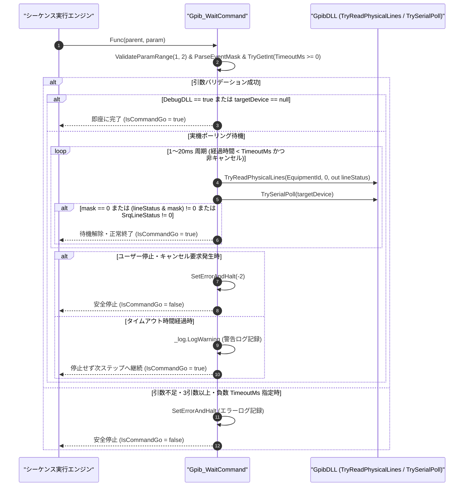

# コマンドリファレンス：Gpib_Wait

## 概要

**Gpib_Wait** は、GPIB バス上の指定イベント（SRQ: サービスリクエスト発生、または任意のイベントマスクビット成立）が発生するまで、指定されたタイムアウト時間（ミリ秒）の範囲内でポーリング待機するコマンドです。

> 💡 **補足**: 単純な一定時間スリープを行う Core 共通コマンドの `Wait`（`WaitMs`）とは異なり、対象機器の物理バスライン状態（`GpibDLL.TryReadPhysicalLines`）およびシリアルポールによる SRQ ライン状態（`GpibDLL.TrySerialPoll`）を `1`〜`20` ms（`Math.Min(20, Math.Max(1, timeoutMs / 10))` ms）間隔でポーリング監視します。測定器のスイープ完了通知（SRQ）を待つイベント駆動同期に使用します。

---

## 💡 書式・パラメータ仕様

### コマンド構文

```csv
,SEQUENCE, [ステップキー], Gpib_Wait, "<EventMask>", "[TimeoutMs: 5000]"
```

### パラメータ（引数）一覧

| 引数位置 | 引数名 | 説明 | 指定方法 / 有効な入力値 |
| :--- | :--- | :--- | :--- |
| 引数1 | `EventMask` | 待機する GPIB バスイベントマスク（必須）。キーワード `"SRQ"`（内部マスク `0x1000`）、`"0x"` 付き 16 進整数、または 10 進整数を指定します（※ `"SRQ"` 以外の未定義文字列や `"0"` を指定した場合はマスク値 `0` となり、待機せず即座に次ステップへ通過します）。 | `"SRQ"`、16 進表記（例: `"0x1000"`）、または 10 進整数（例: `"4096"`） |
| 引数2 | `TimeoutMs` | イベント発生を待機する最大タイムアウト時間［ミリ秒］（任意・省略時既定値: `5000`）。※第 3 引数（タイムアウト分岐ラベル）は存在しないため、最大 2 引数で指定してください。 | `0` 以上の整数（例: `5000`, `10000`）または `$PARAM$` 置換 |

---

## 🔄 特殊置換規約・分岐規約の適用

本コマンドの引数における特殊記法および解釈ルールです。
* **動的置換（`$`）**: 引数内で `$PARAMキー$` のように記述すると、実行時に変数プール（PARAM）の値へ動的置換されます。（適用可能な引数: 全引数対応）
* **ジャンプ先指定（`#`）**: 本コマンドはジャンプ制御を行わないため適用されません。（適用可能な引数: 非適用）
* **共通コマンド指定（`@`）**: 本コマンドは外部マクロを呼び出さないため適用されません。（適用可能な引数: 非適用）
* **カンマのエスケープ**: SCPI コマンド等、引数文字列自体にカンマを含める場合は、必ず `","` と二重引用符で囲んで記述します。
* **エイリアス（別名）**: `GpibWait`（※ `Wait` は Core の時間待機コマンドであるため、GPIB イベント待機は必ず `Gpib_Wait` または `GpibWait` と記述してください）

---

## 💡 動作例（正しい構文での記述例）

### スクリプト記述例

※COMMAND ブロック配下の子要素行（PARAM, SEQUENCE）は必ず行頭カンマ（`,`）から開始してください（行頭スペースのみでは認識されません）。なお、`;` で始まる行やクォート外の `;` 以降はコメントとして自動除去されます。

```csv
COMMAND, "WAIT_SRQ_SWEEP", "PEAK_LVL"
,PARAM, "STB_VAL", Work, "ステータスバイト", ""
,PARAM, "PEAK_LVL", Work, "ピークレベル", ""
,SEQUENCE, 010, Gpib_Open, 0
,SEQUENCE, 020, Gpib_Send, "*SRE 32;*ESE 1;INIT:IMM;*OPC"
; 最大 5000ms 間 SRQ イベント発生を待機
,SEQUENCE, 030, Gpib_Wait, "SRQ", 5000
,SEQUENCE, 040, Gpib_SPL, "STB_VAL"
,SEQUENCE, 050, Gpib_SendReceive, "CALC:MARK1:Y?", "PEAK_LVL"
,SEQUENCE, 060, Gpib_Close, 0
,SEQUENCE, 070, Exit
```

### 実行時の挙動・変数変化

* **実行前の状態**: 測定器へ単発スイープ開始コマンドを送出し、測定完了の SRQ 割り込みを待っている状態。
* **実行後の状態**: ステップ `030` で SRQ イベントが検出された時点で即座に待機が解除されます（`5000` ms 経過しても未検出の場合は警告ログを出力して次ステップへ進みます）。続く `Gpib_SPL` でステータスバイトが `"STB_VAL"` に、測定結果が `"PEAK_LVL"` に格納されます。

---

## 🔄 動作フロー（シーケンス図）



---

## 🚫 エラーハンドリング・安全設計（仕様制限）

1. **引数個数（`1`〜`2`）およびタイムアウト値（`0` 以上）の検証**:
   - `ValidateParamRange(1, 2)` 違反（0 引数または 3 引数以上）や、第 2 引数 `TimeoutMs` に負数・非数値文字列が指定された場合は、`SetErrorAndHalt` によりエラーログを記録して安全停止します。
2. **タイムアウト時の警告継続とキャンセル要求への即時応答**:
   - 指定した `TimeoutMs` 内にイベントが成立しなかった場合は例外停止せず `_log.LogWarning` を出力して `IsCommandGo = true` で次ステップへ進むため、後続の [`Gpib_SPL`](./Gpib_SPL.Md) と `Judge` で柔軟にタイムアウトリカバリを組むことができます。一方、待機中にユーザーから停止（キャンセル）操作が行われた場合は `SetErrorAndHalt(-2, ...)` で即座に安全停止します。

---

## 🧪 ユニットテスト仕様

本コマンドクラス（`Gpib_WaitCommand.cs`）に実装されている `RunUnitTest()` メソッドが検証するユニットテストの仕様です。

### テスト実行前提条件

* **実行トリガー**: `RunUnitTest()` メソッドの呼び出し
* **有効化条件**: システム全体の最小ログレベル（`ErrorLogger.MinimumLevel`）が `LogLevel.Test` であること（それ以外の場合は無効化ガードにより早期リターン）
* **検証結果出力**: `_log.LogTest` によるログ出力。検証失敗時は `_log.LogError`、予期せぬ例外発生時は `_log.LogCritical` で記録し、`finally` ブロックで `GpibDLL.DebugDLL` および `GpibDLL.DebugReceiveData` を元の状態へ復元します。

### テストケース一覧

| No | テストカテゴリ | テスト条件（入力値） | 期待される結果（出力値） | 検証の目的 / 観点 |
| :---: | :--- | :--- | :--- | :--- |
| **1** | 正常系 | `ParseEventMask` に `"SRQ"`・`"0x0100"`・`"64"` を指定、および `("SRQ", "100")` 指定で `Func` を実行 | マスクが `0x1000`・`256`・`64` に変換され、`!HasError`・`IsCommandGo == true` で待機完了する | イベントマスク文字列解析およびシミュレーション待機完了の検証 |
| **2** | 異常系 | `ParseEventMask` に `null`・`"INVALID"` を指定、および引数なし（0 引数）・負数タイムアウト `("SRQ", "-1")` で `Func` を実行 | マスクは `0` を返し、両 `Func` 実行とも `HasError == true`・`IsCommandGo == false` で安全停止する | 不正マスクフォールバックおよび必須引数・タイムアウト範囲（`min: 0`）検証 |
