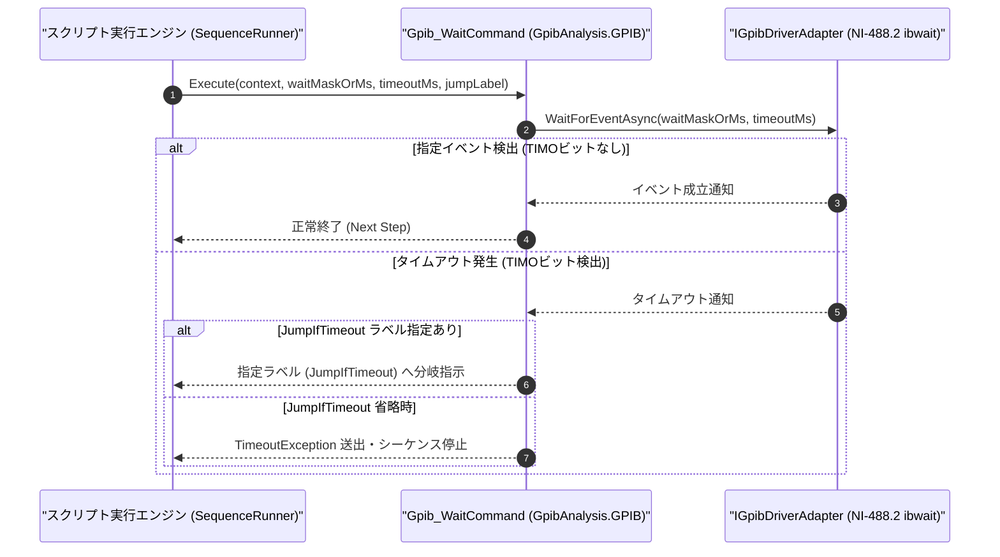

# コマンドリファレンス：Gpib_Wait

---

## 概要

**Gpib_Wait** は、GPIB バス上の指定イベント（SRQ: サービスリクエスト発生、CMPL: 非同期 I/O 完了、LACS: リスナー指定、TACS: トーカー指定等、NI-488.2 `ibwait` ステータスマスク）が発生するまで、または指定された待機時間（ミリ秒）が経過するまで待機するコマンドです。

> 💡 **補足**: 測定器のスイープ完了通知（SRQ）を待つイベント駆動同期や、GPIB バスタイミング調整の双方に対応しています。

---

## 💡 書式・パラメータ仕様

### コマンド構文

```csv
,SEQUENCE,Gpib_Wait, "<WaitMaskOrMs>", "[TimeoutMs: 10000]", "[JumpIfTimeout]"
```

### パラメータ（引数）一覧

| 引数位置 | パラメータ名 | 必須/任意 | 型・制約 | 説明 |
| :---: | :--- | :---: | :--- | :--- |
| 第1引数 | `WaitMaskOrMs` | **必須** | イベント名（`SRQ` / `CMPL` / `RQS`）、16進マスク、または整数（ミリ秒） | 待機する GPIB ステータスマスク（例: `"SRQ"`, `"0x1000"`）、または単純ウェイト時間（ミリ秒）を指定します。 |
| 第2引数 | `TimeoutMs` | 任意 | 整数（ミリ秒、既定値: `10000`） | イベント待機時の最大タイムアウト時間をミリ秒で指定します。 |
| 第3引数 | `JumpIfTimeout` | 任意 | ラベル名 / ステップ番号 | タイムアウト発生時にジャンプする遷移先ラベルを指定します。省略時はタイムアウト例外を送出します。 |

---

## 🔄 特殊置換規約・分岐規約の適用

1. **変数展開（`$` / `@` / `#`）**:
   - 第 1 引数・第 2 引数には変数を指定可能です（例: `"$WAIT_MASK"`, `"$TIMEOUT_MS"`）。
2. **タイムアウト分岐規約**:
   - 第 3 引数 `JumpIfTimeout` を指定した場合、規定時間内に SRQ 等のイベントが発生しなくても異常終了せず、指定ラベルへ分岐します。
3. **レガシー別名互換**:
   - 旧表記の `GpibWait` や `GPIB_WAIT` は内部正規化により本 `Gpib_Wait` コマンドへマッピングされます。

---

## 💡 動作例（正しい構文での記述例）

### スクリプト記述例

```csv
,SEQUENCE,Gpib_Open, "18"
; スペクトラムアナライザへ単発スイープ開始とSRQ有効化を送信
,SEQUENCE,Gpib_Send, "*SRE 32;*ESE 1;INIT:IMM;*OPC"

; 1. 最大10秒間 SRQ イベントを待機（タイムアウト時は SWEEP_TIMEOUT へ分岐）
,SEQUENCE,Gpib_Wait, "SRQ", "10000", "SWEEP_TIMEOUT"

; 2. SRQ検出後にシリアルポールでクリアし、ピーク値を読み出す
,SEQUENCE,Gpib_SPL, "@STB"
,SEQUENCE,Gpib_SendReceive, "CALC:MARK1:Y?", "@PEAK_LVL"
,SEQUENCE,Gpib_Close
,SEQUENCE,Exit

:SWEEP_TIMEOUT
,SEQUENCE,Msg_Box, "スイープ完了SRQがタイムアウトしました"
,SEQUENCE,Gpib_Close
,SEQUENCE,Exit
```

### 実行時の挙動・変数変化

1. `Gpib_Wait, "SRQ", "10000", "SWEEP_TIMEOUT"` により、GPIB バスの SRQ ライン（または RQS ビット）がアサートされるのを最大 10,000ms 待機します。
2. 10 秒以内に SRQ が発生すれば次行の `Gpib_SPL` へ進み、発生しなければ `:SWEEP_TIMEOUT` ラベルへジャンプします。

---

## 🔄 動作フロー（シーケンス図）



---

## 🚫 エラーハンドリング・安全設計（仕様制限）

1. **キャンセル要求への即時応答**:
   - 待機中にユーザーからシーケンス停止要求があった場合は、待機を即座に中断して安全に終了します。
2. **不正なマスク指定の拒否**:
   - 解釈できないイベント名や負のタイムアウト値が指定された場合は `ArgumentException` を送出します。

---

## 🧪 ユニットテスト仕様

### テスト実行前提条件
- **対象クラス**: `GpibAnalysis.GPIB.Gpib_WaitCommand`（`Gpib_WaitCommand.cs`）
- **モック環境**: `IGpibDriverAdapter` モックが注入されていること。

### テストケース一覧

| テストID | テスト観点 | 入力スクリプト | 期待される動作・検証項目 |
| :--- | :--- | :--- | :--- |
| `UT-GPIB-WAIT-01` | 正常系（SRQイベント成立） | `,SEQUENCE,Gpib_Wait, "SRQ", "2000"` | モックが SRQ 成立を返した時点で正常終了すること。 |
| `UT-GPIB-WAIT-02` | 正常系（タイムアウト分岐） | `,SEQUENCE,Gpib_Wait, "SRQ", "100", "ERR_LBL"` | タイムアウト時に例外とならず `"ERR_LBL"` へ分岐すること。 |
| `UT-GPIB-WAIT-03` | 異常系（タイムアウト停止） | `,SEQUENCE,Gpib_Wait, "SRQ", "100"` | 第 3 引数省略時のタイムアウトで `TimeoutException` が送出されること。 |

