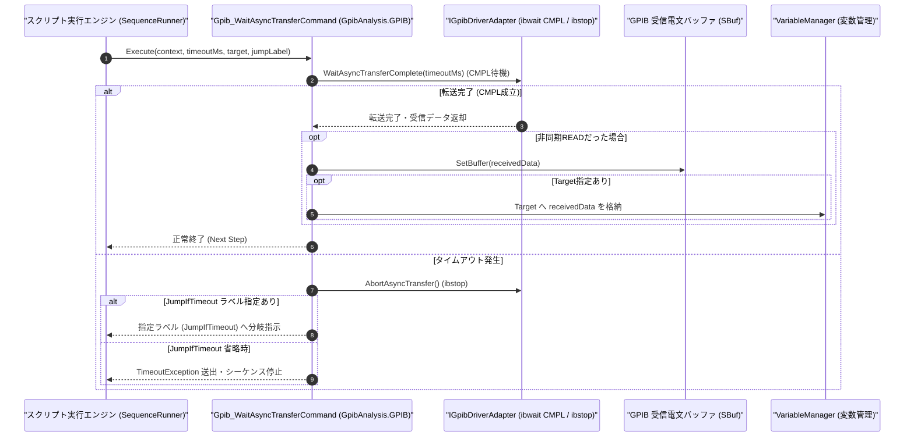

# コマンドリファレンス：Gpib_WaitAsyncTransfer

---

## 概要

**Gpib_WaitAsyncTransfer** は、先行する [`Gpib_StartAsyncTransfer`](./Gpib_StartAsyncTransfer.Md) によって開始された非同期 GPIB データ転送（`ibrda` / `ibwrta`）の完了（NI-488.2 `CMPL` ビット成立）を待機し、非同期受信データを内部受信バッファ（`SBuf`）およびターゲット変数へ確定格納するコマンドです。

> 💡 **補足**: 指定されたタイムアウト時間内に非同期転送が完了しない場合、安全に非同期 I/O をアボート（`ibstop`）してタイムアウト例外またはラベル分岐を行います。

---

## 💡 書式・パラメータ仕様

### コマンド構文

```csv
,SEQUENCE,Gpib_WaitAsyncTransfer, "[TimeoutMs: 10000]", "[Target]", "[JumpIfTimeout]"
```

### パラメータ（引数）一覧

| 引数位置 | パラメータ名 | 必須/任意 | 型・制約 | 説明 |
| :---: | :--- | :---: | :--- | :--- |
| 第1引数 | `TimeoutMs` | 任意 | 整数（ミリ秒、既定値: `10000`） | 非同期転送の完了を待つ最大待機時間をミリ秒単位で指定します。 |
| 第2引数 | `Target` | 任意 | 変数名（`$` / `@`） | 非同期 READ 完了時に受信データを格納するターゲット変数を指定します（`Gpib_StartAsyncTransfer` 側で指定済みの場合は省略可能です）。 |
| 第3引数 | `JumpIfTimeout` | 任意 | ラベル名 / ステップ番号 | タイムアウト発生時にジャンプする遷移先ラベルを指定します。省略時はタイムアウト例外を送出して停止します。 |

---

## 🔄 特殊置換規約・分岐規約の適用

1. **変数展開とタイムアウト分岐規約**:
   - 第 1 引数 `TimeoutMs` には変数を指定可能であり、第 3 引数 `JumpIfTimeout` 指定時はタイムアウト時に該当ラベルへ遷移します。
2. **レガシー別名互換**:
   - 旧表記の `GpibWaitAsyncTransfer` は内部正規化により本 `Gpib_WaitAsyncTransfer` コマンドへマッピングされます。

---

## 💡 動作例（正しい構文での記述例）

### スクリプト記述例

```csv
,PARAM,WAVE_CSV,

,SEQUENCE,Gpib_Open, "7"
,SEQUENCE,Gpib_Send, "WAV:DATA?"

; 1. 非同期データ受信を開始
,SEQUENCE,Gpib_StartAsyncTransfer, "READ", "65536"

; 2. 最大15秒間、非同期転送の完了を待機し、完了後に $WAVE_CSV へ格納（タイムアウト時は ASYNC_ERR へ）
,SEQUENCE,Gpib_WaitAsyncTransfer, "15000", "$WAVE_CSV", "ASYNC_ERR"
,SEQUENCE,Gpib_Close
,SEQUENCE,Exit

:ASYNC_ERR
,SEQUENCE,Msg_Box, "非同期波形データ転送がタイムアウトしました"
,SEQUENCE,Gpib_Close
,SEQUENCE,Exit
```

### 実行時の挙動・変数変化

1. `Gpib_WaitAsyncTransfer` は GPIB ドライバの `CMPL`（I/O Complete）イベントを最大 15,000ms 待機します。
2. 転送が完了すると、受信バッファから文字列が取り出されて `SBuf` と `$WAVE_CSV` に格納されます。
3. タイムアウトした場合は進行中の非同期 I/O を停止（`ibstop`）し、`:ASYNC_ERR` ラベルへ分岐します。

---

## 🔄 動作フロー（シーケンス図）



---

## 🚫 エラーハンドリング・安全設計（仕様制限）

1. **タイムアウト・中断時の確実な `ibstop` 発行**:
   - 非同期転送がタイムアウトまたはユーザー停止された際、バックグラウンド DMA が宙に浮いたままにならないよう確実に `AbortAsyncTransfer()`（`ibstop`）を呼び出してドライバロックを解除します。
2. **非同期転送未開始時の安全な扱い**:
   - 進行中の非同期転送が存在しない状態で呼び出された場合は、警告または `InvalidOperationException` で通知します。

---

## 🧪 ユニットテスト仕様

### テスト実行前提条件
- **対象クラス**: `GpibAnalysis.GPIB.Gpib_WaitAsyncTransferCommand`（`Gpib_WaitAsyncTransferCommand.cs`）
- **モック環境**: `Gpib_StartAsyncTransfer` 実行後の `IGpibDriverAdapter` モックが注入されていること。

### テストケース一覧

| テストID | テスト観点 | 入力スクリプト | 期待される動作・検証項目 |
| :--- | :--- | :--- | :--- |
| `UT-GPIB-ASYNCWAIT-01` | 正常系（非同期READ完了回収） | `,SEQUENCE,Gpib_WaitAsyncTransfer, "5000", "$DATA"` | 完了待機後に受信データが `$DATA` と `SBuf` に格納されること。 |
| `UT-GPIB-ASYNCWAIT-02` | 正常系（タイムアウト分岐＋Abort） | `,SEQUENCE,Gpib_WaitAsyncTransfer, "100", "$DATA", "ERR_LBL"` | タイムアウト時に `AbortAsyncTransfer()` が呼ばれ、`"ERR_LBL"` へ分岐すること。 |
| `UT-GPIB-ASYNCWAIT-03` | 異常系（タイムアウト停止） | `,SEQUENCE,Gpib_WaitAsyncTransfer, "100"` | 第 3 引数省略時のタイムアウトで `TimeoutException` が送出されること。 |

