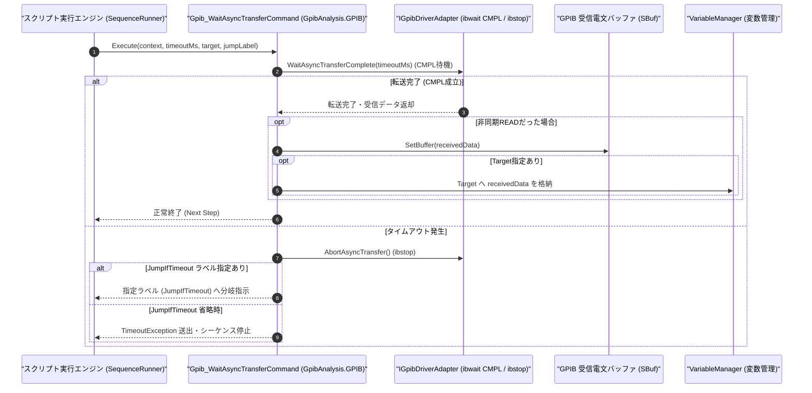

# コマンドリファレンス：Gpib_WaitAsyncTransfer

## 概要

**Gpib_WaitAsyncTransfer** は、先行する [`Gpib_StartAsyncTransfer`](./Gpib_StartAsyncTransfer.Md) によって開始された非同期 GPIB データ転送（`ibrda` / `ibwrta`）の完了（NI-488.2 `CMPL` ビット成立）を待機し、非同期受信データを内部受信バッファ（`SBuf`）およびターゲット変数へ確定格納するコマンドです。

> 💡 **補足**: 指定されたタイムアウト時間内に非同期転送が完了しない場合、安全に非同期 I/O をアボート（`ibstop`）してタイムアウト例外またはラベル分岐を行います。

---

## 💡 書式・パラメータ仕様

### コマンド構文

```csv
,SEQUENCE, [ステップキー], Gpib_WaitAsyncTransfer, "[BoardIdOrTimeoutMs]", "[TransferIdOrJumpLabel]", "[Timeout]", "[DestSizeKey]", "[DestDataKey]"
```

### パラメータ（引数）一覧

| 引数位置 | 引数名 | 説明 | 指定方法 / 有効な入力値 |
| :--- | :--- | :--- | :--- |
| 引数1 | `BoardId` / `TimeoutMs` | 4〜5 引数指定時はボード番号、1〜2 引数短縮指定時は待機タイムアウト［ms］（任意・既定値: `30000`）。 | `0` 以上の整数（例: `0`, `15000`）または `$PARAM$` 置換 |
| 引数2 | `TransferId` / `JumpIfTimeout` | 4〜5 引数指定時は転送 ID、2 引数短縮指定時はタイムアウト時ジャンプ先ラベル（任意）。 | 整数転送 ID または `#ラベル名#` |
| 引数3 | `Timeout` | 4〜5 引数指定時の完了待機タイムアウト時間［ミリ秒］（任意・既定値: `30000`）。 | `0` 以上の整数（例: `30000`） |
| 引数4 | `DestSizeKey` | 4〜5 引数指定時に実転送バイトサイズを格納するパラメータキー名（任意）。 | 格納先 `PARAM` キー名 |
| 引数5 | `DestDataKey` | 5 引数指定時に受信データ本体を格納するパラメータキー名（任意・省略時は開始時予約キー）。 | 格納先 `PARAM` キー名 |

---

## 🔄 特殊置換規約・分岐規約の適用

本コマンドの引数における特殊記法および解釈ルールです。
* **動的置換（`$`）**: 引数内で `$PARAMキー$` のように記述すると、実行時に変数プール（PARAM）の値へ動的置換されます。（適用可能な引数: 全引数対応）
* **ジャンプ先指定（`#`）**: タイムアウト発生時の遷移先ラベルを `#ラベル名#` の形式で指定できます。（適用可能な引数: 引数 2 `JumpIfTimeout`）
* **共通コマンド指定（`@`）**: 本コマンドは外部マクロを呼び出さないため適用されません。（適用可能な引数: 非適用）
* **カンマのエスケープ**: SCPI コマンド等、引数文字列自体にカンマを含める場合は、必ず `","` と二重引用符で囲んで記述します。
* **エイリアス（別名）**: `WaitAsyncTransfer`, `GpibWaitAsyncTransfer`

---

## 💡 動作例（正しい構文での記述例）

### スクリプト記述例

※COMMAND ブロック配下の子要素行（PARAM, SEQUENCE）は必ず行頭カンマから開始し、スペースインデントや行末コメント（`;`）は記述しないでください。

```csv
COMMAND, "ASYNC_WAVE_READ", "WAVE_CSV"
,PARAM, "WAVE_CSV", Work, "波形データ", ""
,SEQUENCE, 010, Gpib_Open, 0
,SEQUENCE, 020, Gpib_Send, "WAV:DATA?"
,SEQUENCE, 030, Gpib_StartAsyncTransfer, 7, "Receive", 65536, "WAVE_CSV"
; 最大 15000ms 間、非同期転送完了を待機（タイムアウト時は #ASYNC_ERR# へ分岐）
,SEQUENCE, 040, Gpib_WaitAsyncTransfer, 15000, #ASYNC_ERR#
,SEQUENCE, 050, Gpib_Close, 0
,SEQUENCE, 060, Exit
,SEQUENCE, #ASYNC_ERR#, Msg_Box, "非同期波形データ転送がタイムアウトしました。"
,SEQUENCE, 080, Gpib_Close, 0
,SEQUENCE, 090, Exit
```

### 実行時の挙動・変数変化

* **実行前の状態**: `Gpib_StartAsyncTransfer` によって最大 `65536` バイトのバックグラウンド非同期受信が開始されている状態。
* **実行後の状態**: ステップ `040` で転送完了が確認されると受信データが `"WAVE_CSV"` に確定格納され、`15000` ms を超過した場合は `#ASYNC_ERR#` へ安全に分岐します。

---

## 🔄 動作フロー（シーケンス図）



---

## 🚫 エラーハンドリング・安全設計（仕様制限）

1. **タイムアウト・中断時の確実な `ibstop` 発行**:
   - 非同期転送がタイムアウトまたはユーザー停止された際、バックグラウンド DMA が宙に浮いたままにならないよう確実に `AbortAsyncTransfer()`（`ibstop`）を呼び出してドライバロックを解除します。
2. **非同期転送未開始時の安全な扱い**:
   - 進行中の非同期転送が存在しない状態で呼び出された場合は、警告または `InvalidOperationException` で通知します。

---

## 🧪 ユニットテスト仕様

本コマンドクラス（`Gpib_WaitAsyncTransferCommand.cs`）に実装されている `RunUnitTest()` メソッドが検証するユニットテストの仕様です。

### テスト実行前提条件

* **実行トリガー**: `RunUnitTest()` メソッドの呼び出し
* **有効化条件**: システム全体の最小ログレベル（`ErrorLogger.MinimumLevel`）が `LogLevel.Test` であること（それ以外の場合は無効化ガードにより早期リターン）
* **検証結果出力**: `_log.LogTest` によるログ出力。検証失敗時は `_log.LogError`、予期せぬ例外発生時は `_log.LogCritical` で記録し、`finally` ブロックで未回収の非同期転送バッファ（`allocatedTid`）の解放および `GpibDLL.DebugDLL`・`DebugReceiveData` の復元を行います。

### テストケース一覧

| No | テストカテゴリ | テスト条件（入力値） | 期待される結果（出力値） | 検証の目的 / 観点 |
| :---: | :--- | :--- | :--- | :--- |
| **1** | 正常系 | 32 バイトの非同期転送を開始して転送 ID `allocatedTid` を取得後、`("0", allocatedTid, "1000", "WAIT_SIZE", "WAIT_DATA")` で `Func` を実行 | `!HasError` となり、`Variables["WAIT_SIZE"]` に `"32"`、`Variables["WAIT_DATA"]` に非空の受信データが格納される | 非同期転送完了待機および実転送サイズ・受信データ格納の検証 |
| **2** | 異常系 | 負数タイムアウト `("-1")` および不正ボード ID `("INVALID", "9999", "1000", "WAIT_SIZE")` で `Func` を実行 | 両ケースとも `HasError == true` かつ `IsCommandGo == false` となり安全停止する | 範囲外タイムアウト（`min: 0`）および不正 `BoardId` 指定時の安全停止検証 |
| **3** | 異常系・分岐 | 未登録転送 ID 状態でタイムアウト分岐ラベル付き `("10", "#ERR_JUMP#")` を指定して `Func` を実行 | `jump == true` かつ `NowStep == "#ERR_JUMP#"` となり指定ラベルへ分岐する | 非同期転送待機失敗時の `JumpIfTimeout` ラベル分岐動作の検証 |
