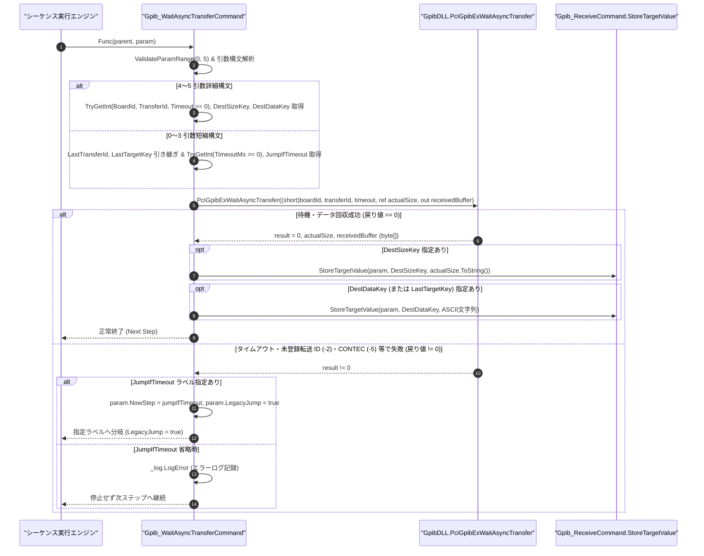

# コマンドリファレンス：Gpib_WaitAsyncTransfer

## 概要

**Gpib_WaitAsyncTransfer** は、 **Interface 社製 GPIB ドライバ（`gpc4304.dll`）専用** の非同期転送完了待機コマンドであり、先行する [`Gpib_StartAsyncTransfer`](./Gpib_StartAsyncTransfer.Md) によって開始された非同期データ転送の完了（`GpibDLL.PciGpibExWaitAsyncTransfer`）を待機し、実転送バイト数や受信 ASCII 文字列を指定ターゲット変数へ確定格納します。

> 💡 **補足（ドライバメーカー制限と 2 系統の構文）**: 短縮 0〜3 引数構文（`SequenceParamCount < 4`）ではカレント機器のボード番号（未設定時 `0`）と直前の `Gpib_StartAsyncTransfer` が記録した転送 ID・格納先キーを自動引き継ぎし、第 1 引数で `TimeoutMs`（既定 `30000`）、第 2 引数で失敗・タイムアウト時の分岐先ラベル `JumpIfTimeout` を指定します（第 3 引数は参照されません。ボード ID・転送 ID を明示指定する場合は 4〜5 引数詳細構文を使用してください）。なお、CONTEC 社製ドライバ（`CGPIB.DLL`）選択時は未サポートエラー（`-5`）となります。

---

## 💡 書式・パラメータ仕様

### コマンド構文

```csv
; 短縮 0〜3 引数構文（直前の Gpib_StartAsyncTransfer の転送 ID・格納先キーを自動引き継ぎ ※第3引数は非参照）
,SEQUENCE, [ステップキー], Gpib_WaitAsyncTransfer, "[TimeoutMs: 30000]", "[JumpIfTimeout]"

; 詳細 4〜5 引数構文（ボード番号・転送 ID・サイズ格納先・データ格納先を明示指定）
,SEQUENCE, [ステップキー], Gpib_WaitAsyncTransfer, <BoardId>, <TransferId>, <Timeout>, "<DestSizeKey>", "[DestDataKey]"
```

### パラメータ（引数）一覧

| 引数位置 | 引数名 | 説明 | 指定方法 / 有効な入力値 |
| :--- | :--- | :--- | :--- |
| 引数1 | `TimeoutMs` / `BoardId` | **0〜3 引数短縮構文時** ：待機タイムアウト時間［ms］（任意、`0` 以上の整数、既定値: `30000`）。<br> **4〜5 引数詳細構文時** ：対象 GPIB ボード番号（整数必須）。 | `0` 以上の整数（例: `15000`, `0`）または `$PARAM$` 置換 |
| 引数2 | `JumpIfTimeout` / `TransferId` | **0〜3 引数短縮構文時** ：待機失敗・タイムアウト時のジャンプ先ラベル（任意）。<br> **4〜5 引数詳細構文時** ：待機対象の非同期転送 ID（整数必須）。 | `#ラベル名#`（短縮構文時）、または整数転送 ID（詳細構文時） |
| 引数3 | `Timeout` | **4〜5 引数詳細構文時** ：完了待機タイムアウト時間［ms］（必須、`0` 以上の整数）。※ 3 引数以下の短縮構文では第 3 引数は `Func` 内で参照されないため、0〜2 引数の短縮構文または 4〜5 引数の詳細構文で指定してください。 | `0` 以上の整数（例: `30000`） |
| 引数4 | `DestSizeKey` | **4〜5 引数詳細構文時** ：実転送バイトサイズを格納するパラメータキー名（非空必須）。 | 格納先 `PARAM` キー名 |
| 引数5 | `DestDataKey` | **5 引数詳細構文時** ：受信データ本体（ASCII 文字列）を格納するパラメータキー名（任意）。 | 格納先 `PARAM` キー名 |

---

## 🔄 特殊置換規約・分岐規約の適用

本コマンドの引数における特殊記法および解釈ルールです。
* **動的置換（`$`）**: 引数内で `$PARAMキー$` のように記述すると、実行時に変数プール（PARAM）の値へ動的置換されます。（適用可能な引数: 全引数対応）
* **ジャンプ先指定（`#`）**: 短縮構文時の第 2 引数に、失敗・タイムアウト発生時の遷移先ラベルを `#ラベル名#` の形式で指定できます。（適用可能な引数: 短縮構文時の引数 2 `JumpIfTimeout`）
* **共通コマンド指定（`@`）**: 本コマンドは外部マクロを呼び出さないため適用されません。（適用可能な引数: 非適用）
* **カンマのエスケープ**: SCPI コマンド等、引数文字列自体にカンマを含める場合は、必ず `","` と二重引用符で囲んで記述します。
* **エイリアス（別名）**: `WaitAsyncTransfer`, `GpibWaitAsyncTransfer`

---

## 💡 動作例（正しい構文での記述例）

### スクリプト記述例

※COMMAND ブロック配下の子要素行（PARAM, SEQUENCE）は必ず行頭カンマ（`,`）から開始してください（行頭スペースのみでは認識されません）。なお、`;` で始まる行やクォート外の `;` 以降はコメントとして自動除去されます。

```csv
COMMAND, "ASYNC_WAVE_READ", "WAVE_CSV"
,PARAM, "WAVE_CSV", Work, "波形データ", ""
,SEQUENCE, 010, Gpib_Open, 0
,SEQUENCE, 020, Gpib_Send, "WAV:DATA?"
,SEQUENCE, 030, Gpib_StartAsyncTransfer, 7, "Receive", 65536, "WAVE_CSV"
; 最大 15000ms 間、非同期転送完了を待機（失敗・タイムアウト時は #ASYNC_ERR# へ分岐）
,SEQUENCE, 040, Gpib_WaitAsyncTransfer, 15000, #ASYNC_ERR#
,SEQUENCE, 050, Gpib_Close, 0
,SEQUENCE, 060, Exit
,SEQUENCE, #ASYNC_ERR#, Msg_Box, "非同期波形データ転送が失敗またはタイムアウトしました。"
,SEQUENCE, 080, Gpib_Close, 0
,SEQUENCE, 090, Exit
```

### 実行時の挙動・変数変化

* **実行前の状態**: `Gpib_StartAsyncTransfer` によって最大 `65536` バイトのバックグラウンド非同期受信が開始されている状態。
* **実行後の状態**: ステップ `040` で転送完了が確認されると受信データ（ASCII 文字列）が開始時に予約された `"WAVE_CSV"` に確定格納されます（`RecData` 受信バッファ自体は更新されません）。失敗またはタイムアウトした場合は `#ASYNC_ERR#` へ分岐します。

---

## 🔄 動作フロー（シーケンス図）



---

## 🚫 エラーハンドリング・安全設計（仕様制限）

1. **引数境界（`0`〜`5`）および数値パラメータの事前検証**:
   - `ValidateParamRange(0, 5)` 違反（6 個以上の引数指定）、負数のタイムアウト値、または詳細構文での非数値 `BoardId`・`TransferId`・空 `DestSizeKey` が指定された場合は、`SetErrorAndHalt` によりエラーログを記録して安全停止します。
2. **待機失敗・タイムアウト時の分岐または非停止継続**:
   - 未登録の転送 ID（`-2`）、CONTEC ドライバ環境（`-5`）、またはタイムアウトにより `PciGpibExWaitAsyncTransfer` が `0` 以外のエラーコードを返した場合、`JumpIfTimeout` ラベルが指定されていれば `param.NowStep = jumpIfTimeout` かつ `param.LegacyJump = true` を設定して該当ステップへジャンプし、省略されていれば `_log.LogError` を出力して停止せず次ステップへ進みます。

---

## 🧪 ユニットテスト仕様

本コマンドクラス（`Gpib_WaitAsyncTransferCommand.cs`）に実装されている `RunUnitTest()` メソッドが検証するユニットテストの仕様です。

### テスト実行前提条件

* **実行トリガー**: `RunUnitTest()` メソッドの呼び出し
* **有効化条件**: システム全体の最小ログレベル（`ErrorLogger.MinimumLevel`）が `LogLevel.Test` であること（それ以外の場合は無効化ガードにより早期リターン）
* **検証結果出力**: `_log.LogTest` によるログ出力。検証失敗時は `_log.LogError`、予期せぬ例外発生時は `_log.LogCritical` で記録し、`finally` ブロックで未回収の非同期転送バッファ（`allocatedTid`）の解放および `GpibDLL.DebugDLL`・`DebugReceiveData` の復元を行います。

### テストケース一覧

| No | テストカテゴリ | テスト条件（入力値） | 期待される結果（出力値） | 検証の目的 / 観点 |
| :---: | :--- | :--- | :--- | :--- |
| **1** | 正常系 | 32 バイトの非同期転送を開始して転送 ID `allocatedTid` を取得後、`("0", allocatedTid, "1000", "WAIT_SIZE", "WAIT_DATA")` で `Func` を実行 | `!HasError` となり、`Variables["WAIT_SIZE"]` に `"32"`、`Variables["WAIT_DATA"]` に非空の受信データが格納される | 非同期転送完了待機および実転送サイズ・受信データ格納の検証 |
| **2** | 異常系・分岐 | 負数タイムアウト `("-1")`・不正ボード ID `("INVALID", "9999", "1000", "WAIT_SIZE")`・未登録転送 ID での分岐ラベル付き `("10", "#ERR_JUMP#")` を指定して `Func` を実行 | 前 2 件は `HasError == true`・`IsCommandGo == false` で安全停止し、分岐指定時は `LegacyJump == true`・`NowStep == "#ERR_JUMP#"` で指定ラベルへ分岐する | 範囲外タイムアウト・不正 `BoardId` の安全停止および待機失敗時の `JumpIfTimeout` 分岐一括検証 |
