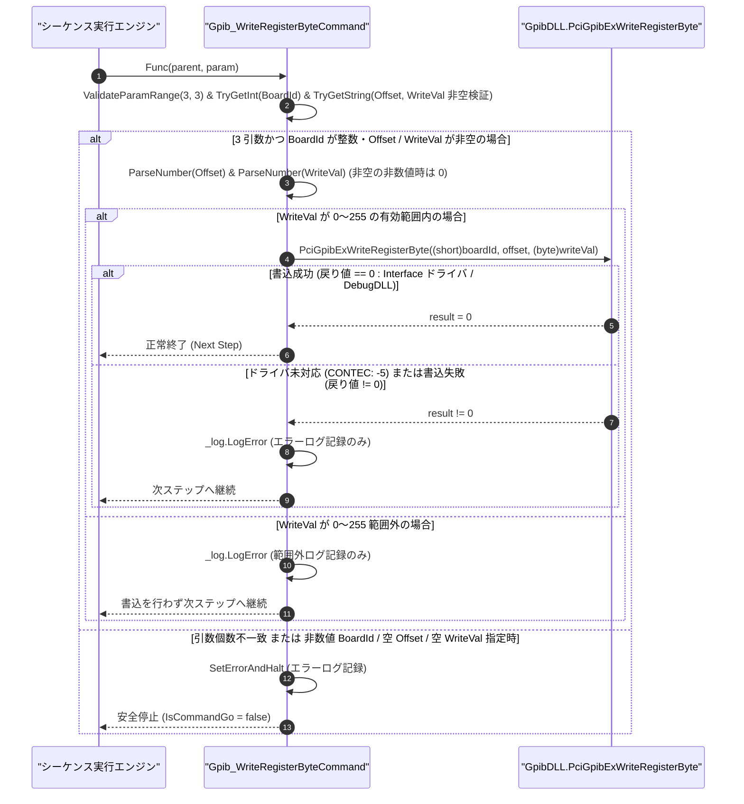

# コマンドリファレンス：Gpib_WriteRegisterByte

## 概要

**Gpib_WriteRegisterByte** は、 **Interface 社製 GPIB ドライバ（`gpc4304.dll`）専用** の低レベル制御コマンドであり、指定した GPIB ボード上のコントローラチップ物理レジスタの指定オフセットアドレスに対して 1 バイト（`0`〜`255` / `0x00`〜`0xFF`）の値を直接書き込みます（`GpibDLL.PciGpibExWriteRegisterByte`）。

> 💡 **補足（ドライバメーカー制限）**: [`Gpib_ReadRegisterByte`](./Gpib_ReadRegisterByte.Md) と対になるハードウェアレジスタ直接制御コマンドです。Interface 社製ドライバ（`gpc4304.dll`）およびデバッグシミュレーションモードに対応しており、CONTEC 社製ドライバ（`CGPIB.DLL`）選択時は未サポートエラー（`-5`）をログ出力して停止せず次ステップへ継続します。

---

## 💡 書式・パラメータ仕様

### コマンド構文

```csv
,SEQUENCE, [ステップキー], Gpib_WriteRegisterByte, <BoardId>, "<Offset>", "<WriteVal>"
```

### パラメータ（引数）一覧

| 引数位置 | 引数名 | 説明 | 指定方法 / 有効な入力値 |
| :--- | :--- | :--- | :--- |
| 引数1 | `BoardId` | 書き込み対象の GPIB コントローラボード番号（必須。`ParameterSpec` 上の制約は `0` 以上、`Func` 実行時は整数型検証を行い `(short)` キャストしてドライバ API へ渡します）。 | `0` 以上の整数（例: `0`）または `$PARAM$` 置換 |
| 引数2 | `Offset` | 書き込み対象のコントローラ ASIC 物理レジスタオフセット番号（非空必須）。※空文字 `""`（または空白）を渡した場合は `TryGetString(allowEmpty: false)` によりエラーコード `-10` で安全停止し、`"INVALID"` 等の非空・非数値文字列の場合に `ParseNumber` で `0` にフォールバックします。 | 10 進整数または `"0x"` 付き 16 進表記（例: `"5"`, `"0x05"`） |
| 引数3 | `WriteVal` | レジスタへ直接書き込む 1 バイト値（非空必須）。※空文字 `""`（または空白）時はエラーコード `-10` で安全停止し、非空・非数値文字列時は `ParseNumber` で `0` にフォールバックします。 | `0`〜`255` の 10 進整数または `"0x00"`〜`"0xFF"` の 16 進表記（例: `"0x02"`, `"128"`） |

---

## 🔄 特殊置換規約・分岐規約の適用

本コマンドの引数における特殊記法および解釈ルールです。
* **動的置換（`$`）**: 引数内で `$PARAMキー$` のように記述すると、実行時に変数プール（PARAM）の値へ動的置換されます。（適用可能な引数: 全引数対応）
* **ジャンプ先指定（`#`）**: 本コマンドはジャンプ制御を行わないため適用されません。（適用可能な引数: 非適用）
* **共通コマンド指定（`@`）**: 本コマンドは外部マクロを呼び出さないため適用されません。（適用可能な引数: 非適用）
* **カンマのエスケープ**: SCPI コマンド等、引数文字列自体にカンマを含める場合は、必ず `","` と二重引用符で囲んで記述します。
* **エイリアス（別名）**: `WriteRegisterByte`, `GpibWriteRegisterByte`

---

## 💡 動作例（正しい構文での記述例）

### スクリプト記述例

※COMMAND ブロック配下の子要素行（PARAM, SEQUENCE）は必ず行頭カンマ（`,`）から開始してください（行頭スペースのみでは認識されません）。なお、`;` で始まる行やクォート外の `;` 以降はコメントとして自動除去されます。

```csv
COMMAND, "WRITE_ASIC_AUXMR", ""
,PARAM, "AUXMR_OFFSET", Text, "対象レジスタオフセット", "0x05"
,PARAM, "CMD_BYTE", Text, "書込コマンドバイト", "0x02"
,SEQUENCE, 010, Gpib_Open, 0
; ボード 0 の補助コマンドレジスタ(0x05)へ 0x02 を直接書き込む (Interface 専用・3 引数必須)
,SEQUENCE, 020, Gpib_WriteRegisterByte, 0, "$AUXMR_OFFSET$", "$CMD_BYTE$"
,SEQUENCE, 030, Gpib_Close, 0
,SEQUENCE, 040, Exit
```

### 実行時の挙動・変数変化

* **実行前の状態**: GPIB ボード `0` がオープン済みで、`"AUXMR_OFFSET"` が `"0x05"`、`"CMD_BYTE"` が `"0x02"` の状態。
* **実行後の状態**: ステップ `020` の実行によりパラメータ展開後のオフセット `0x05` に対してバイト値 `0x02` が書き込まれます。

---

## 🔄 動作フロー（シーケンス図）



---

## 🚫 エラーハンドリング・安全設計（仕様制限）

1. **3 引数必須および `BoardId`・非空文字列バリデーション保護**:
   - `ValidateParamRange(3, 3)` により引数が 3 個ちょうどでない場合（2 引数以下または 4 引数以上：エラーコード `-10`）、第 1 引数 `BoardId` に整数変換できない非数値文字列が指定された場合（エラーコード `-11`）、または第 2 引数 `Offset` もしくは第 3 引数 `WriteVal` に空文字（空白）が指定された場合（`TryGetString(allowEmpty: false)` エラーコード `-10`）は、`SetErrorAndHalt` によりエラーログを記録して安全停止します（非空・非数値文字列の場合は `ParseNumber` で `0` にフォールバックします）。
2. **1 バイト範囲外（`0`〜`255` 以外）および CONTEC 環境・ドライバ失敗時の非停止保護**:
   - 第 3 引数 `WriteVal` の変換結果が `0`〜`255` の範囲外である場合は物理書き込みを行わずに `_log.LogError` を出力してリターンします。また、CONTEC ドライバ環境（`-5`）や範囲外ボード ID・ハードウェア書き込みエラー時（戻り値 `!= 0`）も `_log.LogError` のみで強制停止せず次ステップへ進みます。

---

## 🧪 ユニットテスト仕様

本コマンドクラス（`Gpib_WriteRegisterByteCommand.cs`）に実装されている `RunUnitTest()` メソッドが検証するユニットテストの仕様です。

### テスト実行前提条件

* **実行トリガー**: `RunUnitTest()` メソッドの呼び出し
* **有効化条件**: システム全体の最小ログレベル（`ErrorLogger.MinimumLevel`）が `LogLevel.Test` であること（それ以外の場合は無効化ガードにより早期リターン）
* **検証結果出力**: `_log.LogTest` によるログ出力。検証失敗時は `_log.LogError`、予期せぬ例外発生時は `_log.LogCritical` で記録し、`finally` ブロックで `GpibDLL.DebugDLL` および `GpibDLL.DebugReceiveData` を元の状態へ復元します。

### テストケース一覧

| No | テストカテゴリ | テスト条件（入力値） | 期待される結果（出力値） | 検証の目的 / 観点 |
| :---: | :--- | :--- | :--- | :--- |
| **1** | 正常系 | `ParseNumber("255")`・`ParseNumber("0x5A")` 解析、および `("0", "0x02", "0x5A")` を指定して `Func` を実行 | それぞれ `255`・`90` に変換され、`!HasError`・`IsCommandGo == true` で書込が完了する | 10 進・16 進表記パースおよび物理レジスタ書込動作の検証 |
| **2** | 異常系 | `ParseNumber(null)`・`ParseNumber("INVALID")` 解析、引数不足 `("0", "0x02")`、および不正ボード ID `("INVALID", "0x02", "0x5A")` で `Func` を実行 | 解析は `0` を返し、両 `Func` 実行とも `HasError == true`・`IsCommandGo == false` で安全停止する | 引数不足（`ValidateParamRange(3, 3)`）および不正 `BoardId` 指定時の安全停止検証 |
