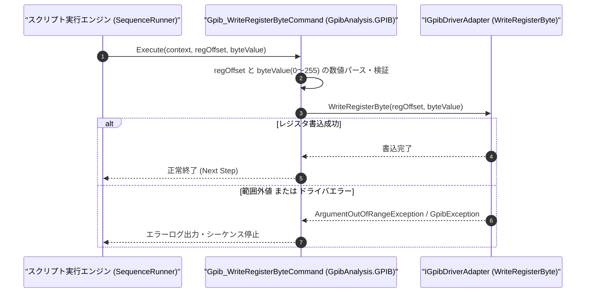

# コマンドリファレンス：Gpib_WriteRegisterByte

## 概要

**Gpib_WriteRegisterByte** は、GPIB コントローラチップ（NEC µPD7210 / NAT9914 / TNT4882 互換レジスタまたはドライバ設定領域）の指定オフセットアドレスに対して 1 バイト（8bit）の値を直接書き込む低レベル制御コマンドです。

> 💡 **補足**: [`Gpib_ReadRegisterByte`](./Gpib_ReadRegisterByte.Md) と対になるハードウェアレジスタ直接制御コマンドであり、特殊タイミング設定や補助コマンドレジスタ（AUXMR 等）の直接操作に使用します。

---

## 💡 書式・パラメータ仕様

### コマンド構文

```csv
,SEQUENCE, [ステップキー], Gpib_WriteRegisterByte, [BoardId], "[Offset]", "[WriteVal]"
```

### パラメータ（引数）一覧

| 引数位置 | 引数名 | 説明 | 指定方法 / 有効な入力値 |
| :--- | :--- | :--- | :--- |
| 引数1 | `BoardId` | 書き込み対象の GPIB コントローラボード番号（必須）。 | `0` 以上の整数（例: `0`）または `$PARAM$` 置換 |
| 引数2 | `Offset` | 書き込み対象のコントローラ ASIC 物理レジスタオフセット番号（必須）。 | 整数または 16 進表記（例: `"0x05"`） |
| 引数3 | `WriteVal` | レジスタへ直接書き込む 1 バイト値（必須）。 | `0`〜`255` の整数または 16 進表記（例: `"0x02"`, `"128"`） |

---

## 🔄 特殊置換規約・分岐規約の適用

本コマンドの引数における特殊記法および解釈ルールです。
* **動的置換（`$`）**: 引数内で `$PARAMキー$` のように記述すると、実行時に変数プール（PARAM）の値へ動的置換されます。（適用可能な引数: 全引数対応）
* **ジャンプ先指定（`#`）**: 本コマンドはジャンプ制御を行わないため適用されません。（適用可能な引数: 非適用）
* **共通コマンド指定（`@`）**: 本コマンドは外部マクロを呼び出さないため適用されません。（適用可能な引数: 非適用）
* **カンマのエスケープ**: SCPI コマンド等、引数文字列自体にカンマを含める場合は、必ず `","` と二重引用符で囲んで記述します。
* **エイリアス（別名）**: `WriteRegisterByte`, `GpibWriteRegisterByte`

---

## 💡 動作例（正しい構文での記述例）

### スクリプト記述例

※COMMAND ブロック配下の子要素行（PARAM, SEQUENCE）は必ず行頭カンマから開始し、スペースインデントや行末コメント（`;`）は記述しないでください。

```csv
COMMAND, "WRITE_ASIC_AUXMR", ""
,PARAM, "AUXMR_OFFSET", Text, "対象レジスタオフセット", "0x05"
,PARAM, "CMD_BYTE", Text, "書込コマンドバイト", "0x02"
,SEQUENCE, 010, Gpib_Open, 0
; ボード 0 の補助コマンドレジスタ(0x05)へ 0x02 を直接書き込む
,SEQUENCE, 020, Gpib_WriteRegisterByte, 0, "$AUXMR_OFFSET$", "$CMD_BYTE$"
,SEQUENCE, 030, Gpib_Close, 0
,SEQUENCE, 040, Exit
```

### 実行時の挙動・変数変化

* **実行前の状態**: GPIB ボード `0` がオープン済みで、`"AUXMR_OFFSET"` が `"0x05"`、`"CMD_BYTE"` が `"0x02"` の状態。
* **実行後の状態**: ステップ `020` の実行によりパラメータ展開後のオフセット `0x05` に対してバイト値 `0x02` が書き込まれます。

---

## 🔄 動作フロー（シーケンス図）



---

## 🚫 エラーハンドリング・安全設計（仕様制限）

1. **1 バイト範囲（`0`〜`255`）およびオフセット範囲の検証**:
   - `ByteValue` が `0`〜`255` の範囲外である場合や、負のオフセットが指定された場合は `ArgumentOutOfRangeException` を送出します。
2. **未オープン時の実行防止**:
   - GPIB ボードが開かれていない状態で実行された場合は `InvalidOperationException` を送出します。

---

## 🧪 ユニットテスト仕様

本コマンドクラス（`Gpib_WriteRegisterByteCommand.cs`）に実装されている `RunUnitTest()` メソッドが検証するユニットテストの仕様です。

### テスト実行前提条件

* **実行トリガー**: `RunUnitTest()` メソッドの呼び出し
* **有効化条件**: システム全体の最小ログレベル（`ErrorLogger.MinimumLevel`）が `LogLevel.Test` であること（それ以外の場合は無効化ガードにより早期リターン）
* **検証結果出力**: `_log.LogTest` によるログ出力。検証失敗時は `_log.LogError`、予期せぬ例外発生時は `_log.LogCritical` で記録し、`finally` ブロックで `GpibDLL.DebugDLL` および `GpibDLL.DebugReceiveData` を元の状態へ復元します。

### テストケース一覧

| No | テストカテゴリ | テスト条件（入力値） | 期待される結果（出力値） | 検証の目的 / 観点 |
| :---: | :--- | :--- | :--- | :--- |
| **1** | 正常系 | `ParseNumber("255")`・`ParseNumber("0x5A")` 解析、および `("0", "0x02", "0x5A")` を指定して `Func` を実行 | それぞれ `255`・`90` に変換され、`!HasError`・`IsCommandGo == true` で書込が完了する | 10 進・16 進表記パースおよび物理レジスタ書込動作の検証 |
| **2** | 異常系 | `ParseNumber(null)`・`ParseNumber("INVALID")` 解析、引数不足 `("0", "0x02")`、および不正ボード ID `("INVALID", "0x02", "0x5A")` で `Func` を実行 | 解析は `0` を返し、両 `Func` 実行とも `HasError == true`・`IsCommandGo == false` で安全停止する | 引数不足（`ValidateParamRange(3, 3)`）および不正 `BoardId` 指定時の安全停止検証 |
