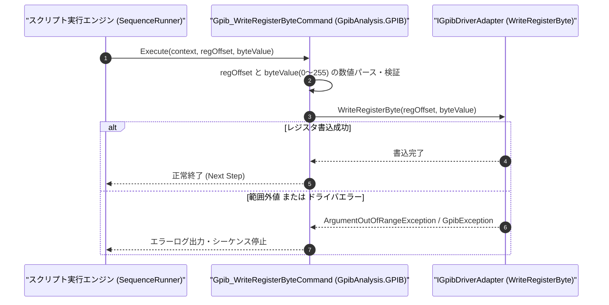

# コマンドリファレンス：Gpib_WriteRegisterByte

---

## 概要

**Gpib_WriteRegisterByte** は、GPIB コントローラチップ（NEC µPD7210 / NAT9914 / TNT4882 互換レジスタまたはドライバ設定領域）の指定オフセットアドレスに対して 1 バイト（8bit）の値を直接書き込む低レベル制御コマンドです。

> 💡 **補足**: [`Gpib_ReadRegisterByte`](./Gpib_ReadRegisterByte.Md) と対になるハードウェアレジスタ直接制御コマンドであり、特殊タイミング設定や補助コマンドレジスタ（AUXMR 等）の直接操作に使用します。

---

## 💡 書式・パラメータ仕様

### コマンド構文

```csv
,SEQUENCE,Gpib_WriteRegisterByte, "<RegisterOffset>", "<ByteValue>"
```

### パラメータ（引数）一覧

| 引数位置 | パラメータ名 | 必須/任意 | 型・制約 | 説明 |
| :---: | :--- | :---: | :--- | :--- |
| 第1引数 | `RegisterOffset` | **必須** | 整数または16進表記（例: `"0x05"`） | 書き込み対象の GPIB コントローラレジスタ番号（オフセット）を指定します。 |
| 第2引数 | `ByteValue` | **必須** | 整数または16進表記（`0`〜`255`、例: `"0x02"`, `"128"`） | レジスタへ書き込む 1 バイト（8bit）値を指定します。 |

---

## 🔄 特殊置換規約・分岐規約の適用

1. **変数展開（`$` / `@` / `#`）**:
   - 第 1 引数・第 2 引数ともに変数を指定可能です（例: `"$REG_ADDR"`, `"$REG_DATA"`）。
2. **レガシー別名互換**:
   - 旧表記の `GpibWriteRegisterByte` は内部正規化により本 `Gpib_WriteRegisterByte` コマンドへマッピングされます。

---

## 💡 動作例（正しい構文での記述例）

### スクリプト記述例

```csv
,PARAM,AUXMR_OFFSET,0x05
,PARAM,CHIP_RESET_CMD,0x02

,SEQUENCE,Gpib_Open, "5"
; 補助コマンドレジスタ(オフセット0x05)へコマンドバイト(0x02)を書き込む
,SEQUENCE,Gpib_WriteRegisterByte, "$AUXMR_OFFSET", "$CHIP_RESET_CMD"
,SEQUENCE,Gpib_Close
,SEQUENCE,Exit
```

### 実行時の挙動・変数変化

1. `$AUXMR_OFFSET`（`0x05`）および `$CHIP_RESET_CMD`（`0x02`）が展開され、GPIB コントローラのオフセット `5` へ `0x02` が書き込まれます。

---

## 🔄 動作フロー（シーケンス図）



---

## 🚫 エラーハンドリング・安全設計（仕様制限）

1. **1 バイト範囲（`0`〜`255`）およびオフセット範囲の検証**:
   - `ByteValue` が `0`〜`255` の範囲外である場合や、負のオフセットが指定された場合は `ArgumentOutOfRangeException` を送出します。
2. **未オープン時の実行防止**:
   - GPIB ボードが開かれていない状態で実行された場合は `InvalidOperationException` を送出します。

---

## 🧪 ユニットテスト仕様

### テスト実行前提条件
- **対象クラス**: `GpibAnalysis.GPIB.Gpib_WriteRegisterByteCommand`（`Gpib_WriteRegisterByteCommand.cs`）
- **モック環境**: `IGpibDriverAdapter` モックが注入されていること。

### テストケース一覧

| テストID | テスト観点 | 入力スクリプト | 期待される動作・検証項目 |
| :--- | :--- | :--- | :--- |
| `UT-GPIB-WRREG-01` | 正常系（16進レジスタ書込） | `,SEQUENCE,Gpib_WriteRegisterByte, "0x05", "0x02"` | `WriteRegisterByte(5, 2)` が呼び出されること。 |
| `UT-GPIB-WRREG-02` | 正常系（10進レジスタ書込） | `,SEQUENCE,Gpib_WriteRegisterByte, "5", "255"` | `WriteRegisterByte(5, 255)` が呼び出されること。 |
| `UT-GPIB-WRREG-03` | 異常系（1バイト範囲超過） | `,SEQUENCE,Gpib_WriteRegisterByte, "5", "256"` | `ArgumentOutOfRangeException` が送出されること。 |

