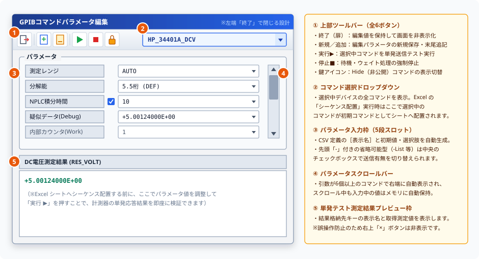

# コマンド編集画面取扱説明書 (User Manual)

本ドキュメントは、コマンド編集・実行システムにおいて、コマンドパラメータの編集やメイン画面への操作指示を行う **「コマンド編集画面」** の取扱説明書です。

---

## 📖 1. 概要
コマンド編集画面は、選択したコマンドに対応する各パラメータの値を画面上で入力・編集するための画面です。
機器ごとに登録されたコマンドの引数（数値範囲、テキスト、リストなど）を自動で判別し、適切な入力枠を画面上に構築します。パラメータが多数ある場合も、スクロール機能によりすべての設定を行うことができます。

---

## 🛠️ 2. 画面上のツールバーボタン説明 (個別機能)
画面上部のツールバー（下図 **①** ）および各領域の個別説明です。なお、誤操作による編集データの強制破棄を防ぐため、タイトルバー右上の `×` ボタンは非表示設計となっており、画面を閉じる際は左端の **「終了」** アイコンを使用します。

### 🔘 終了 / 閉じる ボタン (`FileExit`)
*   **機能**: 編集内容を保持したまま、コマンド編集画面を非表示（クローズ）にします。
*   **用途**: パラメータ編集を終了または一時中断し、メイン画面や Excel ワークシートの操作に戻る場合に使用します。

### 🔘 新規ファイル保存 ボタン (`NewFile`)
*   **機能**: 現在エディタ上で編集中のコマンドパラメータ（送信コマンド文字列等）を指定したファイルに新規作成・上書き保存します。
*   **用途**: 編集した GPIB 送信パラメータやテストスクリプト文字列を単体テキストファイルとして新しく保存・書き出したい場合に使用します。

### 🔘 追加保存 ボタン (`AddFile`)
*   **機能**: 現在エディタ上で編集中のコマンドパラメータ（送信コマンド文字列等）を指定したファイルの末尾へ **追記保存（追加書き込み / Append）** します。
*   **用途**: 既存のスクリプトファイル、ログファイル、またはテストコマンド集の末尾に、編集したパラメータ文字列を追記して蓄積したい場合に使用します。Shift-JIS エンコーディングでファイル末尾に自動追記されます。

### 🔘 実行 ボタン (`CommandGoItem`)
*   **機能**: 選択されているコマンドに、現在画面で編集したパラメータ値を適用して単発の通信送信処理を実行します。
*   **用途**: Excel シートへシーケンスを登録する前に、指定したパラメータ値で GPIB 計測機器が正常に応答するか単発テストしたい場合に使用します。

### 🔘 停止 ボタン (`Stop`)
*   **機能**: 実行中のコマンド送信処理や待機（ウェイト）処理を強制停止します。
*   **用途**: コマンドのテスト送信中に通信がハングアップした場合や、処理を緊急中断したい場合にクリックします。

### 🔘 表示制御（ロック / アンロック）ボタン (`VisibleCont`)
*   **機能**: 非公開属性（`Hide`）が設定されているコマンドの表示／隠蔽状態をトグル切り替えします。
*   **表示アイコン**:
    *   **施錠アイコン（ロック中）**: 非公開コマンドを隠蔽し、通常コマンドのみを表示します。
    *   **開錠アイコン（アンロック中）**: 非公開コマンドを含むすべての定義コマンドを表示します。
*   **用途**: 通常の測定運用時は誤操作防止のためロック状態にし、開発・デバッグ時に隠しコマンドを表示させたい場合に使用します。

---

## ⚙️ 3. その他の操作コントロール説明
パラメータ編集を補助するUI機能の個別説明です。

### 🔘 コマンド選択ドロップダウン
*   **機能**: 選択している機器で利用可能なコマンドの一覧を表示・選択します。
*   **用途**: 編集・送信対象のコマンドを切り替える際に使用します。切り替えると、パラメータ入力枠がそのコマンド専用のものに自動更新されます。

### 🔘 パラメータスクロールバー
*   **機能**: 画面に表示しきれない多数のパラメータがある場合に有効になり、入力エリアを上下にスクロールさせます。
*   **用途**: 多数のパラメータが存在する詳細設定コマンドにおいて、隠れているパラメータを表示して編集したい場合に使用します。スクロール時には、それまで入力していた値が自動的に内部保存されます。

---

## 💾 4. 設定の自動保存・復元機能
本画面では、ユーザーの快適な操作と入力データの保護を行うため、設定情報の保存と復元を自動的に行っています。

### ① 自動的に保存・復元される情報
*   **画面の表示位置**
    *   コマンド編集画面を閉じる際、画面上の表示位置（表示座標）を自動的に保存します。次回起動時は、前回の表示位置に自動的に復元されます。
*   **入力中のパラメータ値の保持**
    *   コマンドの各パラメータ入力エリアにおいて、値の入力中にスクロールバーを操作して非表示領域に移動した場合でも、それまで入力していたパラメータの値を自動的にメモリに一時保存（保存と読み込み）します。これにより、スクロールを戻した際やコマンドの切り替え時に、入力中のデータが意図せず消去されるのを防止します。
