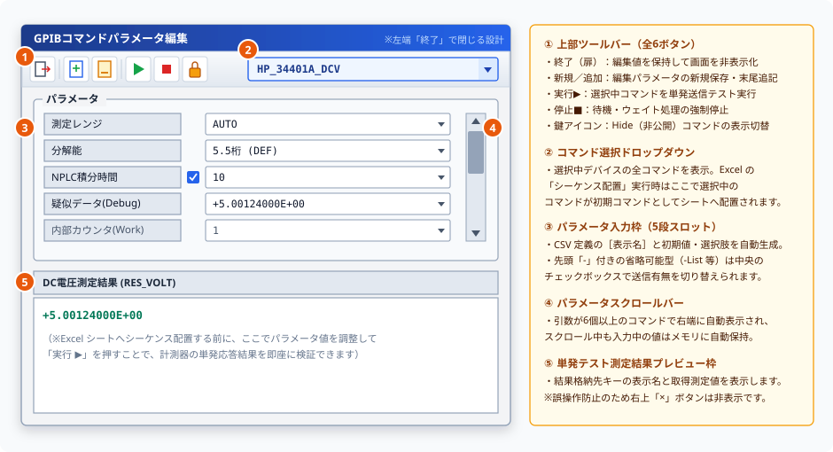

# コマンド編集画面取扱説明書 (User Manual)

👉 [← メイン画面取扱説明書に戻る](./メイン画面取扱説明書.Md)  
👉 [→ プロパティ設定画面取扱説明書](./プロパティ設定画面取扱説明書.Md) ／ [→ Excelアドイン取扱説明書](./Excelアドイン取扱説明書.Md)

---

本書は、GPIB 通信制御システムにおいて、登録された計測器コマンドのパラメータ入力・単発テスト実行・応答結果のテキスト保存、および Excel ワークシートへのシーケンス配置を行う **「コマンド編集画面（GPIBコマンドパラメータ編集）」** の取扱説明書です。

---

# 目次

- [第 1 章 概要と 2 つの使い方](#第-1-章-概要と-2-つの使い方)
  - [1.1 本画面の役割](#11-本画面の役割)
  - [1.2 2 通りの開き方と動作の違い](#12-2-通りの開き方と動作の違い)
  - [1.3 タイトルバー右上に `×` ボタンが無い理由](#13-タイトルバー右上に--ボタンが無い理由)
- [第 2 章 画面の構成と各部の詳細](#第-2-章-画面の構成と各部の詳細)
  - [2.1 画面全体イメージ](#21-画面全体イメージ)
  - [2.2 上部ツールバー（全 6 ボタン）の詳細](#22-上部ツールバー全-6-ボタンの詳細)
  - [2.3 コマンド選択・パラメータ入力エリア・結果欄の詳細](#23-コマンド選択パラメータ入力エリア結果欄の詳細)
- [第 3 章 実践ガイド（2 つの基本ワークフロー）](#第-3-章-実践ガイド2-つの基本ワークフロー)
  - [3.1 手順 1：計測器コマンドを単発テスト実行して応答をテキスト保存する](#31-手順-1計測器コマンドを単発テスト実行して応答をテキスト保存する)
  - [3.2 手順 2：Excel シートへ 2 行 1 ステップのシーケンス行を配置する](#32-手順-2excel-シートへ-2-行-1-ステップのシーケンス行を配置する)
- [第 4 章 設定の自動保存・復元とトラブルシューティング（FAQ）](#第-4-章-設定の自動保存復元とトラブルシューティングfaq)

---

# 第 1 章 概要と 2 つの使い方

## 1.1 本画面の役割

**コマンド編集画面 ** （ウィンドウタイトル： **「GPIBコマンドパラメータ編集」** ）は、計測器ごとに登録されたマクロスクリプト（CSV / XML 定義）のコマンドを選び、必要な引数（設定電圧、レンジ、送信コマンド文字列、待機条件など）をわかりやすく画面上で入力・確認するための専用エディタです。

コマンド定義の内容に応じて入力欄（テキスト入力枠や選択肢ドロップダウン）が自動生成されるため、CSV の内部構文を意識せずに安全にパラメータを設定できます。

## 1.2 2 通りの開き方と動作の違い

本画面は、呼び出し元によって次の 2 つの用途で機能します。

1. **メイン画面から開く場合（単発テスト・事前確認用）**:
   * メイン画面ツールバーの **「コマンド編集」** アイコンをクリックして開きます。
   * Excel シートに手順を並べる前に、パラメータを変えて計測器へ単発実行し、期待どおりの応答が返るかを確認できます。
   * **`終了`** ボタンで閉じると、入力したパラメータ値を保持したままメイン画面へ戻ります。
2. **Excel アドインから開く場合（シートへのシーケンス配置用）**:
   * Excel のリボン **`[アドイン]` ➔ `[GPIB制御]` ➔ `[シーケンス配置]`** をクリックして開きます。
   * 画面上でコマンドを選択し、初期値となるパラメータを入力して **`終了`** ボタンで閉じると、そのコマンドとパラメータを反映した **2 行 1 ステップのシーケンス行** が Excel シートの選択位置へ自動生成されます。

## 1.3 タイトルバー右上に `×` ボタンが無い理由

> [!NOTE]
> **誤破棄防止の安全設計**  
> パラメータを入力している途中で誤ってウィンドウ右上の `×` をクリックして編集内容を失う事故を防ぐため、本画面ではタイトルバー右上の `×` ボタンを意図的に非表示にしています。画面を閉じるときは、必ず上部ツールバー左端の **`終了`** ボタンを使用してください。

---

# 第 2 章 画面の構成と各部の詳細

## 2.1 画面全体イメージ

画面は上から **① 上部ツールバー（6 ボタン） ** 、 **② コマンド選択ドロップダウン ** 、 **③ パラメータ編集エリア（最大 5 段表示＋スクロールバー） ** 、 **④ 下部・結果／編集テキスト欄** の 4 エリアで構成されています。

---

## 2.2 上部ツールバー（全 6 ボタン）の詳細

| ボタン名 | 有効タイミング・状態表示 | 詳しい動作と利用シーン |
| :--- | :--- | :--- |
| **`終了`** | 常時クリック可能 | 現在入力しているパラメータ値を内部保持したまま、コマンド編集画面を閉じます。 ※Excel の **`[シーケンス配置]`** から開いている場合は、ここで選択・編集したコマンドとパラメータ値を使って Excel シートへの配置処理へ進みます。 |
| **`新規`** | 常時クリック可能 | 画面下部の「結果／編集テキスト欄」に表示されている文字列（空欄の場合は、現在選択中コマンドの最終パラメータ値）を、 **Shift_JIS** 形式で新しいテキストファイルへ上書き保存します。 ※マクロスクリプト（CSV 定義）自体を保存・上書きする機能ではなく、テスト実行で取得した測定結果や応答テキストを書き出す機能です。 |
| **`追加`** | 常時クリック可能 | 画面下部の「結果／編集テキスト欄」の文字列（空欄の場合は最終パラメータ値）を、指定した既存テキストファイルの末尾へ **Shift_JIS** 形式で追記保存します。複数回の単発測定結果を 1 つの記録ファイルへ順番に蓄積したいときに便利です。 |
| **`実行`** | 待機時にクリック可能 | 現在画面に入力しているパラメータ値を適用し、選択中のコマンドを計測器へ単発実行します。実行が完了すると、取得した測定値や応答テキスト、またはエラー詳細が画面下部の結果テキスト欄へ表示されます。 |
| **`停止`** | コマンド実行中のみ有効 | `実行` ボタンで走らせているコマンド送信・応答待機・ループ処理を緊急強制中断します。計測器が無応答のまま止まってしまったときに使用します。 |
| **`表示切替`** | ** 施錠アイコン ** ＝ 公開のみ ** 開錠アイコン ** ＝ 全表示 | マクロスクリプト内で非公開属性（`Hide`）が設定されている内部サブルーチンコマンドを、コマンド選択一覧へ表示するかどうかを切り替えます。 ・ ** 施錠（通常運用向け） **: 公開コマンドだけを表示し、内部部品の誤選択を防ぎます。 ・ ** 開錠（開発・デバッグ向け）**: 非公開コマンドも含めてすべて表示し、内部サブルーチンの単体動作テストを行えます。 |

---

## 2.3 コマンド選択・パラメータ入力エリア・結果欄の詳細

### 1. コマンド選択ドロップダウン
現在メイン画面で選択されている計測器（または登録済み機器）で利用可能なコマンドの一覧から、編集・実行したいコマンドを選びます。コマンドを切り替えると、下のパラメータ編集エリアの項目名・入力枠・選択肢が、選んだコマンド専用の内容へ即座に切り替わります。

### 2. パラメータ編集エリアとスクロールバー
* 選択したコマンドに必要な引数が、項目名（ラベル）と入力コントロール（テキストボックスまたはドロップダウンリスト）のペアで最大 5 段同時表示されます。
* パラメータが 6 個以上あるコマンドでは、右側の **スクロールバー** が有効になり、上下にスクロールしてすべての項目を入力できます。
* **入力値の自動保持**: スクロールして画面外へ隠れた項目や、画面を一度閉じた後の入力値も自動的に内部保持されるため、スクロール操作で入力途中の文字が消えることはありません。

### 3. 下部・結果／編集テキスト欄
* **`実行`** ボタンを押したときの計測器からの応答データ（例: `+5.0012E+00`）や実行結果メッセージが表示されます。
* この欄に表示されたテキストはコピーして他ソフトへ貼り付けられるほか、ツールバーの **`新規`** または **`追加`** ボタンでそのままテキストファイルへ保存できます。

---

# 第 3 章 実践ガイド（2 つの基本ワークフロー）

## 3.1 手順 1：計測器コマンドを単発テスト実行して応答をテキスト保存する

Excel シートを作成する前に、計測器が想定どおりに応答するかを確認する手順です。

1. メイン画面で GPIB ポートを接続状態（緑 LED 点灯）にし、ツールバーの **「コマンド編集」** アイコンをクリックします。
2. コマンド選択ドロップダウンから、試したいコマンド（例: 電圧測定コマンドや `Gpib_SendReceive`）を選択します。
3. 中央のパラメータ入力欄に、必要な設定値や送信コマンド文字列（例: `MEAS:VOLT:DC?`）を入力します。
4. ツールバーの **`実行`** ボタンをクリックします。
5. 通信が正常に完了すると、画面下部の結果テキスト欄に計測器からの応答値（例: `+5.0012E+00`）が表示されます。
6. この測定結果をテキストファイルへ残したい場合は、ツールバーの **`新規`** （2 回目以降に同じファイルへ追記したい場合は **`追加`** ）をクリックして保存先ファイルを指定します。
7. 確認が終わったら、ツールバー左端の **`終了`** ボタンをクリックして画面を閉じます。

---

## 3.2 手順 2：Excel シートへ 2 行 1 ステップのシーケンス行を配置する

1. Excel で自動測定シートを開き、コマンドを配置したいセル（例: `A5`）を選択します。
2. リボンの **`[アドイン]` ➔ `[GPIB制御]` ➔ `[シーケンス配置]`** をクリックすると、本画面（コマンド編集画面）が開きます。
3. コマンド選択ドロップダウンで配置したいコマンド（例: `Gpib_Open`、`Gpib_SendReceive` 等）を選び、パラメータ欄に初期値を入力します。
4. 必要に応じて **`実行`** ボタンでその場で動作テストを行います。
5. ツールバー左端の **`終了`** ボタンをクリックすると画面が閉じ、選択したセル位置へ実行ボタン・待機時間・コマンド名・結果・公開パラメータの 2 行構成ブロックが自動配置されます。

---

# 第 4 章 設定の自動保存・復元とトラブルシューティング（FAQ）

### 自動保存される情報
* 画面の表示座標 `(X, Y)` およびウィンドウサイズ情報は `Setting.xml` へ自動保存され、次回開いたときも同じ位置に復元されます。
* スクロール操作時および画面を閉じた際も、入力中のパラメータ値は自動的に保持されます。

### よくある質問（FAQ）

#### Q1. ウィンドウを閉じるための `×` ボタンが右上にありません。
* 入力途中のパラメータを誤って破棄しないための意図的な仕様です。ツールバー左端の **`終了`** ボタンをクリックして閉じてください。

#### Q2. CSV マクロスクリプトに書いたはずのサブルーチンコマンドが一覧に表示されません。
* そのコマンドに非公開属性（`Hide`）が付いている可能性があります。ツールバー右端の **`表示切替`** ボタンをクリックして ** 開錠アイコン（全表示）** へ切り替えてください。

#### Q3. `新規` や `追加` ボタンを押すと、元の CSV マクロ定義ファイルが上書きされてしまいますか？
* いいえ、上書きされません。`新規` / `追加` ボタンは、画面下部の結果テキスト欄に表示されている応答テキスト（または最終パラメータ値）を指定したテキストファイルへ出力するための機能です。

#### Q4. `実行` ボタンを押しても計測器と通信できません。
* メイン画面側で GPIB ポートが接続状態（緑 LED 点灯）になっているか、また実機が無い PC の場合は `[環境設定...] ➔ [デバッグ]` が ON になっているか確認してください。
