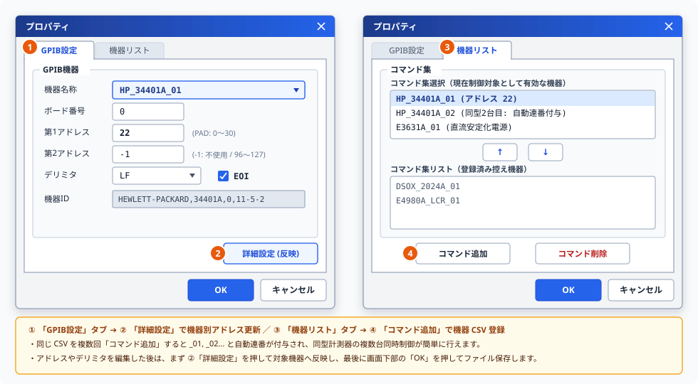

# プロパティ設定画面取扱説明書 (User Manual)

👉 [← メイン画面取扱説明書に戻る](./メイン画面取扱説明書.Md)  
👉 [→ コマンド編集画面取扱説明書](./コマンド編集画面取扱説明書.Md) ／ [→ Excelアドイン取扱説明書](./Excelアドイン取扱説明書.Md)

---

本書は、GPIB（IEEE-488）通信制御システムにおいて、制御対象となる計測器コマンド定義（CSV / XML）の登録・有効化（機器リスト管理）、および各計測器の通信パラメータ（ボード番号・1 次／2 次アドレス・デリミタ・EOI）を設定する **「プロパティ設定画面（プロパティ）」** の取扱説明書です。

---

# 目次

- [第 1 章 概要と 2 タブ構成・保存の重要ルール](#第-1-章-概要と-2-タブ構成保存の重要ルール)
  - [1.1 本画面の役割と開き方](#11-本画面の役割と開き方)
  - [1.2 画面全体イメージ](#12-画面全体イメージ)
  - [1.3 【重要】`[パラメータ反映]` と `[OK]` の保存タイミングの違い](#13-重要パラメータ反映-と-ok-の保存タイミングの違い)
- [第 2 章 各タブの設定項目詳細](#第-2-章-各タブの設定項目詳細)
  - [2.1 ① 「GPIB設定」タブ（GPIB 通信パラメータ設定）](#21--gpib設定タブgpib-通信パラメータ設定)
  - [2.2 ② 「機器リスト」タブ（コマンドセットの追加・有効化・削除）](#22--機器リストタブコマンドセットの追加有効化削除)
  - [2.3 画面上の全ボタン一覧](#23-画面上の全ボタン一覧)
- [第 3 章 実践ガイド（登録手順と応用運用テクニック）](#第-3-章-実践ガイド登録手順と応用運用テクニック)
  - [3.1 手順 1：はじめて計測器を 1 台登録してアドレスを設定する](#31-手順-1はじめて計測器を-1-台登録してアドレスを設定する)
  - [3.2 応用 1：同じ機種の計測器を複数台同時接続する](#32-応用-1同じ機種の計測器を複数台同時接続する)
  - [3.3 応用 2：1 台の多機能計測器を用途別の CSV に分けて管理する](#33-応用-21-台の多機能計測器を用途別の-csv-に分けて管理する)
- [第 4 章 設定の保存先・監査ログとトラブルシューティング（FAQ）](#第-4-章-設定の保存先監査ログとトラブルシューティングfaq)

---

# 第 1 章 概要と 2 タブ構成・保存の重要ルール

## 1.1 本画面の役割と開き方

**プロパティ設定画面 ** （ウィンドウタイトル： **「プロパティ」 ** ）は、メイン画面の **`[通信ポート(C)] ➔ [プロパティ...(P)]`** またはツールバーの ** 「プロパティ設定」** アイコンから開きます。画面は以下の 2 つのタブで構成されています。

1. **「GPIB設定」タブ**: 登録済み計測器ごとに、GPIB ボード番号・1 次アドレス・2 次アドレス・デリミタ・EOI の通信条件を設定します。
2. **「機器リスト」タブ**: 計測器ごとのマクロスクリプト定義ファイル（CSV / XML）を追加読み込みし、実際に使用する機器（有効）と待機させる機器（予備）を管理します。

## 1.2 画面全体イメージ

## 1.3 【重要】`[パラメータ反映]` と `[OK]` の保存タイミングの違い

> [!IMPORTANT]
> **設定が元に戻ってしまうミスを防ぐための最重要ポイント**  
> 本画面では、2 つのタブで設定の保存先と確定ボタンが分かれています。
> * **「GPIB設定」タブ ** の変更（アドレス・デリミタ・EOI 等）は、タブ右下の **`[パラメータ反映]`** ボタンを押した瞬間に、その機器専用の XML ファイル（`<機器名>.xml`）へ保存確定されます。 **`[パラメータ反映]` を押さずに `[OK]` だけで閉じると、アドレス変更は保存されません。**
> * **「機器リスト」タブ ** の変更（機器の追加・有効化・予備移動・削除）は、画面下部の **`[OK]`** ボタンを押したときに `Setting.xml` へ保存され、メイン画面のタブとコマンド一覧が再構築されます。
> * なお、画面下部の **`[キャンセル]`** ボタンは、`[パラメータ反映]` による即時保存との不整合を防ぐため常時無効化（グレーアウト）されています。

---

# 第 2 章 各タブの設定項目詳細

## 2.1 ① 「GPIB設定」タブ（GPIB 通信パラメータ設定）

登録されている計測器 1 台ごとの GPIB 通信パラメータを確認・編集するタブです（図中 **①** ）。

| 項目名 | 設定値・入力範囲（既定値） | 詳しい意味と設定のポイント |
| :--- | :--- | :--- |
| **`機器選択`** | 登録済み機器のドロップダウン | パラメータを確認・変更したい計測器を選びます。選択すると、現在保存されている設定値と下段の `機器 ID` が自動で読み込まれます。 |
| **`ボード番号`** | `0` 以上の半角整数（通常 `0`） | PC に装着されている GPIB ボードの認識番号を指定します。GPIB ボードが 1 枚構成の PC では通常 **`0`** を指定します。 |
| **`1次アドレス`** | `0`〜`30` の半角整数（例: `22`） | 計測器本体の前面パネル（またはメニュー）に設定されている GPIB プライマリアドレスと同じ数値を入力します。バス上の各計測器で重複しない番号を設定してください。 |
| **`2次アドレス`** | サブアドレス整数 （ ** 未使用時は必ず `-1`** ） | セカンダリアドレスを使用する特殊な計測器の場合のみ指定します。 ** 通常の計測器（2 次アドレス未使用）では必ず半角数値 `-1` を入力してください** 。空欄や文字を入力すると無効値とみなされ反映されません。 |
| **`デリミタ`** | `CRLF` / `CR` / `LF` / `None` （数値 `1`/`2`/`3`/`0` も可、既定 `CRLF`） | 計測器との送受信メッセージの終端文字を指定します（大文字・小文字は区別しません）。不正な文字列を入力して反映しようとした場合は、安全のため変更前の設定値が維持されます。 |
| **`機器 ID`** | 読み取り専用表示欄 | ポート接続時に GPIB ドライバから割り当てられた内部機器識別番号を確認用として表示します（手動入力は不要です）。 |
| **`EOI 有効`** | チェックボックス（ON / OFF） | チェックを **ON** にすると、データ送信の最終バイトと同時に IEEE-488 の EOI（End or Identify）信号線を送出して電文終端を明示します。一般的な SCPI 対応計測器では ON を推奨します。 |

* **変更後の必須操作 **: 各項目を入力し終えたら、必ず右下の **`[パラメータ反映]`** ボタン（図中 **②** ）をクリックして `<機器名>.xml` へ保存確定してください。複数台のアドレスを続けて設定する場合は、「`機器選択` で 1 台目を選ぶ ➔ 入力 ➔ `[パラメータ反映]` ➔ `機器選択` で 2 台目を選ぶ ➔ 入力 ➔ `[パラメータ反映]`」の順に行います。

---

## 2.2 ② 「機器リスト」タブ（コマンドセットの追加・有効化・削除）

計測器ごとのコマンド定義ファイル（CSV / XML）を管理し、メイン画面や Excel で使用する機器を選び出すタブです（図中 **③** ）。上下 2 段のリストで構成されています。

| リスト枠 | 役割と管理のポイント |
| :--- | :--- |
| **上段：`選択中デバイス`（現在有効）** | ここに登録されている計測器だけが、メイン画面の「接続機器切り替えタブ」、コマンド編集画面、および Excel アドインの「シーケンス配置」で制御対象として表示されます。 |
| **下段：`予備デバイス`（控えリスト） ** | **`[コマンド追加]`** で新しく読み込んだ定義ファイルは、まずこの下段リストへ追加されます。一時的に使わない計測器を退避させておく保管庫としても機能します。 |

* **有効化と一時退避の操作**:
  * 下段（`予備デバイス`）で機器を選択して中央の **`[ ↑ ]`** ボタンを押すと、上段（`選択中デバイス`）へ移動して有効化されます。
  * 上段（`選択中デバイス`）で機器を選択して中央の **`[ ↓ ]`** ボタンを押すと、下段（`予備デバイス`）へ戻って無効化（一時退避）されます。

---

## 2.3 画面上の全ボタン一覧

| ボタン名 | 配置場所 | 詳しい動作内容 |
| :--- | :--- | :--- |
| **`パラメータ反映`** （図中 ②） | 「GPIB設定」タブ右下 | 入力したボード番号・1 次／2 次アドレス・デリミタ・EOI を選択中機器へ適用し、即座に `<機器名>.xml` へ保存確定します。 |
| **`[ ↑ ]`** / **`[ ↓ ]`** | 「機器リスト」タブ中央 | `予備デバイス`（下段）と `選択中デバイス`（上段）の間で機器定義を移動し、有効／無効を切り替えます。 |
| **`コマンド追加`** （図中 ④） | 「機器リスト」タブ下部 | ファイル選択ダイアログを開き、新しい計測器定義ファイル（CSV / XML）を下段の `予備デバイス` へ追加読み込みします。 |
| **`コマンド削除`** （図中 ④） | 「機器リスト」タブ下部 | 下段の `予備デバイス` で選択中の機器定義をリストから削除します。 ※誤削除防止のため、上段（`選択中デバイス`）にある機器は直接削除できません。削除したい場合は、先に **`[ ↓ ]`** で下段へ移動してから `[コマンド削除]` を押してください。 |
| **`OK`** | ダイアログ最下部 | 「機器リスト」タブで行った構成変更を `Setting.xml` へ保存し、メイン画面の機器タブおよびコマンド一覧を最新状態へ再構築して画面を閉じます。 |
| **`キャンセル`** | ダイアログ最下部 | 常時無効化（グレーアウト）されています（`[パラメータ反映]` で即時保存された内容を巻き戻さないための安全設計です）。 |

---

# 第 3 章 実践ガイド（登録手順と応用運用テクニック）

## 3.1 手順 1：はじめて計測器を 1 台登録してアドレスを設定する

例として、GPIB プライマリアドレス `22` に設定されたデジタルマルチメータ（定義ファイル `DMM_34401A.csv`）を新規登録する手順を示します。

1. メイン画面の **`[通信ポート(C)] ➔ [プロパティ...(P)]`** を開きます。
2. **「機器リスト」 ** タブを開き、右下の **`[コマンド追加]`** ボタンをクリックします。
3. ファイル選択ダイアログで `DMM_34401A.csv` を選んで開くと、下段の **`予備デバイス`** に `DMM_34401A_01` が追加されます。
4. 下段の `DMM_34401A_01` をクリックして選択し、中央の **`[ ↑ ]`** ボタンを押して上段の **`選択中デバイス`** へ移動します。
5. **「GPIB設定」** タブへ切り替えます。
6. `機器選択` ドロップダウンで `DMM_34401A_01` を選び、各項目を入力します：
   * `ボード番号`: **`0`**
   * `1次アドレス`: **`22`**
   * `2次アドレス`: **`-1`**
   * `デリミタ`: **`CRLF`**
   * `EOI 有効`: チェック **ON**
7. タブ右下の **`[パラメータ反映]`** ボタンをクリックして XML へ保存確定します。
8. 最後に画面最下部の **`[OK]`** ボタンをクリックすると、`Setting.xml` が更新され、メイン画面に `DMM_34401A_01` のタブが追加されます。

---

## 3.2 応用 1：同じ機種の計測器を複数台同時接続する

同じ型番の直流電源やマルチメータを 2 台以上同時に制御したい場合は、同じ CSV 定義ファイルを台数分 **`[コマンド追加]`** で読み込みます。

1. `HP_34401A.csv` を 2 回読み込むと、自動的に **`HP_34401A_01`** と **`HP_34401A_02`** のように連番が付与されます。
2. 両方を **`[ ↑ ]`** で上段の `選択中デバイス` へ移動します。
3. 「GPIB設定」タブで、`HP_34401A_01` には `1次アドレス = 22` を設定して **`[パラメータ反映]`** 、続けて `HP_34401A_02` には `1次アドレス = 23` を設定して **`[パラメータ反映]`** をクリックします。
4. **`[OK]`** で閉じると、2 台を独立した機器として同一の Excel シートから並列制御できます。

---

## 3.3 応用 2：1 台の多機能計測器を用途別の CSV に分けて管理する

オシロスコープやマルチメータなど機能が多い 1 台の計測器に対して、「電圧測定用 CSV」「抵抗測定用 CSV」「波形取得用 CSV」のように機能特化型の CSV を別々に読み込み、 **すべてに同じ `1次アドレス`（例: `22`）を設定して `[パラメータ反映]`** することも可能です。コマンド一覧が用途別に整理され、Excel シート作成時のコマンド選択が非常に見やすくなります。

---

# 第 4 章 設定の保存先・監査ログとトラブルシューティング（FAQ）

### 保存先と監査ログ
* **機器リスト構成・ウィンドウ座標**: `%USERPROFILE%\Desktop\Monaca\Setting.xml`（`Table="Monaca GPIB"`）へ自動保存されます。
* **機器別 GPIB パラメータ**: 各機器ごとの `<機器名>.xml` へ保存されます。
* **監査ログ**: 「機器リスト」タブの構成変更を `[OK]` で確定した際、変更前後の差分が既定 `%USERPROFILE%\Desktop\Monaca\info.log` へ `[SAVE]` 区分で自動記録されます。

### よくある質問（FAQ）

#### Q1. `1次アドレス` を変更して `[OK]` を押したのに、次に開いたら元の番号に戻っていました。
* 「GPIB設定」タブの入力内容は、タブ右下の **`[パラメータ反映]`** ボタンを押した時点で保存されます。必ず **`[パラメータ反映]`** をクリックしてから **`[OK]`** で閉じてください。

#### Q2. 上段の `選択中デバイス` にある機器を `[コマンド削除]` で消そうとしても削除できません。
* 稼働中の機器定義を誤って削除しないための安全仕様です。先に中央の **`[ ↓ ]`** ボタンで下段の `予備デバイス` へ降ろしてから、下段で選択して **`[コマンド削除]`** を押してください。

#### Q3. `2次アドレス` を空欄にしたら設定が反映されなくなりました。
* 2 次アドレスを使用しない一般の計測器では、空欄ではなく必ず半角数値の **`-1`** を入力して **`[パラメータ反映]`** を押してください。

#### Q4. `[キャンセル]` ボタンがグレーアウトしていて押せません。
* 仕様どおりの正常な表示です。`[パラメータ反映]` で個別 XML へ即時確定する設計のため、不整合防止として `[キャンセル]` は無効化されています。
