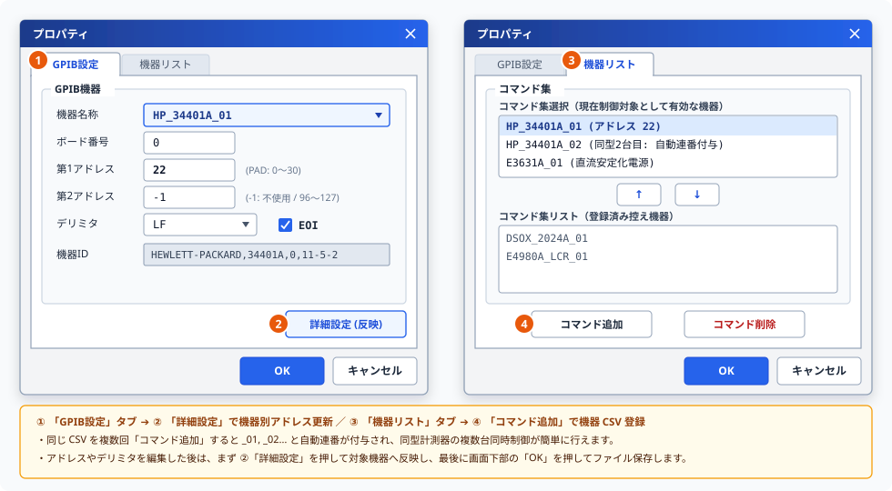

# プロパティ設定画面取扱説明書 (User Manual)

本ドキュメントは、通信制御システムにおける制御対象機器（デバイス）の定義および通信パラメータを編集するための設定画面 **「プロパティ設定画面」** の取扱説明書です。

---

## 📖 1. 概要
プロパティ設定画面は、システムで制御する各種測定器や電源などの機器情報を一元管理する画面です。
機器の追加や削除、それぞれの機器が持つ固有の通信パラメータや対応するコマンド定義を設定し、設定ファイルとして保存します。

---

## 🗂️ 2. タブ構成と機能説明
プロパティ設定画面（ウィンドウタイトル： **「プロパティ」** ）は、以下の 2 つのタブで構成されています。設定したい内容に応じてタブを切り替えて操作します。

### 🔘 ① 「GPIB設定」タブ（機器通信プロパティ）
機器の基本情報の管理や、接続仕様などの通信パラメータを設定するためのタブです（上図 左側 **①** ）。
*   **機器名称の選択**: 上段のドロップダウンから、通信条件を確認・変更したい登録済み機器を選択します。
*   **詳細設定（登録情報更新：②）**: **ボード番号** 、機器固有の **第1アドレス（プライマリアドレス：0〜30）** ・ **第2アドレス（セカンダリアドレス：未使用時は `-1`）** 、通信末尾文字（ **デリミタ** ）、および **EOI** 制御の有無といった物理的な接続パラメータを入力し、右下の **「詳細設定」** ボタンを押すことで選択中機器の登録情報を即時更新できます（最後に画面下部の **「OK」** ボタンでファイルへ保存確定します）。

### 🔘 ③ 「機器リスト」タブ（コマンド集選択・管理）
システムで使用する計測器の「コマンド集（マクロスクリプト CSV）」を登録・有効化するためのタブです（上図 右側 **③** ）。
*   **機器（コマンド集）の追加・削除（④）**: 下部の **「コマンド追加」** から新しい計測器の CSV ファイルを登録し、不要になった定義は **「コマンド削除」** で取り除きます。
*   **有効機器と控えリストの切り替え**: 中央の **`[ ↑ ]`** / **`[ ↓ ]`** ボタンを用いて、現在制御対象として有効化する **「コマンド集選択（上段）」** と **「コマンド集リスト（下段・控え）」** を自在に移動できます。

---

## 🛠️ 3. 画面上のボタン説明 (個別機能)
画面に配置された操作用ボタンの個別説明です。

### 🔘 機器の追加 ボタン
*   **機能**: 制御対象とする新しい機器の定義枠を新規に生成・追加します。
*   **用途**: システムに新しい電源やマルチメータなどの測定器を登録し、制御できるようにしたい場合に使用します。

### 🔘 機器の削除 ボタン
*   **機能**: 選択されている機器の登録情報を削除します。
*   **用途**: 使用しなくなった機器や、不要になった古い測定器の設定をシステムから取り除きたい場合に使用します。

### 🔘 通信詳細設定 ボタン
*   **機能**: 画面上で入力・編集した通信パラメータ（ボード番号、アドレス、デリミタ等）を、選択中の機器の登録情報として更新・反映するボタンです（※別の画面を開くものではなく、入力内容を確定・反映する更新ボタンです）。
    *   **ボード番号**: 制御に使用するインターフェースボードの認識番号を指定します。
    *   **1次アドレス (プライマリアドレス)**: 各機器を一意に識別するための通信アドレスを指定します（通常は 0 〜 30 の範囲）。
    *   **2次アドレス (セカンダリアドレス)**: 機器がサブチャネルや追加機能をサポートしている場合に使用する第2のアドレスを指定します（未使用時は「なし」等に設定）。
    *   **デリミタ (ターミネータ)**: コマンドや応答メッセージの終わりを示す終端文字（例: `CR+LF` や `LF`）を選択・指定します。
    *   **EOI (End or Identify) 制御**: データ送信の最終バイトと同時に EOI 信号ラインをアクティブにし、終端であることを明確に示すかどうかを設定します。
*   **用途**: アドレス変更や通信プロトコル仕様の入力を行った後、その設定内容を選択中の機器に登録・更新したい場合に使用します。

### 🔘 コマンド追加 ボタン
*   **機能**: 選択中の機器に紐づく、新しいコマンド定義を新規に追加します。
*   **用途**: 機器に送信したい独自の測定コマンドや設定コマンドを新たに定義し、Excelシート側から呼び出せるようにしたい場合に使用します。

### 🔘 コマンド削除 ボタン
*   **機能**: 選択中のコマンド定義をリストから削除します。
*   **用途**: 使用しなくなったコマンドや、誤って登録したコマンドの設定を取り除きたい場合に使用します。

### 🔘 確定 (OK) ボタン
*   **機能**: これまで編集した機器情報やコマンドの変更内容を設定ファイルに保存・確定したうえで、プロパティ設定画面を閉じます。
*   **用途**: 設定変更をシステムに反映させ、エディタやExcelシーケンスで利用可能にしたい場合にクリックします。

### 🔘 取消 (キャンセル) ボタン
*   **機能**: 今回画面を開いてから行ったすべての変更内容を破棄し、設定ファイルを更新せずに画面を閉じます。
*   **用途**: 誤って設定を変更してしまった場合や、変更を取りやめたい場合にクリックします。

---

## 💾 4. 設定の自動保存・復元機能
本画面では、ユーザーの利便性と画面遷移の応答性を高めるため、設定情報の保存と復元を自動的に行っています。

### ① 自動的に保存・復元される情報
*   **画面の表示位置**
    *   プロパティ設定画面を閉じる際、画面上の表示位置（表示座標）を自動的に保存します。
        次回起動時は、前回の表示位置に自動的に復元されます。
*   **設定の高速読み込み (キャッシュ機能)**
    *   多数の機器やコマンドを定義している場合でも起動がフリーズしないよう、正常ロードした機器情報を
        一時保存して高速に画面を起動します。
*   **確定時の設定変更履歴（監査ログ）自動記録**
    *   「確定」ボタンを押して通信アドレスやパラメータを更新した際、変更前と変更後の差分内容が
        自動的に監査ログファイルへ記録されます（既定ではデスクトップの `Monaca\info.log` ですが、
        メイン画面のメニュー [環境設定...] ➔ [エラー履歴] から保存先やファイル名を変更可能です）。
        設定変更の証跡が確実に残るため、複数人での測定運用でも安心して機器設定を更新・管理できます。

---

## 🌟 5. 応用運用テクニック

プロパティ設定画面と CSV 定義ファイルを組み合わせることで、多様なハードウェア構成や測定シナリオに柔軟に対応できます。本システムの大きな特長である運用テクニックをご紹介します。

### ① 同じ計測器を複数台つなぐ場合（台数回ロードと自動ナンバリング）
同一型番のマルチメータや電源を2台以上接続してシステムを組む場合は、以下の手順で登録します。
1. 「コマンド選択」タブの **「コマンド追加」** から、対象機器の **CSV ファイルを接続する台数回読み込ませます**。
2. システムが自動的に `01`〜 の連番（例: `HP_34401A_01`, `HP_34401A_02`...）を付与してデバイス名を生成するため、重複することなく別々の機器として区別・管理されます。
3. 「プロパティ」タブに戻り、それぞれの機器（`_01`, `_02`...）を選択して、画面上で**実機ハードウェアに設定されている個別のアドレス（プライマリアドレス等）を指定し、「通信詳細設定」ボタンをクリックして登録情報を更新**します。
4. すべての機器の設定が完了したら「確定」ボタンをクリックして保存します。これにより、Excel シート上から各機器を独立して制御できるようになります。

### ② 1つの計測器に対し機能特化型 CSV ファイルを用意する場合（同一アドレス指定）
多機能な計測器（オシロスコープや高機能マルチメータ等）を制御する際、1つの巨大な CSV ファイルに全機能をまとめるのではなく、**測定機能や用途ごとに特化した複数の CSV ファイル**（例: 電圧測定用 CSV、周波数測定用 CSV、初期設定用 CSV 等）を用意して登録することが可能です。
1. 機能ごとに分割したそれぞれの CSV ファイルを「コマンド追加」から読み込ませます。
2. 「プロパティ」タブにて、それぞれの機器定義を選択し、画面上で**同一のアドレス（プライマリアドレス等）を指定し、「通信詳細設定」ボタンをクリックして登録情報を更新**します。
3. 「確定」ボタンをクリックして保存します。これにより、Excel シート上では機能別にすっきりと整理されたコマンド群から選択できるようになり、操作ミスや設定漏れを大幅に低減できます。

### ③ 自由なハイブリッド混在運用
上記「同型機の複数台接続（01〜連番）」と「機能特化型 CSV（同一アドレス指定）」は、**同一システム内で自由に混在させて運用することが可能**です。

* **運用実例（名前生成規則とアドレス設定の流れ）**:
  * **機器1（電源・アドレス 1）**:
    * `POWER_MAIN.csv` を用いて自動生成名 **`POWER_MAIN_01`**（アドレス `1` を指定して更新）
  * **機器2（マルチメータ1台目・アドレス 22）**:
    * `DMM_VOLT.csv`（電圧機能特化CSV）を用いて自動生成名 **`DMM_VOLT_01`**
    * `DMM_FREQ.csv`（周波数機能特化CSV）を用いて自動生成名 **`DMM_FREQ_01`**
    * ※上記2つの定義に同一のアドレス `22` を指定し、「通信詳細設定」ボタンで登録情報を更新
  * **機器3（マルチメータ2台目・アドレス 23）**:
    * `DMM_VOLT.csv`（電圧機能特化CSV）を再度用いて自動連番で **`DMM_VOLT_02`**
    * ※個別のアドレス `23` を指定し、「通信詳細設定」ボタンで登録情報を更新

このような高度で柔軟な測定ラインの構築も、プロパティ画面での簡単な操作だけでスムーズに実現できます。

