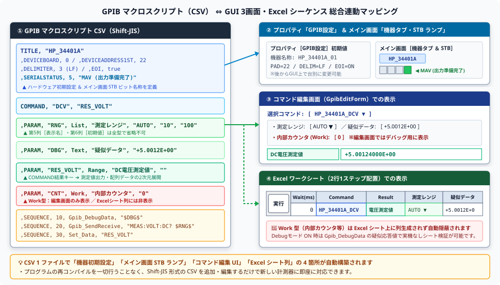

# マクロスクリプト取扱説明書 (User Manual)

> [!IMPORTANT]
> **基本フォーマットおよび表記言語・文字コード・AI生成仕様**  
> * **表記言語の原則（多言語化対応とデフォルト言語）**:  
>   多言語化を意識した設計とし、スクリプト内のコメント、パラメータ表示名、ダイアログメッセージ、および **シリアルステータスビット定義（`SERIALSTATUS`）の名称等の設定値文字列** は、マニュアル原本が英語等であっても、特に指定がない限り **日本語をデフォルトとして適切に翻訳して記述・設定** してください。
> * **文字コード（エンコーディング）の原則**:  
>   GPIBマクロスクリプトファイルは、 **CSV形式** で保存されます。 **CSVを日本語で記述する場合は、日本語Excelの制限（互換性維持および文字化け防止）から、必ず Shift-JIS (CP932) で記載・保存** してください。  
>   編集およびファイル保存時には、文字コードが Shift-JIS であることを必ず確認してください。
> * **AI生成元の明記規約（スクリプトおよびAI指示書・他者再現性の保証）**:  
>   AIによってGPIBマクロスクリプト（CSV）や、 **自動生成されたGPIBマクロスクリプト自動生成指示書（Markdown指示書ファイル等）** を作成・編集した場合は、トレーサビリティ・品質管理および **他者が同一条件で生成結果を再現できるよう** 、 **「実行環境（エージェント／IDE名）」と「自身のAIエンジン（モデル名・エディション／ティア）」の双方を正確に判別できる名称** を必ず明記してください。  
>   * **マクロスクリプト（CSV）**: 最先頭のヘッダコメント（最先頭行付近）に `; 生成AI: <エージェント名> (<AIエンジン名>)` の形式で明記（例: `; 生成AI: Antigravity (Gemini 4 Carbon (Medium))` 等）。  
>   * **AI指示書（Markdown）**: ファイル冒頭（タイトル直後の注記ブロック等）に `> **生成AI**: <エージェント名> (<AIエンジン名>)` の形式で明記（例: `> **生成AI**: Antigravity (Gemini 4 Carbon (Medium))` 等）。  
>   * **【厳禁事項とAIエンジン判別手順】**:  
>     1. エージェント名のみ（例: ❌ `Antigravity` のみ）の記載は、使用したAIエンジンが判別できず他者が再現不能となるため **絶対禁止** とします。  
>     2. 本書やテンプレート内の記載例（例示文字列）の丸写し、または事前学習知識からの推測・ハルシネーションによる不正確なモデル名（例: ❌ `Gemini 3.1 Pro` や架空のバージョン等）の記載は **絶対禁止** とします。  
>     3. AIは記述前に必ずセッションのモデル選択情報（Antigravity 環境では `<USER_SETTINGS_CHANGE>` の `Model Selection` 設定値、コンテキスト要約後は会話ログ `transcript.jsonl` 内の `USER_SETTINGS_CHANGE` 記録値）を参照・突合し、実際に稼働している自身のAIエンジン名称を一字一句正確に転記してください（環境から判別できない場合は推測せず、必ず `ask_question` ツールでユーザーに確認すること）。
> * **個人情報・開発環境絶対パスの完全排除規約（スクリプト、AI指示書、および全関連ドキュメント）**:  
>   AIによってGPIBマクロスクリプト（CSV）、 **自動生成されるAI指示書（Markdown指示書ファイル等）** 、および変更履歴まとめ等の関連ドキュメントを作成・編集する場合は、開発環境固有の絶対パス（`<LOCAL_DIR>\...` 等）、ローカルファイルURIスキーム、およびユーザー名（`<USER_DIR>\...`）を絶対に含めてはなりません。  
>   ファイル参照やMarkdownリンクを記述する場合は、必ず同一ディレクトリまたはプロジェクトからの **完全な相対パス（`./...`, `../...`）** を使用してください。パスの例示が必要な場合は、必ず汎用プレースホルダー（`<APP_DIR>`, `<MACRO_DIR>`, `./Macro/` 等）を使用してください。

## 📌 1. 階層構造の基本規約
マクロ解析エンジンは、カンマ（CSV）またはタブ（TSV）で分割された行頭（第1フィールド）の状態を基準に、親ブロックとサブコマンドの親子関係を判別します。

### ⚠️ 行頭による認識ルール

* **親ブロックの開始宣言** ：  
第1フィールド（行頭）にキーワード（`GENERAL` / `TITLE` / `COMMAND`）がある行。

* **サブコマンドの定義（子）** ：  
行頭がカンマ `,`（TSV 形式の場合はタブ `\t`）から始まり、第1フィールドが空で第2フィールド以降にキーワードが続く行。  
直前で宣言された親ブロックに帰属します。  
※カンマを置かずに半角スペースのみで字下げした行は、第1フィールドの前後空白がトリムされるためサブコマンド行としては認識されません。必ず **行頭カンマ（`,`）** で開始してください。

* **コメント行および行末コメント** ：  
行頭が `;`、`#`、または `//` から始まる行、完全な空行、および親ブロック・サブコマンドのいずれにも一致しない行は無視されます。また、二重引用符（`"`）の外側にあるセミコロン（`;`）以降は、すべての行において行末コメントとして安全に切り捨てられます（SCPI の連結コマンド `"*RST;*CLS"` のように引数自体に `;` を含める場合は、必ず二重引用符で囲んで記述してください）。

---

## 🏢 2. 親ブロックとサブコマンドの帰属関係一覧
ファイル内は大きく分けて「① 機器情報定義」と「② コマンド定義」の2つの階層構造で構成されます。

### ① 機器情報ブロック（`GENERAL` / `TITLE`）
共通機能やハードウェア（計測器）の物理構成を定義する最上階層です。

* `GENERAL`
  * `GENERAL, "GENERAL"` (共通コマンド開始) [行頭記述]
  * └── 配下サブコマンドなし (ヘッダー宣言のみ)

* `TITLE`
  * `TITLE, "[機器名称]"`    (対象機器・ハードウェア構成) [行頭記述]
  * ├── `,DEVICEBOARD`      (ボード番号指定)
  * ├── `,DEVICEADDRESS1ST` (プライマリアドレス)
  * ├── `,DEVICEADDRESS2ND` (セカンダリアドレス)
  * ├── `,DELIMITER`        (送受信終端文字)
  * ├── `,EOI`              (EOI信号線制御)
  * └── `,SERIALSTATUS`     (ステータスビット名称 ※1〜8の1始まり指定、0は無視)

### ② コマンド定義ブロック（`COMMAND`）
自動化マクロとして実行したい処理枠と、内部で使う変数、および具体的な実行手順を定義する階層です。

* `COMMAND`
  * `COMMAND, "[マクロ名]", "[結果格納先キー（任意）]"` [行頭記述]
  * ├── `,PARAM` (マクロ内で使用する変数・型・初期値の定義)
  * └── `,SEQUENCE` (実際に実行する処理ステップ・引数の定義)
  * ※ `[結果格納先キー]` はオプションです。マクロから出力データを返したい場合のみ指定し、出力がない場合は省略可能です。

### ③ CSV マクロスクリプトと各 GUI 画面・Excel シートの総合連動イメージ

1 つの GPIB マクロスクリプト（CSV）を登録するだけで、`TITLE` ブロックから **「プロパティ設定画面の初期値」** と **「メイン画面の機器タブ・STB 8 ビットランプ名称」** が自動構成され、`COMMAND` / `PARAM` / `SEQUENCE` ブロックから **「コマンド編集画面」** と **「Excel 2 行シーケンス」** が連動生成されます。



<!-- PDF出力時改ページを追加する。 -->
<div style="page-break-before:always"></div>

## 📝 3. 各サブコマンドの記述仕様・パラメータ構成

### 1️⃣ TITLE ブロック帰属 サブコマンド
ハードウェア設定を規定します。すべて第2フィールドに記述します。パラメータ構成以降は無視されるため、コメントを記述することも可能です。

| サブコマンド | パラメータ構成 | 説明 |
| :--- | :--- | :--- |
| **DEVICEBOARD** | `,DEVICEBOARD, [ボード番号]` | GPIBボード（コントローラ）の番号を指定（既定値: 0）。 |
| **DEVICEADDRESS1ST** | `,DEVICEADDRESS1ST, [PAD]` | 計測器のプライマリアドレス（0〜30）を指定。 |
| **DEVICEADDRESS2ND** | `,DEVICEADDRESS2ND, [SAD]` | セカンダリアドレス（96〜127）を指定。不使用時は -1。 |
| **DELIMITER** | `,DELIMITER, [識別子]` | 送受信終端文字を指定（0:なし, 1:CRLF, 2:CR, 3:LF）。 |
| **EOI** | `,EOI, [true/false]` | 送信時のEOI信号線制御の有効・無効を指定。 |
| **SERIALSTATUS** | `,SERIALSTATUS, [番号], [名称]` | シリアルポーリング時に返るステータスビットの名称を **1〜8（1始まり：`1`＝Bit0 〜 `8`＝Bit7、`0` は無視）** で定義。多言語化を意識し、英語マニュアル記載の場合でも指定がない限り日本語をデフォルトとして適切に翻訳して設定します。 |

### 2️⃣ COMMAND ブロック帰属 サブコマンド
マクロの動的データと実行フローを規定します。
すべて行頭カンマ（`,`）から開始し、第2フィールドにキーワードを記述します。
クォート外の `;` 以降はパーサーにより行末コメントとして自動除去されますが、可変長フィールドとの混同や引数内 `;` のエスケープ漏れを防ぐため、コメントは原則として **独立したコメント行（行頭 `;`）に記述することを推奨** します。

#### PARAM（変数・パラメータ定義）

| サブコマンド | パラメータ構成 | 説明 |
| :--- | :--- | :--- |
| **`PARAM`** | `,PARAM, [パラメータキー], [★データ型], [表示名], [値/選択肢...]` | コマンド内で使用する変数の型、表示名、初期値、選択肢を定義。 |

> [!CAUTION]
> **【重要】`[表示名]` および `[値/選択肢...]` の明記規約（列位置ズレによる初期値欠落防止）**  
> 現行のマクロ構文解析処理はフィールド数の境界保護を備えているため、4フィールド以下で記述しても例外でクラッシュすることはありません（第5フィールド省略時はパラメータキー名が表示名に、第6フィールド省略時は初期値 `""` に自動補完されます）。  
> 
> ただし、 **表示名（第5フィールド）を省略して5フィールドで初期値を詰めて記述（例: `,PARAM, "カウンタ", Work, "0"`）した場合、`"0"` が第5フィールドの「表示名」に入ってしまい、肝心の初期値（第6フィールド）が空文字 `""` になる論理バグ** が発生します。  
> 意図しない列ズレを確実に防ぐため、 **どのようなデータ型（`Range` や `Work` を含む）であっても、必ず第5フィールドに `[表示名]`、第6フィールドに `[初期値]` を省略せず明記してください** （初期値が存在しない場合でも `""` を指定）。

##### 📋 各フィールドの位置と役割

| フィールド位置 | 項目名 | 必須性 | 説明・指定例 |
| :---: | :--- | :---: | :--- |
| 第1フィールド | （空白） | **必須** | 行頭カンマ（`,`）で開始（子要素を示す）。 |
| 第2フィールド | `PARAM` | **必須** | サブコマンド識別子。 |
| 第3フィールド | `[パラメータキー]` | **必須** | コマンド内で参照する変数名（例: `"測定レンジ"`, `"P_VOLT"`, `"カウンタ"`）。 |
| 第4フィールド | `[★データ型]` | **必須** | `Text`, `List`, `Range`, `Number`, `Label`, `Work` のいずれか。 |
| 第5フィールド | `[表示名]` | **推奨（規約必須）** | UIに表示される名称。列ズレ防止のため内部変数や結果格納先でも省略せず明記（例: `"測定値"`, `"データバッファ"`）。 |
| 第6フィールド | `[初期値]` | **推奨（規約必須）** | 変数の初期値（List型の場合は初期選択肢）。初期値が不要な場合は `""` を記述。 |
| 第7フィールド以降 | `[選択肢2, 3...]` | 任意 | List型の場合の2番目以降のドロップダウン選択肢。 |

##### ❌ 誤った記述例（NG）と ⭕ 正しい記述例（OK）

| データ型 | 判定 | 記述例 | 問題点 / 解説 |
| :--- | :---: | :--- | :--- |
| **`Range`** <br>(結果格納先) | ❌ | `,PARAM, "測定値", Range` | **【非推奨】** 表示名と初期値が省略されています（パーサーにより補完されますが、列位置明示規約違反となります）。 |
| | ⭕ | `,PARAM, "測定値", Range, "測定データ", ""` | **正常** 。表示名と初期値（空文字）が正しく定義されています。 |
| **`Work`** <br>(内部変数) | ❌ | `,PARAM, "カウンタ", Work, "0"` | **【不具合】** 表示名が欠落（5フィールド）し、`"0"` が第5列の表示名として解釈され初期値が空になります。 |
| | ⭕ | `,PARAM, "カウンタ", Work, "ループカウンタ", "0"` | **正常** 。第5フィールドに表示名、第6フィールドに初期値 `"0"` が設定されます。 |
| | ⭕ | `,PARAM, "バッファ", Work, "受信バッファ", ""` | **正常** 。初期値不要な場合も `""` を指定。 |
| **`List`** <br>(選択肢) | ❌ | `,PARAM, "レンジ", List, "AUTO", "0.1", "1"` | **【不具合】** `"AUTO"` が表示名になり、初期選択肢・追加選択肢の割り振りが1列ズレます。 |
| | ⭕ | `,PARAM, "レンジ", List, "測定レンジ", "AUTO", "0.1", "1"` | **正常** 。第5=表示名、第6=初期選択肢、第7以降=追加選択肢。 |
| **`Number`** <br>(数値) | ❌ | `,PARAM, "上限値", Number, "100"` | **【不具合】** `"100"` が第5列の表示名になり、初期値が空になります。 |
| | ⭕ | `,PARAM, "上限値", Number, "電圧上限値", "100"` | **正常** 。第5=表示名、第6=初期値。 |

💡 **PARAM サブコマンドにおける「★データ型」詳細仕様**
第4フィールド（データ型）には、エディタ上のUIおよびバリデーション形式を決定する以下のキーワードを指定します。

| 指定キーワード  |  説明・UI上の挙動 |
| :---           | :--- |
| **`Text`**    | 自由なテキスト入力を許可するスタイル。汎用文字列用。 |
| **`List`**    | ドロップダウンリストからの選択を強制・推奨するスタイル。 |
| **`Range`**   | 範囲指定用の入力スタイル。Excel上で結果セル（Result）に配列データを展開する際に、このデータ型が適用されます（カンマ・改行区切りの配列データをセルへ自動展開）。 |
| **`Number`**  | 数値入力（整合性チェック付き）を要求するスタイル。設定値や上限値用。 |
| **`Label`**   | 実行行のラベル（ジャンプ先など）を文字列指定するスタイル。 |
| **`Work`**    | ワークエリア（内部メモリや変数領域・バッファ）を指定するスタイル。※Excelアドイン側では入力セルが生成されず非表示となります。そのため、Excelからユーザーが入力・変更したいパラメータ（デバッグ疑似データなど）には使用せず、必ず `Text` や `Number` などの型を指定してください。 |

#### SEQUENCE（処理手順定義）

| サブコマンド | パラメータ構成 | 説明 |
| :--- | :--- | :--- |
| **`SEQUENCE`** | `,SEQUENCE, [ステップキー], [マクロ名], [引数1], [引数2]...` | 実際に実行する処理ステップと、渡す引数リストを定義。 |

💡 **特殊規約**
* **共通コマンド指定と自動フォールバック**:  
  外部マクロ（サブルーチン）を参照・操作するコマンド（`Call`, `Param_Set`, `Param_Get`, `Param_Move`, `Param_Add`, `Param_Mul`, `Param_Div`, `Param_Mod`）において、ターゲットとなるマクロ名の先頭に `@` を付与することで明示的に共通コマンド（`GENERAL`）として登録されたマクロを対象とします。`@` を付けない場合は、対象機器名とコマンド名を組み合わせた機器固有マクロを優先探索し、該当する機器固有マクロが存在しない場合は自動的に共通コマンド（`GENERAL` に登録された共通マクロ）へフォールバック解決されます。
* **動的置換**:  
  引数内で `$PARAMキー$` のようにパラメータキーの両端を `$` で囲むと、実行時に PARAM の値へと動的置換されます。
* **条件ジャンプ**:  
  ジャンプ先を指定する場合は、ターゲットとなるラベル名（ステップキー）を `#10#` や `#Start#` のように `#` で囲んで引数に指定します（ラベル名には任意の文字列または数値が使用可能です）。
* **カンマのエスケープ**:  
  引数自体にカンマを含める場合は、必ず `","` のように二重引用符で囲んで記述します。
* **デバッグデータ設定と受信フローの順序（最重要・AI指示書必須制約）**:  
  デバッグ実行モード（動作シミュレーションモード有効時）において、`Gpib_Receive`（別名: `Receive`）コマンドはデバッグ用の疑似受信データ保持領域から疑似受信データを取得します。そのため、疑似受信データを設定する **`Gpib_DebugData`（別名: `DebugData`）コマンドは、必ず `Gpib_Receive` コマンドの直前（前）に配置しなければなりません** 。`Gpib_Receive` より後に配置しても、受信処理には反映されません。  
  データ測定・回収を行うマクロシーケンスでは、必ず以下の順序でステップを構成してください：  
  1. **`Gpib_Send`** （クエリまたはトリガ送信）  
  2. **`Gpib_DebugData, [疑似データ]`** （デバッグ用受信データを事前設定）  
  3. **`Gpib_Receive`** （測定データの物理受信または疑似データ取得）  
  4. **`Gpib_Wait`** （GPIBバスイベント・ステータス待機：`Gpib_Wait, "0", 5000` 等）  
  5. **`Set_Data`** （受信データの抽出・パラメータ格納）
* **デバッグ疑似データのデータ型規約（Excel連携・Work以外での定義鉄則）**:  
  デバッグ疑似データを格納するパラメータ（`DEBUG_VAL` や `デバッグデータ` 等）は、 **Excel シート上からユーザーが任意にテストデータを指定・変更できるよう、`Work` 型ではなく必ず `Work` 以外の型（`Text` 型推奨、または `Number` 型）として定義してください** 。  
  ※`Work` 型で定義されたパラメータは Excel アドイン側でパラメータ入力セルが生成されず、Excel からのテストデータ入力・変更ができなくなります。
* **タイムスタンプ有効時のデータパース・3列展開カンマ分離規約（最重要・AI指示書必須制約）**:  
  タイムスタンプ機能が有効化（`Time_Stamp, true`）されている場合、システムは受信データを以下の形式で取得します：  
  `[ 2026/10/31 23:59:59.999 ] R:data`  
  （※角括弧 `[...]` 内に日付と時刻・ミリ秒、続いて受信識別子 `R:`、および機器からの応答データ本体。なお物理受信時は機器応答本体に含まれる半角空白 `' '` がアンダースコア `'_'` に自動置換されます）  
  この受信データを `Set_Data`（旧別名: `SetData` / `SetData_RowAdd`）等で処理する場合、 **日付・時刻・測定データをカンマで分離し、Excel上で3列展開されるフォーマット（`"%s, %s, %u"` または `"%s, %s, %f"` 形式）として扱うことを標準規約とします** 。  
  これによって、Excel上で結果格納先パラメータ（`Range` 型推奨）へ展開される際、 **1列目に日付、2列目に時刻、3列目に測定値** が自動的に3列の2次元表として綺麗に展開・整列されます。  
  * **パース指定の標準パターン例 (`Set_Data`)**:

```csv
; 日付・時刻・測定数値を分離し、カンマ区切り（3列マトリクス）として行追記格納
; ※倍精度実数（8.5桁DMM等の高精度測定）には %u、一般的な単精度実数には %f を使用
,SEQUENCE, 80, Set_Data, "測定値", "[ %s %s ] R:%u", "%s, %s, %0.6f"
```

  ※受信データ内の `[ 日付 時刻 ] R:数値` から、`%s %s` で日付と時刻を別々に抽出し、`%u`（倍精度 `double`）または `%f`（単精度 `float`）で数値を抽出した上で、sprintf 書式 `"%s, %s, %0.6f"` によって `日付, 時刻, 数値` のカンマ区切りテキスト（3列展開）として結合・蓄積します。  
    ※文字列データとしてそのまま抽出・結合する場合は、`Set_Data, "測定値", "[ %s %s ] R:%s", "%s, %s, %s"` のように指定します（ただし `sscanf` の `%s` はカンマで止まらない一方、`sprintf` の `%s` はカンマ `,` やセミコロン `;` で打ち切るため、カンマを含む複数要素応答をそのまま格納する場合は第3引数 `sprintf` 書式を省略するか `Gpib_Receive` の直接格納機能を使用してください）。
* **タイムスタンプ無効時（通常時）のパース指定規約**:  
  タイムスタンプが無効（`Time_Stamp, false`）の場合であっても、受信バッファは測定値のみ格納されるのではなく、受信マークを含む **`R:data` 形式（例: `R:12.345`）** で取得されます。したがって、`Set_Data` による数値パース書式には `"%u"` / `"%f"` ではなく **`"R:%u"`（高精度推奨）または `"R:%f"` 形式** を指定する必要があります（例: `,SEQUENCE, 80, Set_Data, "測定値", "R:%u", "%0.6f"`）。
* **Time_Stamp コマンドの実行順序鉄則（すべての送受信コマンドに先立って実行・最重要規約）**:  
  `Time_Stamp` コマンド（`Time_Stamp, true` または `Time_Stamp, $パラメータ$`）は、 **`Gpib_Send` や `Gpib_Receive` を含むすべての送受信コマンドに先立って（最優先で）実行しなければなりません** 。送受信が一度でも行われた後に `Time_Stamp` を設定すると、通信バッファやログの整合性に問題が生じる恐れがあるため、シーケンスの先頭（ステップ10等）で必ず送受信コマンドより前に実行してください。
* **コマンド終了時の Time_Stamp OFF 復帰鉄則（他コマンドへの影響防止・AI指示書必須制約）**:  
  `Time_Stamp` コマンドによるタイムスタンプ機能の変更は、システム全体の受信データ取得状態に影響を与えます。そのため、タイムスタンプ機能を使用したコマンドを定義した場合、 **他のコマンドや後続シーケンスへの予期せぬ影響を確実に防止するため、そのコマンドの終了時（`Exit` 直前）に必ず `Time_Stamp, false` を実行して機能を OFF に戻さなければなりません** 。
* **測定マクロ設計の標準規約（単発・連続の統合と即時終了規約）**:  
  測定マクロは、単発専用マクロ（`_Single`）と連続専用マクロ（`_Continuous`）に分離・重複作成せず、 **「回数指定可能な連続ループ構造」を基本骨格として定義し、単発測定は「取得回数＝1」で兼ねることを標準原則とします** 。  
  * **初期値の統一**: `取得回数` パラメータの初期値は必ず `"1"` と設定し、デフォルト実行で単発測定として動作させます。  
  * **単発測定時（回数＝1）の即時終了規約**:  
    データ回収・格納後にカウンタをインクリメントし、規定回数到達判定を行います。規定回数（1回など）に達した場合は、 **`Wait`（サンプリング周期待機）をスキップして即座に終了処理（`Exit`）へジャンプ** させてください。これにより、単発実行時にサンプリング待ち時間が発生せず、最速で測定が完了します。
* **初期化（INIT）の独立化と測定コマンドの繰り返し実行規約**:  
  自動計測やExcel上から測定コマンドを高速かつ柔軟に繰り返し呼び出せるようにするため、通信ボードの接続・初期化（`Gpib_Open`, `Gpib_Init`, 機器リセットコマンド等）は各測定コマンド内には含めず、 **独立した初期化コマンド（`INIT`）として分離定義することを標準原則とします** 。  
  * **測定コマンドの軽量化**: 各測定コマンド内では毎回 `Gpib_Open` / `Gpib_Close` を行わず、すでに初期化済みのセッション上で「機器設定 ➔ トリガ ➔ 受信 ➔ 格納 ➔ 回数判定 ➔ Exit」のみを実行します。  
  * **メリット**: 測定コマンドをループ等で何度繰り返し実行しても、都度ボードの再接続や切断によるオーバーヘッドが発生せず、機器の設定状態を維持したまま最小遅延で高速な測定を継続できます。
  * **終了処理の分離**: 計測作業全体の終了時に通信ボードを安全に解放するため、独立した終了コマンド（`CLOSE`）を設けます。

<!-- PDF出力時改ページを追加する。 -->
<div style="page-break-before:always"></div>

## 📊 4. GPIB ドライバー機能比較（CONTEC vs Interface）

本セクションは、CONTEC 製ドライバー（`CGPIB.DLL`）とインターフェース製ドライバー（`GPC4304.DLL` 高機能版）を使用した場合のマクロコマンドの動作差異および対応状況を整理したものです。

### 4.1 概要と切り替え
システムは、設定ファイルの `DLLType` セクションの `DLLMaker` キーに基づいて、使用するドライバーを動的に切り替えます。
*   **CONTEC製ドライバー使用時**: `CONTEC` を指定
*   **Interface製ドライバー使用時**: `Interface` を指定

Interface製ドライバー（高機能版）を使用する場合も、共通のマクロコマンドを使用して同様に通信が可能です。

---

### 4.2 機能カテゴリ別コマンド対応一覧

| 機能カテゴリ | マクロコマンド名 | CONTEC (CGPIB) | Interface (GPC4304) | 説明 |
| :--- | :--- | :---: | :---: | :--- |
| **初期化・終了** | [`Gpib_Init`](./GPIB/Gpib_Init.Md) / [`Gpib_Open`](./GPIB/Gpib_Open.Md) | 🟢 対応 | 🟢 対応 | ボードまたは装置の初期化・接続を実行します（別名: `Init` / `Open`）。 |
| | [`Gpib_Close`](./GPIB/Gpib_Close.Md) / [`Exit`](./Core/Param/Exit.Md) | 🟢 対応 | 🟢 対応 | ボードまたは装置の解放（クローズ）およびシーケンス終了を実行します（別名: `Close`）。 |
| **データ送受信** | [`Gpib_Send`](./GPIB/Gpib_Send.Md) / [`Gpib_SendDirect`](./GPIB/Gpib_SendDirect.Md) | 🟢 対応 | 🟢 対応 | 機器へのデータ送信を実行します（別名: `Send` / `SendDirect`）。 |
| | [`Gpib_Receive`](./GPIB/Gpib_Receive.Md) / [`Gpib_ReceiveDirect`](./GPIB/Gpib_ReceiveDirect.Md) | 🟢 対応 | 🟢 対応 | 機器からのデータ受信を実行します（別名: `Receive` / `ReceiveDirect`）。 |
| | [`Gpib_SendReceive`](./GPIB/Gpib_SendReceive.Md) / [`Gpib_SendFile`](./GPIB/Gpib_SendFile.Md) | 🟢 対応 | 🟢 対応 | クエリ送受信一括実行および外部ファイル一括送信を実行します（別名: `SendReceive` / `SendFile`）。 |
| | [`Gpib_DebugData`](./GPIB/Gpib_DebugData.Md) | 🟢 対応 | 🟢 対応 | デバッグ実行モード（動作シミュレーションモード）時の疑似受信データ文字列を事前設定します（別名: `DebugData`）。 |
| **バス制御・コマンド** | [`Gpib_IFC`](./GPIB/Gpib_IFC.Md) | 🟢 対応 | 🟢 対応 | IFC (インターフェースクリア) 信号を送出します（別名: `IFC`）。 |
| | [`Gpib_REN`](./GPIB/Gpib_REN.Md) | 🟢 対応 | 🟢 対応 | REN (リモートイネーブル) ラインの有効・無効化を制御します（別名: `REN`）。 |
| | [`Gpib_GET`](./GPIB/Gpib_GET.Md) | 🟢 対応 | 🟢 対応 | 指定装置に対してグループ実行トリガを送出します（別名: `GET`）。 |
| | [`Gpib_SDC`](./GPIB/Gpib_SDC.Md) | 🟢 対応 | 🟢 対応 | 指定装置に対して選択デバイスクリアを送出します（別名: `SDC`）。 |
| | [`Gpib_DCL`](./GPIB/Gpib_DCL.Md) / [`Gpib_Reset`](./GPIB/Gpib_Reset.Md) | 🟢 対応 | 🟢 対応 | バス全体に対してデバイスクリアまたはハードウェアリセットを送出します（別名: `DCL` / `Reset`）。 |
| | [`Gpib_GTL`](./GPIB/Gpib_GTL.Md) | 🟢 対応 | 🟢 対応 | 指定装置をローカル制御状態に戻します（別名: `GTL`）。 |
| | [`Gpib_LLO`](./GPIB/Gpib_LLO.Md) | 🟢 対応 | 🟢 対応 | バス全体に対してローカルロックアウトを送出します（別名: `LLO`）。 |
| **ポーリング** | [`Gpib_SPL`](./GPIB/Gpib_SPL.Md) | 🟢 対応 | 🟢 対応 | シリアルポーリングを行い、ステータスバイトを取得します（別名: `SPL`）。 |
| | [`Gpib_SRQSend`](./GPIB/Gpib_SRQSend.Md) | 🟢 対応 | 🟢 対応 | サービスリクエスト(SRQ)信号を送出します（別名: `SRQSend`）。 |
| | [`Gpib_PPL`](./GPIB/Gpib_PPL.Md) | 🟢 対応 | 🟢 対応 | パラレルポーリングを実行し、応答バイトを取得します（別名: `PPL`）。 |
| **イベント・通知** | [`Gpib_Find`](./GPIB/Gpib_Find.Md) | 🟢 対応 | 🟢 対応 | 接続されているリスナ装置を探索します（別名: `Find`）。 |
| | [`Gpib_Wait`](./GPIB/Gpib_Wait.Md) / [`Wait`](./Core/Sequence/Wait.Md) | 🟢 対応 | 🟢 対応 | GPIBバスイベント・SRQ到着を監視待機（`Gpib_Wait`、正規化キー互換 `GpibWait`）または指定ミリ秒時間待機（Core 共通コマンド `Wait`）します。※ `Wait` は `Gpib_Wait` の別名ではありません。 |

---

### 4.3 Interface製ドライバー（GPC4304）専用コマンド

Interface 製ドライバー（`gpc4304.dll` 高機能版）を使用している場合のみ物理動作する、ハードウェア制御用の専用マクロコマンドです。  
CONTEC 製ドライバー（`CGPIB.DLL`）使用時にこれら 4 コマンドを実行した場合は、内部ラッパーがドライバ不一致エラーコード `-5` を返してエラーログを記録し、シーケンス自体は異常停止（`Halt`）せず安全に次のステップへ進みます（`Gpib_WaitAsyncTransfer` でタイムアウト・異常時ジャンプ先ラベルを指定している場合は指定ラベルへ分岐します）。

| マクロコマンド名 | 引数の数 | 主な役割 | 詳細リファレンス |
| :--- | :---: | :--- | :--- |
| `Gpib_ReadRegisterByte` | 3 | ボードの特定レジスタから 1 バイト値を読み込み変数に格納します（別名: `ReadRegisterByte`）。 | [Gpib_ReadRegisterByte リファレンス](./GPIB/Gpib_ReadRegisterByte.Md) |
| `Gpib_WriteRegisterByte` | 3 | ボードの特定レジスタに直接 1 バイト値を書き込みます（別名: `WriteRegisterByte`）。 | [Gpib_WriteRegisterByte リファレンス](./GPIB/Gpib_WriteRegisterByte.Md) |
| `Gpib_StartAsyncTransfer` | 3〜4 | DMA / バッファリングによる非同期転送を開始し、転送 ID を取得します（別名: `StartAsyncTransfer`）。 | [Gpib_StartAsyncTransfer リファレンス](./GPIB/Gpib_StartAsyncTransfer.Md) |
| `Gpib_WaitAsyncTransfer` | 0〜5 | 開始された非同期転送の完了を待機し、受信サイズとデータを回収します（別名: `WaitAsyncTransfer`）。 | [Gpib_WaitAsyncTransfer リファレンス](./GPIB/Gpib_WaitAsyncTransfer.Md) |

---

### 4.4 ドライバー間における動作・パラメータ仕様の詳細差異

両ドライバーのAPIマッピングおよび実装方式の違いにより、以下の挙動・パラメータ仕様の違いが存在します。

#### 1. タイムアウト設定
* **CGPIB (CONTEC)**: ミリ秒単位の設定値をそのままドライバーに適用します。
* **GPC4304 (Interface)**: タイムアウト設定時に指定されたミリ秒値を内部で `100` で割った値（100msステップ、最小値は `1`）としてドライバーへ登録します。値を取得する際は、ドライバーから取得したステップ数に `100` を乗算したミリ秒値に復元します。そのため、設定したタイムアウト値は100ms単位に丸められます。

#### 2. デリミタ設定 (`DELIMITER` / `Gpib_Init`)
* **CGPIB (CONTEC)**: デリミタの数値コードおよび EOI 制御状態をそのまま数値としてドライバーへ適用します。
* **GPC4304 (Interface)**: EOI 指定フラグは個別には反映されず、指定されたデリミタ種別コードが Interface ドライバー固有の送受信デリミタ指定形式（コード `1` ➔ `CR`、`2` ➔ `LF`、`3` ➔ `EOI`、それ以外 ➔ `CRLF`）へ内部変換されて設定されます。また、ドライバーから設定値を読み出す際は共通のデリミタ種別コードおよび EOI 状態へ逆変換されます。

#### 3. デバイスクリア送出 (`Gpib_DCL` / `Gpib_SDC`) の分離制御
* **CGPIB (CONTEC)**: ボード単位の指定時はバス全体への DCL、機器単位の指定時は選択機器のみへの SDC としてドライバー側で処理されます。
* **GPC4304 (Interface)**: システム内部で各登録機器の識別番号をボード番号（`0`〜`15`）と重複しない `100` 番台で自動採番・管理しており、`Gpib_DCL` 実行時はバス全体へのデバイスクリア、`Gpib_SDC` 実行時は選択中の対象機器のみへの選択デバイスクリアへ自動的に振り分けられます。

#### 4. スレーブ動作・モード設定 (`Gpib_REN` 等)
* **CGPIB (CONTEC)**: ドライバーのステータス設定機能を通じてマスター／スレーブ動作モードやリモートイネーブル状態が適用されます。
* **GPC4304 (Interface)**: ドライバー固有のシステム制御機能を通じてマスター／スレーブ動作モードの切り替えや、スレーブ動作時のシリアルポーリング応答状態の確認が行われます。

#### 5. パラレルポーリング (`Gpib_PPL`) の動作仕様
* **マクロコマンド仕様 (`Gpib_PPL`)**: `Gpib_PPL` コマンドは `[格納先変数]`（1 引数：カレント機器のボード番号を使用）または `[ボード番号], [格納先変数]`（2 引数）を指定し、バス上の全機器から一斉取得したパラレルポーリング応答集約値（PPR：10 進整数文字列）を指定変数へ格納します（マクロコマンド自体にデータラインリストや極性リストの引数はなく、応答値の読み取りを行います）。
* **ドライバー間の内部構成機能差異**: 複数機器に対するパラレルポーリング応答構成において、CGPIB (CONTEC) は機器ごとのデータラインと応答極性の個別指定に対応する一方、GPC4304 (Interface) はドライバー仕様に準じた固定構成値による簡易設定となります。

#### 6. エスケープキー監視
* **CGPIB (CONTEC)**: ドライバーレベルでのエスケープキー監視に対応しています。
* **GPC4304 (Interface)**: 非サポートのため、物理的な動作は行われず、常に成功（`0` を返すダミー動作）として処理されます。

#### 7. スムーズモード設定
* **CGPIB (CONTEC)**: ノイズ対策用としてスムーズモードを設定します。
* **GPC4304 (Interface)**: 非サポートです（Interface社製ハードウェアではデータ転送ウェイトが自動最適化されるため設定不要）。呼び出された場合は、エラーや例外をスローせず安全に無視（スキップ）して正常終了します。

<!-- PDF出力時改ページを追加する。 -->
<div style="page-break-before:always"></div>

## 🚀 5. マクロコマンド詳細リファレンス（全90コマンド：共通基盤63件＋GPIB専用27件）

### 5.1 配列バッファ操作系（`Array`：全7コマンド）

* [**Array_Init**](./Core/Array/Array_Init.Md)
  * **概要** :  
   指定されたX軸（列数）/Y軸（行数）の要素数とデリミタに基づいて、二次元配列バッファを初期化生成します。要素数が0以下は早期リターン。
  * **書式**:  
   `,SEQUENCE, [ステップキー], Array_Init, [格納先変数], [X軸要素数], [Y軸要素数], [区切り文字(任意)]`
  * **指定例**:  
   `,SEQUENCE, 10, Array_Init, CH1_RAW, 3, 5, ","`（カンマを指定する場合は必ず `","` で囲む）

* [**Array_Set**](./Core/Array/Array_Set.Md)
  * **概要** :  
   二次元配列バッファの特定のインデックス（X, Y）に値を上書きします。配列長を超えている場合は自動拡張（Auto-Resize）します。
  * **書式** :  
   `,SEQUENCE, [ステップキー], Array_Set, [対象変数], [X軸インデックス], [Y軸インデックス], [区切り文字], [設定値(任意、省略時: "")]`
  * **指定例**:  
   `,SEQUENCE, 20, Array_Set, CH1_GRID, 3, 0, ",", "12.34"`

* [**Array_Get**](./Core/Array/Array_Get.Md)
  * **概要** :  
   二次元配列バッファの特定セル（X, Y）の値、または行全体（`XIndex = -1` 指定時、旧 `Array_Line` 統合）を取得して格納先変数へ格納します（4引数指定時は区切り文字省略として動作）。
  * **書式** :  
   `,SEQUENCE, [ステップキー], Array_Get, [取得元テーブル変数], [X軸インデックス(-1で行全体)], [Y軸インデックス], [区切り文字(任意)], [格納先変数]`
  * **指定例**:  
   `,SEQUENCE, 25, Array_Get, CH1_GRID, 0, 1, ",", CELL_VAL`

* [**Array_Split**](./Core/Array/Array_Split.Md)
  * **概要** :  
   二次元配列から指定された矩形範囲を切り出し、別の変数へ格納します。はみ出した領域は空文字で自動補完されます。
  * **書式** :  
   `,SEQUENCE, [ステップキー], Array_Split, [格納先変数], [元データ変数], [X軸範囲], [Y軸範囲], [区切り文字(任意)]`
  * **指定例**:  
   `,SEQUENCE, 30, Array_Split, CH1_ONLY, BIG_DATA, "0-1", "0-50", ","`

* [**Array_Join**](./Core/Array/Array_Join.Md)
  * **概要** :  
   二次元配列の各行末に対して、別の配列またはデータ列を水平連結（マージ）します。
  * **書式** :  
   `,SEQUENCE, [ステップキー], Array_Join, [結合先テーブル変数], [追加データまたは変数], [区切り文字(任意)]`
  * **指定例**:  
   `,SEQUENCE, 35, Array_Join, MAIN_TABLE, SUB_COL, ","`

* [**Array_Replace**](./Core/Array/Array_Replace.Md)
  * **概要** :  
   指定された配列・変数内の文字列に対し、検索文字列（固定リテラル文字列）による一括置換処理を実行します（※正規表現置換には非対応。別名: `Gpib_Array_Replace` / `Term_Array_Replace`）。
  * **書式** :  
   `,SEQUENCE, [ステップキー], Array_Replace, [置換対象変数], [検索文字列], [置換後の文字列(任意、省略時: "")]`
  * **指定例**:  
   `,SEQUENCE, 40, Array_Replace, SrcData, "VOLT:", ""`

* [**Array_Transpose**](./Core/Array/Array_Transpose.Md)
  * **概要** :  
   二次元配列テーブルの行（Row）と列（Column）を入れ替える行列転置を実行します。
  * **書式** :  
   `,SEQUENCE, [ステップキー], Array_Transpose, [対象テーブル変数], [格納先変数(任意)], [区切り文字(任意)]`
  * **指定例**:  
   `,SEQUENCE, 45, Array_Transpose, SRC_TABLE, DST_TABLE, ","`

<!-- PDF出力時改ページを追加する。 -->
<div style="page-break-before:always"></div>

### 5.2 外部マクロ・変数・ループ制御系（`Param`：全17コマンド）

* [**Call**](./Core/Param/Call.Md)
  * **概要** :  
   指定された外部マクロ（サブルーチン）に対して可変長のパラメータを動的に一括代入し同期実行します（先頭に `@` を付与することで明示的に共通コマンド `GENERAL` を指定可能。`@` を省略した場合は対象機器名とコマンド名を組み合わせた機器固有マクロを優先探索し、未定義時は共通コマンド `GENERAL` に登録された共通マクロへ自動フォールバック解決されます）。
  * **書式** :  
   `,SEQUENCE, [ステップキー], Call, [呼び出し先マクロ名], [[引数キー1], [値1], [引数キー2], [値2] ...]`
  * **指定例**:  
   `,SEQUENCE, 10, Call, "Sub_Measure", "1", "$1$", "2", "5.5"`  
   `,SEQUENCE, 20, Call, "@Common_Measure", "1", "$1$"`

* [**Exit**](./Core/Param/Exit.Md)
  * **概要** :  
   サブルーチン呼び出し中（コールスタック存在時）は呼び出し元の次ステップへ復帰（Return動作）し、トップレベル実行時は現在実行中のコマンドシーケンスを終了（Exit動作）します。
  * **書式** :  
   `,SEQUENCE, [ステップキー], Exit, [メッセージ/戻り値(任意)], [エラーコード(任意)]`

* [**Param_Set**](./Core/Param/Param_Set.Md)
  * **概要** :  
   対象マクロが保持する内部パラメータ群に対し、複数の指定キーと設定値をペア単位で動的に一括代入します（旧別名: `ParamSet`。`@` による共通コマンド指定、および省略時の `GENERAL` 自動フォールバックに対応）。
  * **書式** :  
   `,SEQUENCE, [ステップキー], Param_Set, [対象マクロ名], [設定する値1], [対象変数キー1], [[設定する値2], [対象変数キー2] ...]`
  * **指定例**:  
   `,SEQUENCE, 15, Param_Set, "Sub_Measure", "10V", "RANGE", "5", "TIMEOUT"`  
   `,SEQUENCE, 16, Param_Set, "@Common_Measure", "10V", "RANGE"`

* [**Param_Get**](./Core/Param/Param_Get.Md)
  * **概要** :  
   別マクロの内部パラメータ群から複数の指定キーの値を動的に一括取得し、自マクロの変数プールへ書き戻します（旧別名: `ParamGet`。`@` による共通コマンド指定、および省略時の `GENERAL` 自動フォールバックに対応）。
  * **書式** :  
   `,SEQUENCE, [ステップキー], Param_Get, [参照元マクロ名], [自格納先変数1], [相手参照先変数1], [[自格納先変数2], [相手参照先変数2] ...]`
  * **指定例**:  
   `,SEQUENCE, 20, Param_Get, "Sub_Measure", "1", "RAW_DATA", "2", "ERR_CODE"`  
   `,SEQUENCE, 21, Param_Get, "@Common_Measure", "1", "RAW_DATA"`

* [**Param_Move**](./Core/Param/Param_Move.Md)
  * **概要** :  
   コピー元コマンドの指定パラメータ値を、コピー先コマンドの指定パラメータへ直接転送・複写します。
  * **書式** :  
   `,SEQUENCE, [ステップキー], Param_Move, [コピー元マクロ名], [コピー元変数キー], [コピー先マクロ名], [コピー先変数キー]`
  * **指定例**:  
   `,SEQUENCE, 22, Param_Move, "Sub_Measure", "RAW_DATA", "Main_Measure", "RESULT_DATA"`

* [**Param_Add**](./Core/Param/Param_Add.Md) / [**Param_Mul**](./Core/Param/Param_Mul.Md) / [**Param_Div**](./Core/Param/Param_Div.Md) / [**Param_Mod**](./Core/Param/Param_Mod.Md)
  * **概要** :  
   対象マクロのパラメータに対して四則演算・剰余演算を一括実行します（別名: `Add` / `Mul` / `Div` / `Mod`）。`Param_Add` に負数を指定することで減算にも対応し、元の表記形式（整数・小数・16進表記など）を自動解析してフォーマット復元します。`Param_Div` / `Param_Mod` は0除算防御付きです。
  * **書式** :  
   `,SEQUENCE, [ステップキー], [Param_Add/Param_Mul/Param_Div/Param_Mod], [対象マクロ名], [変数キー1], [演算値1]...`
  * **指定例**:  
   `,SEQUENCE, 25, Param_Add, "Sub_Measure", "LOOP_CNT", "1"`  
   `,SEQUENCE, 26, Param_Mul, "@Common_Measure", "GAIN", "10"`

* [**ParamSub**](./Core/Param/ParamSub.Md) / [**ParamInc**](./Core/Param/ParamInc.Md) / [**ParamDec**](./Core/Param/ParamDec.Md) / [**ParamHexAdd**](./Core/Param/ParamHexAdd.Md) / [**CalcExpression**](./Core/Param/CalcExpression.Md)
  * **概要** :  
   自マクロ・実行コンテキスト内の単一変数に対する直接減算（`ParamSub`、別名: `Sub`）、インクリメント（`ParamInc`、別名: `Inc` / `Increment`）、デクリメント（`ParamDec`、別名: `Dec` / `Decrement`）、16進オフセット加算（`ParamHexAdd`、別名: `HexAdd`）、および括弧付き四則数式評価（`CalcExpression`、別名: `Calc` / `Eval` / `ParamCalc`）を実行し、`PARAM` およびコンテキスト変数へ同期反映します。
  * **書式** :  
   `,SEQUENCE, [ステップキー], ParamSub, [対象変数], [減算値]`  
   `,SEQUENCE, [ステップキー], ParamInc, [対象変数], [増分値(任意、既定: 1)]`  
   `,SEQUENCE, [ステップキー], ParamDec, [対象変数], [減分値(任意、既定: 1)]`  
   `,SEQUENCE, [ステップキー], ParamHexAdd, [対象16進変数], [加算16進オフセット]`  
   `,SEQUENCE, [ステップキー], CalcExpression, [格納先変数], [数式文字列]`
  * **指定例**:  
   `,SEQUENCE, 27, ParamInc, "LOOP_CNT"`  
   `,SEQUENCE, 28, CalcExpression, "POWER_MW", "$VOLT$ * $CURR$ * 1000"`

* [**Loop**](./Core/Param/Loop.Md) / [**Next**](./Core/Param/Next.Md) / [**Break**](./Core/Param/Break.Md)
  * **概要** :  
   指定回数の反復ループ開始（`Loop`）、ループカウンタ更新と先頭復帰・満了脱出（`Next`）、およびループの強制中断脱出（`Break`）をループスタック管理により制御します（多重ネスト対応）。
  * **書式** :  
   `,SEQUENCE, [ステップキー], Loop, [反復回数], [カウンタ変数キー(任意、既定: "$LOOP_INDEX$")], [脱出先行ラベル(任意)]`  
   `,SEQUENCE, [ステップキー], Next, [カウンタ変数キー(任意)]`  
   `,SEQUENCE, [ステップキー], Break, [脱出先行ラベル(任意)]`

<!-- PDF出力時改ページを追加する。 -->
<div style="page-break-before:always"></div>

### 5.3 シーケンス・フロー制御・待機・UI対話系（`Sequence`：全17コマンド）

* [**Judge**](./Core/Sequence/Judge.Md) / [**Equal**](./Core/Sequence/Equal.Md)
  * **概要** :  
   `Judge` は計測データと閾値を各種比較演算子（`GE`, `GT`, `LE`, `LT`, `EQU`, `NEQ`）で評価し、「不成立（NG）」の場合のみ指定ラベルへ条件ジャンプします。一方、`Equal`（別名: `JudgeEqual` / `JudgeHD` / `Gpib_Equal`）は 2 つの文字列を比較し、「一致（OK）」した場合に指定ラベルへ条件ジャンプします。
  * **書式** :  
   `,SEQUENCE, [ステップキー], Judge, [判定符号(GE/GT/LE/LT/EQU/NEQ)], [比較値1], [比較値2], [不成立時ジャンプ先ラベル名]`  
   `,SEQUENCE, [ステップキー], Equal, [実測値], [期待値], [一致時ジャンプ先ラベル名], [大小文字区別(true/false、任意)]`
  * **指定例**:  
   `,SEQUENCE, 30, Judge, EQU, "$P_TIMESTAMP$", "true", #PARSE_NO_TS#`  
   `,SEQUENCE, 35, Judge, LT, $LOOP_CNT$, $P_COUNT$, #FINISH#`

* [**Jump**](./Core/Sequence/Jump.Md) / [**Return**](./Core/Sequence/Return.Md)
  * **概要** :  
   指定された行ラベルへの無条件ジャンプ（`Jump`）、およびコールスタックからのサブルーチン復帰・`$RETURN_VALUE$` 返却（`Return`、別名: `Ret`）を実行します。
  * **書式** :  
   `,SEQUENCE, [ステップキー], Jump, [ジャンプ先ラベル名]`  
   `,SEQUENCE, [ステップキー], Return, [戻り値(任意)]`
  * **指定例**:  
   `,SEQUENCE, 40, Jump, #10#` （または `#LOOP_START#`）

* [**OnError**](./Core/Sequence/OnError.Md) / [**ClearError**](./Core/Sequence/ClearError.Md) / [**SetError**](./Core/Sequence/SetError.Md) / [**Version**](./Core/Sequence/Version.Md)
  * **概要** :  
   エラー発生時のトラップハンドラ登録（`OnError`、別名: `TrapError`）、エラーステータス `$ERROR_CODE$` / `$ERROR_MESSAGE$` の初期化（`ClearError`、別名: `ResetError`）、任意エラー発火（`SetError`、別名: `RaiseError` / `Throw`）、および実行環境の最小要求バージョン検査（`Version`）を制御します。
  * **書式** :  
   `,SEQUENCE, [ステップキー], OnError, [ハンドラ("#ラベル#" / "Next" / "Halt")]`  
   `,SEQUENCE, [ステップキー], ClearError`  
   `,SEQUENCE, [ステップキー], SetError, [エラーコード], [エラーメッセージ(任意)]`  
   `,SEQUENCE, [ステップキー], Version, [要求バージョン], [未達時ジャンプ先ラベル(任意)]`

* [**Wait**](./Core/Sequence/Wait.Md) / [**WaitMs**](./Core/Sequence/WaitMs.Md) / [**WaitSec**](./Core/Sequence/WaitSec.Md) / [**WaitTime**](./Core/Sequence/WaitTime.Md)
  * **概要** :  
   ミリ秒単位の非同期タイマー待機（`Wait` および `WaitMs`［別名: `Delay`］）、秒数（小数対応）指定の非同期タイマー待機（`WaitSec`、別名: `WaitSeconds`）、および指定日時・時刻到達までのスケジュール待機（`WaitTime`、別名: `WaitUntilTime` / `WaitClock`）を実行します。
  * **書式** :  
   `,SEQUENCE, [ステップキー], Wait, [待機時間(ms)]`  
   `,SEQUENCE, [ステップキー], WaitMs, [待機時間(ms)]`  
   `,SEQUENCE, [ステップキー], WaitSec, [待機秒数(小数可)]`  
   `,SEQUENCE, [ステップキー], WaitTime, [目標日時または時刻("HH:mm:ss"等)]`
  * **指定例**:  
   `,SEQUENCE, 45, Wait, 1000`

* [**WaitUntil**](./Core/Sequence/WaitUntil.Md) / [**WaitFile**](./Core/Sequence/WaitFile.Md) / [**WaitProcess**](./Core/Sequence/WaitProcess.Md)
  * **概要** :  
   変数値が期待値と一致するまでのポーリング待機（`WaitUntil`、別名: `WaitCondition`）、指定ファイルが出現するまでの待機（`WaitFile`、別名: `WaitForFile`）、および指定外部プロセス稼働検知待機（`WaitProcess`、別名: `WaitForProcess`）を非同期で実行します。
  * **書式** :  
   `,SEQUENCE, [ステップキー], WaitUntil, [監視変数名], [期待値], [タイムアウトms(任意)], [ポーリング周期ms(任意)], [タイムアウト時分岐先(任意)]`  
   `,SEQUENCE, [ステップキー], WaitFile, [ファイルパス], [タイムアウトms(任意)], [ポーリング周期ms(任意)], [タイムアウト時分岐先(任意)]`  
   `,SEQUENCE, [ステップキー], WaitProcess, [プロセス名またはPID], [タイムアウトms(任意)], [ポーリング周期ms(任意)], [タイムアウト時分岐先(任意)]`

* [**Ext_Call**](./Core/Sequence/Ext_Call.Md)
  * **概要** :  
   外部プロセス（実行可能ファイルやバッチ・スクリプト）を起動し、完了待機および終了コードの取得を行います（別名: `Gpib_ExtCall` / `Term_ExtCall`）。
  * **書式** :  
   `,SEQUENCE, [ステップキー], Ext_Call, [実行ファイルパス], [第1引数(任意)], [第2引数(任意)], [終了コード格納先変数(任意)], [タイムアウト秒(任意)]`

* [**Msg_Box**](./Core/Sequence/Msg_Box.Md)
  * **概要** :  
   スレッド安全な最前面ポップアップ対話ダイアログを表示し、ユーザーの選択ボタン結果を格納先変数および `$LAST_MSGBOX_RESULT$` へ記録します（旧別名: `MsgBox`）。
  * **書式** :  
   `,SEQUENCE, [ステップキー], Msg_Box, [メッセージ], [タイトル(任意)], [ボタン種別(任意)], [結果格納先変数(任意)]`
  * **指定例**:  
   `,SEQUENCE, 100, Msg_Box, "実行しますか？", "確認", "YesNo", Ans`

<!-- PDF出力時改ページを追加する。 -->
<div style="page-break-before:always"></div>

### 5.4 GPIB 物理通信・ライン制御系（`GPIB`：全27コマンド）

> 💡 **レガシー別名互換と注意事項**: 各 `Gpib_*` コマンドは、旧表記のプレフィックスなし名称（`Open`, `Close`, `Init`, `Send`, `Receive`, `SendReceive`, `SendDirect`, `ReceiveDirect`, `SendFile`, `DebugData`, `IFC`, `DCL`, `SDC`, `Reset`, `REN`, `LLO`, `GTL`, `SPL`, `PPL`, `GET`, `Find`, `SRQSend`, `ReadRegisterByte`, `WriteRegisterByte`, `StartAsyncTransfer`, `WaitAsyncTransfer`）も内部エイリアスとして互換サポートしています。  
> ※ただし `Gpib_Wait` に別名 `Wait` は存在しません（`Wait` は Core 共通のミリ秒時間待機コマンドです。アンダースコアを省いた `GpibWait` は正規化キー互換で実行可能です）。

* [**Gpib_Open**](./GPIB/Gpib_Open.Md) / [**Gpib_Close**](./GPIB/Gpib_Close.Md)
  * **概要** :  
   GPIB物理層の全ボード一括回線接続（`Gpib_Open`、別名: `Open`）および全ボード一括切断（`Gpib_Close`、別名: `Close`）を制御します。Open時はIFC/DCL送出・REN有効化・緑LED点灯を一括実行します（第1引数を指定した場合は `0` 以上の整数型検証のみ行われます）。
  * **書式** :  
   `,SEQUENCE, [ステップキー], Gpib_Open, [ボード番号(任意)]`  
   `,SEQUENCE, [ステップキー], Gpib_Close, [ボード番号(任意)]`

* [**Gpib_Init**](./GPIB/Gpib_Init.Md)
  * **概要** :  
   カレント対象機器の設定情報を通信ドライバーへ登録し、機器定義のデリミタ・EOI設定をハードウェア層へ同期適用します（別名: `Init`。IFC送出やREN制御は行いません）。
  * **書式** :  
   `,SEQUENCE, [ステップキー], Gpib_Init, [ボード番号(任意、型検証用)]`

* [**Gpib_Send**](./GPIB/Gpib_Send.Md) / [**Gpib_Receive**](./GPIB/Gpib_Receive.Md) / [**Gpib_SendReceive**](./GPIB/Gpib_SendReceive.Md)
  * **概要** :  
   機器へのコマンド送信（`Gpib_Send`、別名: `Send`）、応答データの物理受信（`Gpib_Receive`、別名: `Receive`）、およびクエリ送信と応答受信の一括実行（`Gpib_SendReceive`、別名: `SendReceive`）を制御します。物理受信時は応答データ内の半角空白 `' '` がアンダースコア `'_'` に置換されます。  
   ⚠️ **デバッグ実行時の重要制約（AI必須）**: デバッグ実行モード（動作シミュレーションモード）では、受信実行時に `Gpib_DebugData` で事前設定された疑似データを受信バッファへ読み出します。
  * **書式** :  
   `,SEQUENCE, [ステップキー], Gpib_Send, [送信文字列], [フォーマット("ASCII"/"HEX"、任意)]`  
   `,SEQUENCE, [ステップキー], Gpib_Receive, [格納先変数(任意)], [タイムアウトms(任意、既定: 5000)]`  
   `,SEQUENCE, [ステップキー], Gpib_SendReceive, [クエリ文字列], [格納先変数(任意)], [タイムアウトms(任意、既定: 5000)]`
  * **指定例**:  
   `,SEQUENCE, 10, Gpib_Send, "*IDN?"`  
   `,SEQUENCE, 11, Gpib_Receive, IDN_STR, 3000`  
   `,SEQUENCE, 12, Gpib_SendReceive, "MEAS:VOLT:DC?", VOLT_VAL, 5000`

* [**Gpib_SendDirect**](./GPIB/Gpib_SendDirect.Md) / [**Gpib_ReceiveDirect**](./GPIB/Gpib_ReceiveDirect.Md)
  * **概要** :  
   3引数指定時はボード番号と宛先／受信元アドレスリスト（カンマ区切り）を直接指定してバイナリ直接送信（`Gpib_SendDirect`、別名: `SendDirect`）および直接受信（`Gpib_ReceiveDirect`、別名: `ReceiveDirect`）を実行します。`Gpib_SendDirect` の 2 引数指定時はカレント機器のボード番号を使用し、第 1 引数が `0`〜`30` の有効なアドレス（またはカンマ区切りアドレスリスト）である場合は第 1 引数を送信先アドレスリスト・第 2 引数を送信データとして直接送信し、それ以外の場合（および 1 引数指定時）はカレント機器の 1 次アドレスに対して第 1 引数を送信データとして直接送信します。`Gpib_ReceiveDirect` の 1〜2 引数指定時はカレント機器のボード番号・1 次アドレスに対して直接受信し、指定した格納先変数へ直接保存します（※引数個数により第 1 引数の意味が切り替わるため注意してください。また、`Gpib_ReceiveDirect` は通常の `Gpib_Receive` が更新する共通受信バッファは更新しません）。
  * **書式** :  
   `; 3引数構文（ボード番号・アドレスリスト直接指定）`  
   `,SEQUENCE, [ステップキー], Gpib_SendDirect, [ボード番号], [宛先アドレスリスト(カンマ区切り)], [送信データ]`  
   `,SEQUENCE, [ステップキー], Gpib_ReceiveDirect, [ボード番号], [受信元アドレスリスト(カンマ区切り)], [格納先変数]`  
   `; 2引数構文（カレント機器ボード番号・宛先アドレスリスト指定）`  
   `,SEQUENCE, [ステップキー], Gpib_SendDirect, [宛先アドレスリスト(0〜30カンマ区切り)], [送信データ]`  
   `; 1〜2引数短縮構文（カレント機器対象）`  
   `,SEQUENCE, [ステップキー], Gpib_SendDirect, [送信データ]`  
   `,SEQUENCE, [ステップキー], Gpib_ReceiveDirect, [格納先変数], [最大受信バイト数(任意、省略時実行既定: 1024 / 編集画面初期表示値: 65536)]`
  * **指定例**:  
   `,SEQUENCE, 15, Gpib_SendDirect, 0, "1,2", "*RST"`  
   `,SEQUENCE, 16, Gpib_SendDirect, "1,2", "*CLS"`  
   `,SEQUENCE, 17, Gpib_ReceiveDirect, 0, "1", RESULT_VAL`

* [**Gpib_SendFile**](./GPIB/Gpib_SendFile.Md)
  * **概要** :  
   メイン画面連携時に外部テキストファイル内のコマンド群（`機器名 >> S:コマンド` / `機器名 >> R:` 構文対応）を行単位で順次送信、またはバイナリファイルを一括直接送信します（別名: `SendFile`。ヘッドレス単体実行時は無処理でリターンします）。
  * **書式** :  
   `,SEQUENCE, [ステップキー], Gpib_SendFile, [ファイルパス], [行間ディレイmsまたはモード("LINE"/"RAW"/"BINARY"、任意)]`
  * **指定例**:  
   `,SEQUENCE, 18, Gpib_SendFile, "./Macro/test.mac", 50`

* [**Gpib_IFC**](./GPIB/Gpib_IFC.Md) / [**Gpib_DCL**](./GPIB/Gpib_DCL.Md) / [**Gpib_SDC**](./GPIB/Gpib_SDC.Md)
  * **概要** :  
   全ボードに対するインターフェースクリア一括送出（`Gpib_IFC`、別名: `IFC`）、全ボードに対するデバイスクリア一括送出（`Gpib_DCL`、別名: `DCL`）、およびカレント選択機器に対する選択デバイスクリア送出（`Gpib_SDC`、別名: `SDC`）を実行します（第1引数を指定した場合は整数範囲検証のみ行われます）。
  * **書式** :  
   `,SEQUENCE, [ステップキー], Gpib_IFC, [ボード番号(任意)]`  
   `,SEQUENCE, [ステップキー], Gpib_DCL, [ボード番号(任意)]`  
   `,SEQUENCE, [ステップキー], Gpib_SDC, [対象アドレス(任意)]`

* [**Gpib_Reset**](./GPIB/Gpib_Reset.Md)
  * **概要** :  
   指定されたボード番号（引数省略時はカレント機器の登録機器 ID、未設定時は `0`）に対してドライバーのハードウェアリセット処理を実行します（別名: `Reset`。`"*RST;*CLS"` 文字列送信は行いません）。
  * **書式** :  
   `,SEQUENCE, [ステップキー], Gpib_Reset, [ボード番号(任意)]`
  * **指定例**:  
   `,SEQUENCE, 22, Gpib_Reset, 0`

* [**Gpib_REN**](./GPIB/Gpib_REN.Md) / [**Gpib_LLO**](./GPIB/Gpib_LLO.Md) / [**Gpib_GTL**](./GPIB/Gpib_GTL.Md)
  * **概要** :  
   リモートイネーブルラインの ON/OFF 制御（`Gpib_REN`、別名: `REN`）、全ボードへのローカルロックアウト一括送出（`Gpib_LLO`、別名: `LLO`）、およびカレント機器のローカル制御状態復帰（`Gpib_GTL`、別名: `GTL`）を制御します。
  * **書式** :  
   `,SEQUENCE, [ステップキー], Gpib_REN, [状態("ON"/"OFF"/"TRUE"/"FALSE"/"ENABLE"/"DISABLE"/"1"/"0"、省略時: "1")]`  
   `,SEQUENCE, [ステップキー], Gpib_LLO, [ボード番号(任意)]`  
   `,SEQUENCE, [ステップキー], Gpib_GTL, [対象アドレス(任意)]`

* [**Gpib_SPL**](./GPIB/Gpib_SPL.Md) / [**Gpib_PPL**](./GPIB/Gpib_PPL.Md)
  * **概要** :  
   カレント機器に対するシリアルポーリング実行・ステータスバイト（STB 10進整数値）取得（`Gpib_SPL`、別名: `SPL`）、および指定ボードでのパラレルポーリング応答値（PPR）取得（`Gpib_PPL`、別名: `PPL`）を制御します。
  * **書式** :  
   `,SEQUENCE, [ステップキー], Gpib_SPL, [格納先変数(任意)], [対象アドレス(任意、0〜30検証用)]`（※旧互換 `[対象アドレス], [格納先変数]` 順序も可）  
   `,SEQUENCE, [ステップキー], Gpib_PPL, [格納先変数]`（1引数時：カレント機器ボード）  
   `,SEQUENCE, [ステップキー], Gpib_PPL, [ボード番号], [格納先変数]`（2引数時）
  * **指定例**:  
   `,SEQUENCE, 30, Gpib_SPL, STB_VAL`  
   `,SEQUENCE, 31, Gpib_PPL, 0, PP_RESULT`

* [**Gpib_GET**](./GPIB/Gpib_GET.Md)
  * **概要** :  
   対象機器に対して GET (Group Execute Trigger) を送出します（別名: `GET`）。メイン画面連携時に画面の設定欄を更新する場合は、 **第1引数と第2引数の2つを同時に指定** してください（0〜1引数時は画面の現在設定値のまま実行します。なお第1引数の周期に `1` 以上のミリ秒を指定すると周期タイマーが起動して連続送出され、単発即時トリガー送出を行う場合は `"0"` を指定します）。
  * **書式** :  
   `,SEQUENCE, [ステップキー], Gpib_GET, [測定周期ms(任意、単発即時: "0")], [サイクル表示値(任意)]`（設定欄更新は2引数同時指定時のみ反映）

* [**Gpib_Find**](./GPIB/Gpib_Find.Md) / [**Gpib_SRQSend**](./GPIB/Gpib_SRQSend.Md) / [**Gpib_Wait**](./GPIB/Gpib_Wait.Md) / [**Gpib_DebugData**](./GPIB/Gpib_DebugData.Md)
  * **概要** :  
   アクティブなリスナ機器を探索して発見アドレス群をカンマ区切り文字列で格納（`Gpib_Find`、別名: `Find`）、自ボードからのSRQ送出・STB設定（`Gpib_SRQSend`、別名: `SRQSend`）、GPIBバスライン・SRQイベントのポーリング待機（`Gpib_Wait`、正規化互換: `GpibWait`）、およびデバッグ実行時の疑似受信データ設定（`Gpib_DebugData`、別名: `DebugData`）を制御します。
  * **書式** :  
   `,SEQUENCE, [ステップキー], Gpib_Find, [ボード番号], [格納先変数]`（2〜3引数時：開始アドレス `0`）  
   `,SEQUENCE, [ステップキー], Gpib_Find, [ボード番号], [開始1次アドレス], [開始2次アドレス], [格納先変数]`（4引数時）  
   `,SEQUENCE, [ステップキー], Gpib_SRQSend, [ボード番号(任意)]`（0〜2引数時：送出ON・STB `0x40` 既定）  
   `,SEQUENCE, [ステップキー], Gpib_SRQSend, [ボード番号], [有効フラグ("1"/"0"/"true"/"false")], [ステータスバイト値(10進/0x16進)]`（3引数時）  
   `,SEQUENCE, [ステップキー], Gpib_Wait, [待機イベントマスク("SRQ"/"0"/10進/0x16進)], [タイムアウトms(任意、既定: 5000)]`  
   `,SEQUENCE, [ステップキー], Gpib_DebugData, [疑似受信データ文字列(任意)]`
  * **指定例**:  
   `,SEQUENCE, 45, Gpib_Find, 0, 0, 0, FOUND_ADDRS`  
   `,SEQUENCE, 47, Gpib_SRQSend, 0, "1", "0x40"`  
   `,SEQUENCE, 48, Gpib_Wait, "0", 5000`  
   `,SEQUENCE, 49, Gpib_DebugData, "$DEBUG_VAL$"`

* [**Gpib_ReadRegisterByte**](./GPIB/Gpib_ReadRegisterByte.Md) / [**Gpib_WriteRegisterByte**](./GPIB/Gpib_WriteRegisterByte.Md) / [**Gpib_StartAsyncTransfer**](./GPIB/Gpib_StartAsyncTransfer.Md) / [**Gpib_WaitAsyncTransfer**](./GPIB/Gpib_WaitAsyncTransfer.Md)
  * **概要** :  
   Interface 製ドライバー（`gpc4304.dll`）使用時専用のハードウェアレジスタ直接読み書き、およびDMA/バッファリング非同期転送の開始・完了待機を制御します（別名: `ReadRegisterByte` / `WriteRegisterByte` / `StartAsyncTransfer` / `WaitAsyncTransfer`）。CONTEC 環境ではエラーコード `-5` をログ記録して停止せず次ステップへ進行します。
  * **書式** :  
   `,SEQUENCE, [ステップキー], Gpib_ReadRegisterByte, [ボードID], [レジスタオフセット(10進/0x16進)], [格納先変数]`  
   `,SEQUENCE, [ステップキー], Gpib_WriteRegisterByte, [ボードID], [レジスタオフセット(10進/0x16進)], [書込バイト値(0〜255/0x00〜0xFF)]`  
   `,SEQUENCE, [ステップキー], Gpib_StartAsyncTransfer, [ボードID], [バッファサイズ], [転送ID格納先変数]`（既存3引数構文）  
   `,SEQUENCE, [ステップキー], Gpib_StartAsyncTransfer, [アドレス], [方向("Send"/"Receive")], [バイト数], [格納先変数(任意)]`（統一3〜4引数構文：対象ボードはカレント機器のボード番号を使用）  
   `,SEQUENCE, [ステップキー], Gpib_WaitAsyncTransfer, [タイムアウトms(任意、既定: 30000)], [タイムアウト時ジャンプ先ラベル(任意)]`（短縮0〜3引数構文）  
   `,SEQUENCE, [ステップキー], Gpib_WaitAsyncTransfer, [ボードID], [転送ID], [タイムアウトms], [受信サイズ格納先変数], [受信データ格納先変数(任意)]`（詳細4〜5引数構文）

> 💡 **GPIBデータ受信方式の選択（クエリ送受信とトリガー＋ステータス確認）**
> システム構成や測定器の仕様に応じて、GPIBからのデータ受信は以下の2つのアプローチから選択できます。
> * **直接クエリ送受信方式 (`Gpib_Send` ＋ `Gpib_Receive` または `Gpib_SendReceive` コマンド)**:
>   `Gpib_Send` コマンドで測定命令を送信した後に `Gpib_Receive` コマンドで応答を受信する方式、または `Gpib_SendReceive` コマンドでクエリ送信と応答受信を一括実行する方式です。シンプルで最も一般的な制御フローです。
> * **トリガー送出＋ステータスポーリング待機方式 (`Gpib_GET` ＋ `Gpib_SPL` ＋ `Judge` コマンド)**:
>   `Gpib_GET` コマンドで対象機器へグループ実行トリガーを送出した後、`Gpib_SPL`（シリアルポーリング）と `Judge` 条件分岐（または `Gpib_Wait`）を組み合わせて測定完了ステータス（MAV / RQS ビット等）の成立を確認してから `Gpib_Receive` でデータを回収する方式です。積分時間の長い測定や複数機器の同期トリガー測定に適しています。

<!-- PDF出力時改ページを追加する。 -->
<div style="page-break-before:always"></div>

### 5.5 データ・ワーク処理系およびファイル制御系（`Work` 全5コマンド / `File` 全5コマンド）

#### 1️⃣ データ・ワーク処理系（`Work`：全5コマンド）

* [**Set_Data**](./Core/Work/Set_Data.Md)
  * **概要** :  
   直前の受信データバッファまたは指定ソースに対し、`sscanf` 抽出および最大 2 段階の `sprintf` 書式整形を適用して格納先変数へ格納します（全 1〜4 引数。別名: `SetData` / `SetData_RowAdd` / `SetData_ER` / `Gpib_SetData`）。  
   ※受信データはタイムスタンプ無効時でも測定値のみではなく `"R:data"` 形式（物理受信時は半角スペースが `'_'` に置換）となるため、通常は `"R:%u"`（倍精度 `double`：高精度測定推奨）または `"R:%f"`（単精度 `float`）形式で指定します。タイムスタンプが有効（`Time_Stamp, true`）な場合は `"[ yyyy/MM/dd HH:mm:ss.fff ] R:data"` 形式となり、Excel上で日付・時刻・数値の3列展開を行うため `"[ %s %s ] R:%u", "%s, %s, %0.6f"` のように書式指定します。
  * **書式** :  
   `,SEQUENCE, [ステップキー], Set_Data, [格納先変数], [sscanf書式または取得元(任意)], [sprintf書式1(任意)], [sprintf書式2(任意)]`
  * **指定例**:  
   `; タイムスタンプ無効時（倍精度 R:%u 形式での抽出例）`  
   `,SEQUENCE, 20, Set_Data, "測定値", "R:%u", "%0.6f"`  
   `; タイムスタンプ有効時（日付・時刻・倍精度数値をカンマ区切りの3列展開で格納する例）`  
   `,SEQUENCE, 30, Set_Data, "測定値", "[ %s %s ] R:%u", "%s, %s, %0.6f"`

* [**Get_Line**](./Core/Work/Get_Line.Md)
  * **概要** :  
   受信ワークバッファ内の指定行（1始まり）のテキストを抽出し、格納先変数へ格納します（旧別名: `GetLine`）。
  * **書式** :  
   `,SEQUENCE, [ステップキー], Get_Line, [格納先変数], [行番号(1始まり)], [取得元バッファ変数(任意)]`
  * **指定例**:  
   `,SEQUENCE, 22, Get_Line, "LINE1_TEXT", 1`

* [**Skip_Data**](./Core/Work/Skip_Data.Md) / [**Skip_Line**](./Core/Work/Skip_Line.Md)
  * **概要** :  
   受信バッファ内の不要なデータを指定パターン・`sscanf` 書式（一致箇所自体も含めて破棄）または指定文字数分だけ読み飛ばすか（`Skip_Data`、別名: `SkipData` / `DataSkip` / `Gpib_SkipData`）、不要な応答ヘッダー等を指定行数分だけ一括読み飛ばし（`Skip_Line`、別名: `SkipLine`）を実行します。
  * **書式** :  
   `,SEQUENCE, [ステップキー], Skip_Data, [検索パターン・%書式・または文字数], [対象バッファ変数(任意)]`  
   `,SEQUENCE, [ステップキー], Skip_Line, [読み飛ばし行数], [対象バッファ変数(任意)]`

* [**Time_Stamp**](./Core/Work/Time_Stamp.Md)
  * **概要** :  
   第 1 引数に `"ON"` / `"TRUE"` / `"ENABLE"` / `"1"` または `"OFF"` / `"FALSE"` / `"DISABLE"` / `"0"`（第 2 引数省略）を指定した場合は、受信データのタイムスタンプ付与モードの ON/OFF を切り替えます（別名: `TimeStamp` / `TimeOn` / `TimeOff` / `Gpib_TimeStamp`）。  
   それ以外の文字列（変数名）を指定した場合（または第 2 引数に日時書式を指定した場合）は **現在日時取得モード（旧 `TimeGet` 統合）** として動作し、指定書式（既定: `"yyyy/MM/dd HH:mm:ss"`）の現在日時文字列を対象変数へ格納します。  
   ※ **【最重要】タイムスタンプ付与モード切り替えとして使用する場合は、すべての送受信コマンド（`Gpib_Send` / `Gpib_Receive`）に先立って実行してください** 。また、他コマンドへの影響を防ぐため、本機能を使用したコマンドの終了時（`Exit` 直前）には必ず `Time_Stamp, false` を実行して機能を OFF に戻してください。
  * **書式** :  
   `; モード切替構文`  
   `,SEQUENCE, [ステップキー], Time_Stamp, [ON/OFF/true/false/ENABLE/DISABLE/1/0]`  
   `; 現在日時取得構文（旧 TimeGet 互換）`  
   `,SEQUENCE, [ステップキー], Time_Stamp, [格納先変数名], [日時書式(任意、既定: "yyyy/MM/dd HH:mm:ss")]`
  * **指定例**:  
   `; タイムスタンプ機能を有効化する例（必ず送受信コマンドより前に実行）`  
   `,SEQUENCE, 10, Time_Stamp, true`  
   `,SEQUENCE, 20, Gpib_Send, "*IDN?"`  
   `; コマンド終了時にタイムスタンプ機能を無効化（OFF復帰）する例`  
   `,SEQUENCE, 90, Time_Stamp, false`  
   `,SEQUENCE, 95, Exit`

#### 2️⃣ ファイル制御系（`File`：全5コマンド）

* [**Read_File**](./Core/File/Read_File.Md)
  * **概要** :  
   指定されたテキストファイル全体を一括で読み込み、格納先変数へ格納します（別名: `ReadFile` / `FileRead` / `Gpib_ReadFile`。文字コード省略時既定: `"SJIS"`）。
  * **書式** :  
   `,SEQUENCE, [ステップキー], Read_File, [ファイルパス], [格納先変数], [文字コード(任意、既定: "SJIS")]`

* [**Write_File**](./Core/File/Write_File.Md)
  * **概要** :  
   指定されたデータまたは変数の内容を、指定モード（新規上書き `"Overwrite"`［または `"Create"`, `"Write"`, `"False"`, `"0"`］／末尾追記 `"Append"`［または `"Add"`, `"True"`, `"1"`］）でテキストファイルに書き込みます（別名: `WriteFile` / `FileWrite` / `Gpib_WriteFile`。※ `"New"` は未定義モードエラー `-14` となるため `"Overwrite"` を使用してください）。
  * **書式** :  
   `,SEQUENCE, [ステップキー], Write_File, [ファイルパス], [書き込みデータまたは変数], [モード("Overwrite"/"Append"、任意)], [文字コード(任意、既定: "SJIS")]`
  * **指定例**:  
   `,SEQUENCE, 30, Write_File, "./Log/data.txt", "$MyVal$", "Overwrite"`

* [**Append_File**](./Core/File/Append_File.Md)
  * **概要** :  
   指定されたテキストファイルの末尾へデータを追記保存します（別名: `AppendFile` / `FileAppend` / `Gpib_AppendFile`。文字コード省略時既定: `"SJIS"`）。
  * **書式** :  
   `,SEQUENCE, [ステップキー], Append_File, [ファイルパス], [追記データまたは変数], [文字コード(任意、既定: "SJIS")]`
  * **指定例**:  
   `,SEQUENCE, 35, Append_File, "./Log/data.txt", "$MyVal$"`

* [**Read_Line**](./Core/File/Read_Line.Md) / [**Write_Line**](./Core/File/Write_Line.Md)
  * **概要** :  
   テキストファイルの指定行（1始まり）の読み込み（`Read_Line`、別名: `ReadLine` / `FileReadLine` / `Gpib_ReadLine`）、および指定行または末尾への1行テキスト書き込み（`Write_Line`、別名: `WriteLine` / `FileWriteLine` / `Gpib_WriteLine`）を実行します。
  * **書式** :  
   `,SEQUENCE, [ステップキー], Read_Line, [ファイルパス], [行番号], [格納先変数], [文字コード(任意、既定: "SJIS")]`  
   `,SEQUENCE, [ステップキー], Write_Line, [ファイルパス], [書込行テキスト], [行番号(省略時: 末尾追記)], [文字コード(任意、既定: "SJIS")]`

<!-- PDF出力時改ページを追加する。 -->
<div style="page-break-before:always"></div>

#### 📊 サポートする sscanf書式（％演算子）

| 指定子 | 説明 | 変換・置換の挙動 |
|---|---|---|
| `%d` | 10進数整数（`long`） | 符号や数値をパース（`'_'` はスキップ）し、10進整数文字列として結果に反映 |
| `%f` | 単精度浮動小数点数（`float`） | 小数点や指数を単精度（有効約7桁）でパースし、実数文字列として結果に反映 |
| `%u` | 倍精度浮動小数点数（`double`） | 小数点や指数を倍精度（有効15〜17桁）でパースし、実数文字列として反映（8.5桁DMM等の高精度測定で推奨） |
| `%x` | 16進数整数 | 16進数を抽出し、10進数整数文字列へインライン変換して反映 |
| `%y` | 16進数IEEE 754単精度実数 | 16進数を抽出し、10進数単精度実数文字列へダイレクト変換して反映 |
| `%s` | 任意文字列 | 半角空白・改行（または書式内の直後文字）に達するまでの文字を抽出して反映（※カンマ `,` やセミコロン `;` では停止しません。また物理受信データでは半角空白が `'_'` に置換されています） |
| `%z` | データ破棄（スキップ） | 次の空白・改行（または直後文字）に達するまでデータを読み進めるが、結果からは除外（消滅） |

> 💡 **sscanf における定数リテラル（固定文字列）の読み飛ばし規約**  
> 書式文字列内に記述された定数リテラル（受信識別マーク `"R:"` やヘッダー `"DATA:"`、記号 `"["`、`"]"` など）は、受信データとの **照合（同期）および読み飛ばし（スキップ）用** として機能し、 **抽出結果には含まれません** 。  
> これにより、例えば `"R:12.345"` に対して `"R:%u"`（または `"R:%f"`）を指定した場合、受信マーク `"R:"` が自動的に除外されて数値 `"12.345"` のみが抽出されます。  
> また、書式文字列内の空白文字は結果に維持されるため、`"[ %s %s ] R:%u"` のように指定することで日付・時刻・測定数値を安全に抽出できます（抽出後の sprintf 書式で `"%s, %s, %0.8f"` とカンマ結合することでExcelの3列展開を実現します）。

#### 📊 サポートする sprintf書式（％演算子）

| 指定子 | 説明 | 書式化・置換の挙動 |
|---|---|---|
| `%d` | 10進数整数 | 指定の幅（Width）に合わせて右詰めまたは左詰め（`-` 指定）で配置 |
| `%f` / `%u` | 浮動小数点数（`double` 評価） | 指定された小数点以下精度（Precision）で四捨五入して配置 |
| `%x` | 16進数整数 | 10進数数値を16進数大文字文字列へ変換してゼロ埋め配置 |
| `%g` | 浮動小数点ビット変換 | 単精度浮動小数点（`float`）の内部ビットパターンをそのまま16進数化 |
| `%s` | 任意文字列 | 空白・カンマ（`,`）・セミコロン（`;`）を区切りとして切り出した1トークン文字列を配置（最大文字数制限にも対応） |
| `%z` | データ破棄（スキップ） | 対応する引数トークンを1つパース消費するが、結果文字列からは除外（消滅） |

---

### 5.6 Excel シート順序制御系および透過ポート通信制御系（`Excel` 全8コマンド / `Port` 全4コマンド）

#### 1️⃣ Excel シート順序制御エクステンション系（`Excel`：全8コマンド）
Excel ワークシート上の 2 行シーケンス一括／ステップ実行において、シートの `現在位置` セル（行ジャンプ・シート行ループ・対話分岐・完了終了）を制御する共通コマンド群です。

* [**Excel_Jump**](./Core/Excel/Excel_Jump.Md) / [**Excel_Judge**](./Core/Excel/Excel_Judge.Md)
  * **概要** :  
   指定した公開パラメータ番号に入力されたセル番地／名前定義へのシート行無条件ジャンプ（`Excel_Jump`）、および比較条件不成立（NG）時のシート行分岐ジャンプ・停止（`Excel_Judge`）を制御します。
  * **書式** :  
   `,SEQUENCE, [ステップキー], Excel_Jump, [遷移先公開パラメータ番号]`  
   `,SEQUENCE, [ステップキー], Excel_Judge, [比較演算子], [比較値1], [比較値2], [不成立時遷移先パラメータ番号(任意)]`

* [**Excel_Loop**](./Core/Excel/Excel_Loop.Md) / [**Excel_Next**](./Core/Excel/Excel_Next.Md) / [**Excel_Break**](./Core/Excel/Excel_Break.Md)
  * **概要** :  
   Excel シート上の複数シーケンス行区間の反復ループ開始（`Excel_Loop`）、ループ終端折り返し（`Excel_Next`）、およびループ早期脱出またはブレークポイント一時中断（`Excel_Break`）をシート単位ループスタックで制御します。
  * **書式** :  
   `,SEQUENCE, [ステップキー], Excel_Loop, [反復回数], [脱出先パラメータ番号(任意)]`  
   `,SEQUENCE, [ステップキー], Excel_Next`  
   `,SEQUENCE, [ステップキー], Excel_Break, [脱出先パラメータ番号(任意)]`

* [**Excel_Wait**](./Core/Excel/Excel_Wait.Md) / [**Excel_Msg_Box**](./Core/Excel/Excel_Msg_Box.Md) / [**Excel_Exit**](./Core/Excel/Excel_Exit.Md)
  * **概要** :  
   キャンセル即時応答付きの非同期ミリ秒待機（`Excel_Wait`）、オペレーター対話確認と応答別シート行分岐（`Excel_Msg_Box`）、およびシート一括実行全体の完了終了（`Excel_Exit`）を制御します。
  * **書式** :  
   `,SEQUENCE, [ステップキー], Excel_Wait, [待機時間(ms)]`  
   `,SEQUENCE, [ステップキー], Excel_Msg_Box, [メッセージ], [タイトル(任意)], [ボタン構成(任意)], [結果格納変数(任意)], [Cancel/No時遷移先パラメータ番号(任意)]`  
   `,SEQUENCE, [ステップキー], Excel_Exit, [完了メッセージ(任意)], [終了コード(任意)]`

#### 2️⃣ 透過ポート通信制御系（`Port`：全4コマンド）
共通の通信ポート機能が割り当てられた実行環境向けのプロトコル非依存送受信コマンド群です（※GPIB アドオン環境では短縮名 `Send` / `Receive` は `Gpib_Send` / `Gpib_Receive` に割り当てられるため、本コマンド群を使用する際は正式名称で指定してください）。

* [**PortSend**](./Core/Port/PortSend.Md) / [**SendCR**](./Core/Port/SendCR.Md) / [**PortReceive**](./Core/Port/PortReceive.Md) / [**PortQuery**](./Core/Port/PortQuery.Md)
  * **概要** :  
   抽象化ポートへの文字列送信（`PortSend`）、CR（`\r`）自動終端送信（`SendCR`）、タイムアウト付き応答受信（`PortReceive`）、およびクエリ送受信一括実行（`PortQuery`）を行います。
  * **書式** :  
   `,SEQUENCE, [ステップキー], PortSend, [送信文字列]`  
   `,SEQUENCE, [ステップキー], SendCR, [送信文字列]`  
   `,SEQUENCE, [ステップキー], PortReceive, [格納先変数], [タイムアウトms(任意、既定: 5000)]`  
   `,SEQUENCE, [ステップキー], PortQuery, [格納先変数], [クエリ文字列], [タイムアウトms(任意、既定: 5000)]`

<!-- PDF出力時改ページを追加する。 -->
<div style="page-break-before:always"></div>

## 💡 6. 記述サンプル
親ブロックが左端（第1フィールド）から始まり、帰属するサブコマンドが行頭カンマ（`,`）によって第2フィールドから記述される構造に注目してください。

```csv
; ==========================================
; 機器情報定義ブロック（HP 3458A 用物理設定）
; ==========================================
TITLE, "HP_3458A"
,DEVICEBOARD, 0           ; GPIBボード番号を指定（既定値: 0）
,DEVICEADDRESS1ST, 22     ; HP 3458Aのデフォルトアドレス（22）を指定
,DEVICEADDRESS2ND, -1     ; セカンダリアドレスは不使用（-1）
,DELIMITER, 1             ; 送受信終端文字（デリミタ）に「CRLF(1)」を指定
,EOI, true                ; 送信時のEOI信号線制御を「有効」に設定
,SERIALSTATUS, 1, "サブプログラム実行完了" ; Bit0（番号1〜8の1始まり指定、0は無視）
,SERIALSTATUS, 2, "上限/下限判定通過"      ; Bit1
,SERIALSTATUS, 3, "SRQコマンド実行"        ; Bit2
,SERIALSTATUS, 4, "電源投入リセット発生"   ; Bit3
,SERIALSTATUS, 5, "命令準備完了"           ; Bit4
,SERIALSTATUS, 6, "エラー発生"             ; Bit5
,SERIALSTATUS, 7, "サービス要求(RQS)"      ; Bit6
,SERIALSTATUS, 8, "データ準備完了"         ; Bit7

; ==========================================
; コマンド定義ブロック 1: 初期化マクロ (INIT)
; 計測開始前に1回実行し、以降の測定コマンドの高速・連続な繰り返し実行を可能にする
; ==========================================
COMMAND, "INIT"
,SEQUENCE, 10, Gpib_Open
,SEQUENCE, 20, Gpib_Init
,SEQUENCE, 30, Gpib_Send, "END ALWAYS"
,SEQUENCE, 40, Exit

; ==========================================
; コマンド定義ブロック 2: DC電圧測定マクロ (Measure_DCV)
; 初期化済みセッション上で動作し、何度でも繰り返し高速に実行可能
; 単発測定は「取得回数=1」で兼用し、規定回数到達時は即座に終了
; ==========================================
COMMAND, "Measure_DCV", "V_DATA"
; ------------------------------------------
; 変数・パラメータ定義 (PARAM)
; ※列ズレ防止のため表示名（第5フィールド）および初期値（第6フィールド）は必ず明記
; ------------------------------------------
,PARAM, P_RANGE, List, "測定レンジ", "AUTO", "0.1", "1", "10", "100", "1000"
,PARAM, P_COUNT, List, "取得回数", "1", "5", "10", "20", "50", "100"
,PARAM, P_INTERVAL, List, "サンプリング周期(ms)", "100", "200", "500", "1000"
,PARAM, P_TIMESTAMP, List, "タイムスタンプ", "false", "true"
; V_DATA: 取得した測定データを保存するExcelセル展開用領域（初期値: 空文字明記）
,PARAM, V_DATA, Range, "測定データ結果", ""
; 内部ループ制御変数（Work型）
,PARAM, LOOP_CNT, Work, "ループカウンタ", "0"
; デバッグ疑似データ（Excelから指定できるようText型で定義）
,PARAM, DEBUG_VAL, Text, "デバッグ疑似データ", "10.00000000"
; ------------------------------------------
; 処理手順定義 (SEQUENCE)
; ※毎回Gpib_Open/Gpib_Init/Gpib_Closeを行わず、設定・測定・格納のみを高速実行
; ※Time_Stampはすべての送受信コマンドに先立って最優先で実行
; ※HP 3458A（8.5桁DMM）の倍精度桁数を維持するため sscanf 書式には %u（double）を使用
; ------------------------------------------
,SEQUENCE, 10, Time_Stamp, $P_TIMESTAMP$
,SEQUENCE, 20, Gpib_Send, "FUNC DCV, $P_RANGE$"
,SEQUENCE, 30, Param_Set, "Measure_DCV", "0", "LOOP_CNT"
; --- 測定ループ先頭 ---
,SEQUENCE, #LOOP_START#, Gpib_Send, "TRIG SGL"
,SEQUENCE, 50, Gpib_DebugData, "$DEBUG_VAL$"
,SEQUENCE, 60, Gpib_Receive
,SEQUENCE, 70, Gpib_Wait, "0", 5000
; --- タイムスタンプ有無のパース分岐 ---
,SEQUENCE, 80, Judge, EQU, "$P_TIMESTAMP$", "true", #PARSE_NO_TS#
,SEQUENCE, 90, Set_Data, "V_DATA", "[ %s %s ] R:%u", "%s, %s, %0.8f"
,SEQUENCE, 100, Jump, #CHECK_COUNT#
,SEQUENCE, #PARSE_NO_TS#, Set_Data, "V_DATA", "R:%u", "%0.8f"
; --- 回数判定（規定回数到達時はWaitをスキップして即終了）---
,SEQUENCE, #CHECK_COUNT#, Param_Add, "Measure_DCV", "LOOP_CNT", "1"
,SEQUENCE, 120, Judge, LT, $LOOP_CNT$, $P_COUNT$, #FINISH# ; カウンタ < 規定回数 が不成立なら終了へ即ジャンプ
,SEQUENCE, 130, Wait, $P_INTERVAL$                         ; 継続時のみウェイト実行
,SEQUENCE, 140, Jump, #LOOP_START#                         ; ループ先頭へ
; --- 終了処理 ---
,SEQUENCE, #FINISH#, Time_Stamp, false                      ; Time_Stampを必ずOFF復帰
,SEQUENCE, 160, Exit

; ==========================================
; コマンド定義ブロック 3: 終了・解放マクロ (CLOSE)
; 全計測完了時に通信セッションを安全に閉じる
; ==========================================
COMMAND, "CLOSE"
,SEQUENCE, 10, Gpib_Close
,SEQUENCE, 20, Exit
```


<!-- PDF出力時改ページを追加する。 -->
<div style="page-break-before:always"></div>

# ⚙️ GPIBマクロスクリプト 自動生成システムルールセット

あなたは、仕様書に定義された独自の階層構造およびCSVベースのフォーマットに準拠したGPIBマクロスクリプトを正確に出力する、高度なエンジニアリングAIです。以下のルールを「絶対的な制約」として厳守し、構文エラーのないスクリプトを出力してください。

### 🌐 表記言語および文字コード（エンコーディング）・AI生成元の鉄則
* **表記言語**: 多言語化を意識した構成とし、スクリプト内のコメント、パラメータ表示名、メッセージ等に加え、 **シリアルステータスビット定義（`SERIALSTATUS`）の名称等の設定値文字列も、マニュアル原本の言語にかかわらず指定がない限り日本語をデフォルトとして適切に翻訳して設定** してください。
* **文字コード**: CSVを日本語で記述する場合は、 **日本語Excelの制限から必ず Shift-JIS (CP932) で記載・保存** してください。
* **AI生成元の明記規約（指示書およびスクリプト・他者再現性の保証）**:
  * **自動生成されたAI指示書（Markdown）**: マクロスクリプト自動生成用のAI指示書（`*_prompt.md`）自体を新規作成・自動生成する場合も、ファイル冒頭（タイトル直後）に他者が同一条件で再現できるよう、 **実行環境（エージェント／IDE名）および自身のAIエンジン（モデル名・エディション／ティア）を正確に判別できる名称** （例: `> **生成AI**: Antigravity (Gemini 4 Carbon (Medium))` 等）を必ず明記してください。
  * **マクロスクリプト（CSV）**: スクリプトの最先頭ヘッダブロックには、トレーサビリティおよび他者再現性確保のため、 **実行環境および自身のAIエンジンを正確に判別できる名称** を必ずコメント行（`;`）として明記してください（例: `; 生成AI: Antigravity (Gemini 4 Carbon (Medium))` など）。
  * **【絶対遵守】自身のAIエンジンの確実な判別手順**:
    * エージェント名のみ（❌ `Antigravity`）の記載や、マニュアル内の例示文字列の丸写し、事前学習知識からの推測・ハルシネーション（❌ 無根拠な `Gemini 3.1 Pro` 等）は一切禁止します。
    * 記述時は必ず現在のセッションにおける実際のモデル選択値（Antigravity 環境では `<USER_SETTINGS_CHANGE>` の `Model Selection`、コンテキスト圧縮後は `transcript.jsonl` 内の `USER_SETTINGS_CHANGE` 記録値）を確認し、システムプロンプトの汎用言い換えヒントよりも本規約（正確なAIエンジン識別名の明記）を最優先して転記してください。環境から取得不能な場合は推測せず `ask_question` でユーザーに確認してください。

## 🛠 1. 最重要ルール：行頭判定と「第2フィールド」の鉄則
解析エンジンは、行頭（第1フィールド）の状態だけで親ブロックか子要素（サブコマンド）かを判別します。

1. **親ブロック（最上階層：`TITLE`, `COMMAND`）**
   * 必ず行頭の1文字目からキーワードを開始してください。
2. **子要素（サブコマンド：`PARAM`, `SEQUENCE` および `TITLE`配下設定）**
   * 必ず **行頭を空（カンマ `,` から開始）** にし、2番目の領域（第2フィールド）にキーワードを記述してください。
   * **【禁止】** 半角スペースのみによる字下げではサブコマンド行として認識されないため使用せず、必ず「行頭カンマ（`,`）」で表現してください。

## 🏢 2. ブロック別の詳細構文ルール

### ① 機器情報定義（`TITLE`ブロック）およびスクリプトヘッダ
* **スクリプトヘッダ（機器情報コメント・AI生成元情報）の必須追記**:
  スクリプトファイルの最先頭（`TITLE` 宣言行の前）には、対象機器を識別するためのメタデータ（対象機器名称、メーカー名、モデル/型番、準拠マニュアルのドキュメント番号やURL、概要・作成日など）に加え、 **どのAIが生成したのかがわかる情報（AIモデル名・エージェント名・バージョン等）** を、独立したコメント行（行頭 `;`）として必ずヘッダブロックに記述してください。
* `TITLE` 宣言行は行頭から記述します。
* 配下の物理設定コマンドは、すべて **行頭カンマ（第2フィールド）** から記述します。
* **シリアルステータス定義の番号（1〜8）と日本語翻訳規約**:  
  `SERIALSTATUS` のビット指定番号は **`1`〜`8`（1始まり：`1`＝Bit0 〜 `8`＝Bit7、`0` は無視）** です。多言語化を意識した設計とし、各ビット名称は英語マニュアル記載の定義（例: `"Data Available"`, `"Ready for Instructions"` 等）をそのまま英語で出力せず、特に言語指定がない限りデフォルトである日本語（例: `"データ使用可能"`, `"命令準備完了"` など）へ適切に翻訳して設定してください。
* **コメント記述ルール**: パーサーは二重引用符（`"`）の外側の `;` 以降をすべての行で行末コメントとして安全に除去しますが、SCPI の連結コマンド（`"*RST;*CLS"` 等）との混同を防ぐため、コメントは原則として独立したコメント行（行頭 `;`）に記述し、引数内に `;` を含める場合は必ず二重引用符で囲んでください。

### ② コマンド定義（`COMMAND`ブロック）
* `COMMAND` 宣言行は行頭から記述します。第3フィールドの `[結果格納先キー]` は任意（省略可能）です。
* 配下の `PARAM`（変数定義）および `SEQUENCE`（処理手順）は、すべて **行頭カンマ（第2フィールド）** から記述してください。
* **【厳守】PARAM の「表示名（第5フィールド）」および「初期値（第6フィールド）」の省略禁止（列ズレ防止）**:  
  現行のマクロ構文解析処理は境界保護を備えているため4フィールド以下でも例外停止はしませんが、表示名を飛ばして `,PARAM, "カウンタ", Work, "0"` のように5フィールドで記述すると、`"0"` が第5列の「表示名」に入って初期値が空文字になる不具合が発生します。  
  `Range` 型（結果格納先）や `Work` 型（内部変数）であっても、`[表示名]` や `[初期値]` を省略せず、必ず第5フィールドに表示名、第6フィールドに初期値（不要時は空文字 `""`）を明記してください。
* **コメント行の推奨**: クォート外の `;` 以降は行末コメントとして自動除去されますが、可変長フィールドの視認性を保つため、`COMMAND` ブロック配下での説明コメントは独立したコメント行（行頭 `;`）として記述することを推奨します。

## 📝 3. 具体的な記述書式（シンタックス）

### A. 変数・パラメータ定義（`PARAM`）
`,PARAM, [パラメータキー], [★データ型], [表示名], [値/選択肢...]`
* **標準フィールド構成（全6フィールド以上推奨・規約必須）**:
  * 第1: `（空白）`（行頭カンマ）
  * 第2: `PARAM`
  * 第3: `[パラメータキー]`（変数識別名）
  * 第4: `[★データ型]`（`Text` / `List` / `Range` / `Number` / `Label` / `Work` の6種類）
  * 第5: `[表示名]`（ **省略不可** 。UI表示名。内部変数や結果格納先の場合でも省略せず記述）
  * 第6: `[初期値]`（ **省略不可** 。List型の初期選択肢、Work/Number型の初期値。不要時は空文字 `""` を指定）
  * 第7以降: `[追加選択肢...]`（List型用の2番目以降の選択肢）
* **【重要】** 表示名を省略して値を詰めて記述（例: `,PARAM, "CNT", Work, "0"`）すると、`"0"` が表示名として認識され、初期値が空になるため禁止です（必ず `,PARAM, "CNT", Work, "カウンタ", "0"` と記述）。

### B. 処理手順定義（`SEQUENCE`）
`,SEQUENCE, [ステップキー], [マクロ名], [引数1], [引数2]...`
* **動的置換**: 引数内で PARAM の値へ動的置換させる場合は、パラメータキーの両端を `$` で囲むこと（例: `$P_FREQ$`）。
* **条件ジャンプ**: ジャンプ先となるターゲットのステップキーを指定する場合は `#` で囲むこと（例: `#10#`）。
* **カンマ・セミコロンのエスケープ**: 引数自体にカンマ `,` やセミコロン `;` を含む場合は、必ず `","` や `"*RST;*CLS"` のように二重引用符で囲むこと。

<!-- PDF出力時改ページを追加する。 -->
<div style="page-break-before:always"></div>

## 📐 4. コマンド設計の基本原則（単一責任・個別実装と単発/連続の統合）

### ① 測定項目ごとの個別実装（ファンクション分岐の禁止）
* 1つの `COMMAND` で複数の測定ファンクション（DCV/ACV/OHM等）を兼ねるような汎用マクロの作成は **禁止** します。
* 引数によるファンクション切り替え（`Judge` や `Jump` による複雑な分岐）を排除し、`DCV`, `ACV`, `OHMF` などの測定項目ごとに独立した COMMAND を定義してください。

### ② 単発測定は「取得回数＝1」で兼用（単発専用マクロの作成禁止）
* `_Single` や `_Continuous` のようにマクロを2重化せず、すべての測定マクロを **「回数指定可能な連続ループ構造」** で統一してください。
* `取得回数` パラメータの **初期値は必ず `"1"`** とし、デフォルトで単発測定として機能するようにしてください。

### ③ 単発実行時（回数＝1）の即時終了規約（無駄なウェイトの完全排除）
* データ受信・格納後、カウンタをインクリメントして「規定回数に達したか」を判定してください。
* 規定回数に達した場合は、`Wait`（サンプリング周期待機）を **スキップして即座に終了処理へジャンプ** させてください（単発測定時に余計な待ち時間が発生しないようにするため）。

### ④ コマンド繰り返し実行のための初期化（INIT）独立化規約
* 測定コマンドを外部（Excel VBAやループスクリプト等）から繰り返し高速に呼び出せるようにするため、通信ボードの接続・初期化（`Gpib_Open` / `Gpib_Init` / 機器リセット設定等）は各測定コマンド内には含めず、 **独立した初期化マクロ（`INIT`）として分離定義** してください。
* 各測定コマンド内では毎回 `Gpib_Open` や `Gpib_Close` を行わず、初期化済みの通信セッション上で「設定・トリガ・受信・格納・回数判定」のみを行って `Exit` させてください。これにより、繰り返し実行時の切断・再接続オーバーヘッドが解消され、機器設定を維持したまま最小遅延で高速な測定を継続できます。
* 計測作業全体の終了時に通信ボードを安全に解放するため、独立した終了コマンド（`CLOSE`）を設けてください。

### ⑤ Time_Stamp コマンドはすべての送受信コマンドに先立って実行する鉄則
* タイムスタンプ機能を有効化（またはパラメータ指定で設定）する場合、 **シーケンス内で実行される最初の送受信コマンド（`Gpib_Send` / `Gpib_Receive`）よりも前に、最優先で実行** してください。
* 送受信が実行された後に `Time_Stamp` を呼び出すことは禁止です。必ず測定コマンドのステップ先頭（ステップ10等）で `Time_Stamp, $パラメータ$` を実行し、その後に機器設定コマンド（`Gpib_Send`）やトリガ送出（`Gpib_Send`）を行うシーケンス構造に統一してください。

### ⑥ デバッグ疑似データは Excel から指定できるよう Work 以外（Text型等）で定義する鉄則
* 疑似受信データを供給するパラメータ（`DEBUG_VAL` や `デバッグデータ` 等）は、Excel ワークシート上からユーザーが自由にテストデータを入力・指定できるよう、 **`Work` 型ではなく `Text` 型（または `Number` 型）として定義** してください。
* `Work` 型で定義されたパラメータは、内部ワーク変数とみなされて Excel アドイン側でパラメータ入力セルが生成されません。Excel 上でのデバッグ検証を可能にするため、必ず `Work` 以外の型（`Text` 型推奨）を使用してください。

<!-- PDF出力時改ページを追加する。 -->
<div style="page-break-before:always"></div>

## 📊 5. 視覚的構造テンプレート（AI出力用）
AIが出力するスクリプトは、必ず以下の構造パターンと一致している必要があります。

```csv
; ==============================================================================
; GPIB Macro Script
; 生成AI: <エージェント名> (<自身の正確なAIエンジン名> / 例: Antigravity (Gemini 4 Carbon (Medium)))
; 対象機器: (メーカー名) (モデル名 / 機器種別)
; 機器名称: (TITLEに指定する識別名称)
; 準拠マニュアル: (マニュアル名 / ドキュメント番号 / URL)
; ==============================================================================
TITLE, "(機器名称)"
,DEVICEBOARD, (ボード番号)
,DEVICEADDRESS1ST, (アドレス)
,DEVICEADDRESS2ND, -1
,DELIMITER, (識別子)
,EOI, (true/false)
,SERIALSTATUS, 1, "(定義1)"
,SERIALSTATUS, 2, "(定義2)"
,SERIALSTATUS, 3, "(定義3)"
,SERIALSTATUS, 4, "(定義4)"
,SERIALSTATUS, 5, "(定義5)"
,SERIALSTATUS, 6, "(定義6)"
,SERIALSTATUS, 7, "(定義7)"
,SERIALSTATUS, 8, "(定義8)"

; パターンA：独立初期化マクロ（INIT）
; 計測開始前に1回実行し、以降の測定コマンドの高速・連続な繰り返し実行を可能にする
COMMAND, "INIT"
,SEQUENCE, 10, Gpib_Open
,SEQUENCE, 20, Gpib_Init
,SEQUENCE, 30, Gpib_Send, "(基本リセット・設定コマンド)"
,SEQUENCE, 40, Exit

; パターンB：測定系コマンド（単発・連続統合型／繰り返し実行対応）
; ※初期化済みセッション上で動作し、Gpib_Open/Gpib_Init/Gpib_Closeを行わず何度でも繰り返し実行可能
; ※単発測定は「取得回数=1」で兼用し、規定回数到達時は即座に終了する
COMMAND, "(測定マクロ名)", "(結果格納先キー)"
; コメントは原則として独立した行に書く（引数内の ; は必ず二重引用符で囲むこと）
; PARAMは必ず「第5フィールド=表示名」「第6フィールド=初期値」を省略せず記述すること
,PARAM, "レンジ", List, "測定レンジ", "AUTO", "0.1", "1", "10", "100"
,PARAM, "取得回数", List, "取得回数", "1", "5", "10", "20", "50", "100"
,PARAM, "サンプリング周期", List, "サンプリング周期(ms)", "100", "200", "500", "1000"
,PARAM, "タイムスタンプ", List, "タイムスタンプ", "false", "true"
; 結果格納先キーのPARAM定義（Range型：表示名と空文字初期値を必ず指定し省略禁止）
,PARAM, "(結果格納先キー)", Range, "測定データ結果", ""
; 内部制御用変数のPARAM定義（Work型：表示名と初期値を必ず指定）
,PARAM, "カウンタ", Work, "ループカウンタ", "0"
; デバッグ疑似データ（Excelから指定できるようWork型ではなくText型で定義）
,PARAM, "デバッグデータ", Text, "デバッグ疑似データ", "10.000000"
; シーケンス（Time_Stamp設定 → 機器設定 → ループ先頭 → 取得 → 格納 → 回数判定[成立時Waitスキップ] → 終了）
,SEQUENCE, 10, Time_Stamp, $タイムスタンプ$
,SEQUENCE, 20, Gpib_Send, "(機器設定コマンド)"
,SEQUENCE, 30, Param_Set, "(測定マクロ名)", "0", "カウンタ"
; --- 測定ループ ---
,SEQUENCE, #LOOP_START#, Gpib_Send, "(トリガ送出コマンド)"
,SEQUENCE, 50, Gpib_DebugData, "$デバッグデータ$"
,SEQUENCE, 60, Gpib_Receive
,SEQUENCE, 70, Gpib_Wait, "0", 5000
; --- タイムスタンプパース分岐（高精度倍精度実数の場合は %u、単精度の場合は %f を指定）---
,SEQUENCE, 80, Judge, EQU, "$タイムスタンプ$", "true", #PARSE_NO_TS#
,SEQUENCE, 90, Set_Data, "(結果格納先キー)", "[ %s %s ] R:%u", "%s, %s, %0.8f"
,SEQUENCE, 100, Jump, #CHECK_COUNT#
,SEQUENCE, #PARSE_NO_TS#, Set_Data, "(結果格納先キー)", "R:%u", "%0.8f"
; --- 回数到達判定（規定回数到達時はWaitをスキップして即時終了）---
,SEQUENCE, #CHECK_COUNT#, Param_Add, "(測定マクロ名)", "カウンタ", "1"
,SEQUENCE, 120, Judge, LT, $カウンタ$, $取得回数$, #FINISH#
,SEQUENCE, 130, Wait, $サンプリング周期$
,SEQUENCE, 140, Jump, #LOOP_START#
; --- 終了処理 ---
,SEQUENCE, #FINISH#, Time_Stamp, false
,SEQUENCE, 160, Exit

; パターンC：終了・解放マクロ（CLOSE）
; 全計測完了時に通信セッションを安全に閉じる
COMMAND, "CLOSE"
,SEQUENCE, 10, Gpib_Close
,SEQUENCE, 20, Exit

; パターンD：設定系コマンド（結果格納先キーなし／単発設定）
COMMAND, "(設定マクロ名)"
,PARAM, "(入力パラメータキー)", Text, "(表示名)", "(初期文字列)"
,PARAM, "(内部変数キー)", Work, "(内部変数表示名)", ""
,SEQUENCE, 10, Gpib_Send, "(設定コマンド)"
,SEQUENCE, 20, Exit
```

<!-- PDF出力時改ページを追加する。 -->
<div style="page-break-before:always"></div>

## 🎯 6. 出力前チェックリスト（セルフバリデーション）

出力前に、自身が生成したスクリプトが以下のチェックをすべてパスしているか確認してください。

- [ ] 自動生成されたAI指示書（Markdown）のファイル冒頭に、 **他者が再現できるよう自身のAIエンジン（モデル名・エディション／ティア）を正確に判別できる名称（`> **生成AI**: <エージェント名> (<AIエンジン名>)`）** が明記されているか？（エージェント名のみの記載や、推測・例示の丸写しになっていないか？コンテキスト圧縮時は `transcript.jsonl` の `USER_SETTINGS_CHANGE` で実際の `Model Selection` を確認したか？）
- [ ] スクリプト最先頭のヘッダコメントに **他者が再現できるよう自身のAIエンジンを正確に判別できる名称（`; 生成AI: <エージェント名> (<AIエンジン名>)`）** および機器情報（メーカー・型番・マニュアル情報等）が記載されているか？
- [ ] **多言語化を意識し、表記言語は指定がない限りデフォルトの日本語に従っているか？（`SERIALSTATUS` のビット名称等の設定値文字列も日本語へ翻訳されているか？）**
- [ ] **日本語を含むCSVスクリプトは、日本語Excelの制限に準拠して Shift-JIS (CP932) で記載・保存されているか？**
- [ ] `TITLE` に `SERIALSTATUS`（ビット番号 `1`〜`8` の 1 始まり指定）のサブコマンドが含まれているか？
- [ ] `PARAM` や `SEQUENCE` の行の先頭は、すべて漏れなくカンマ（`,`）から始まっているか？（スペースのみの字下げになっていないか？）
- [ ] **すべての `PARAM` 行において `[表示名]`（第5フィールド）および `[値/選択肢...]`（第6フィールド）が省略・欠落せずに記述されているか？**
  - 特に `Range` 型で `,PARAM, "測定値", Range` のように第5・第6フィールドを省略していないか？（第5フィールドの表示名と第6フィールドの空文字 `""` を明記）
  - 特に `Work` 型で `,PARAM, "カウンタ", Work, "0"` のように表示名を飛ばして初期値を第5フィールドに書いていないか？
- [ ] 引数自体にカンマ `,` やセミコロン `;`（SCPI連結コマンド等）を含む場合、二重引用符（`"`）で囲まれているか？
- [ ] **単発測定は専用マクロ（`_Single`）を作らず、「取得回数＝1」の連続ループ構造で実装されているか？**
- [ ] **規定回数到達時（単発測定含む）に `Wait` をスキップして即座に終了処理（`Exit`）へジャンプしているか？**
- [ ] **コマンドの繰り返し実行を可能にするため、初期化処理（`Gpib_Open`/`Gpib_Init`等）は独立した `INIT` コマンドとして分離されているか？**
- [ ] **測定コマンド内で毎回 `Gpib_Open` / `Gpib_Close` を行わず、初期化済みセッション上で繰り返し実行可能になっているか？**
- [ ] **使用するすべてのマクロコマンド名が、本取扱説明書 5章（マクロコマンド詳細リファレンス：全90コマンド）に定義された正式名称（`Gpib_Open`, `Gpib_Init`, `Gpib_Send`, `Gpib_DebugData`, `Gpib_Receive`, `Gpib_Wait`, `Gpib_Close`, `Time_Stamp`, `Set_Data`, `Param_Set`, `Param_Add`, `Judge`, `Jump`, `Wait`, `Msg_Box`, `Exit` 等）と完全一致しているか？**
- [ ] `Gpib_DebugData`（別名: `DebugData`）コマンドは `Gpib_Receive` の直前に配置されているか？
- [ ] **デバッグ疑似データパラメータは、Excelから指定できるよう `Work` 以外（`Text` 型等）で定義されているか？**
- [ ] タイムスタンプ有効時のパース書式は `Set_Data, "[結果変数]", "[ %s %s ] R:%u", "%s, %s, %0.6f"`（または単精度 `%f`、日付・時刻・測定値の3列展開）になっているか？
- [ ] タイムスタンプ無効時のパース書式は `Set_Data, "[結果変数]", "R:%u", "%0.6f"`（または単精度 `"R:%f"`）になっているか？
- [ ] **`Time_Stamp` コマンドは、`Gpib_Send` や `Gpib_Receive` を含むすべての送受信コマンドに先立って（シーケンス先頭で）実行されているか？**
- [ ] コマンド終了時（`Exit` 直前）に `Time_Stamp, false` を実行して機能を復帰しているか？
- [ ] 引数内の変数置換は `$`、ジャンプ先は `#` で正しく囲まれているか？
- [ ] **生成したAI指示書（Markdown）、マクロスクリプト（CSV）、および関連ドキュメント内に、開発環境固有の絶対パス（`<LOCAL_DIR>\...` 等）やローカルファイルURIスキーム、個人名（`<USER_DIR>\...`）が含まれておらず、完全な相対パス（`./...`, `../...`）またはプレースホルダーになっているか？**

---

指示は以上です。了解した場合は、 **「GPIBマクロスクリプト 総合取扱説明書を了解しました。」** とだけ返し、次の具体的な指示を待機してください。
