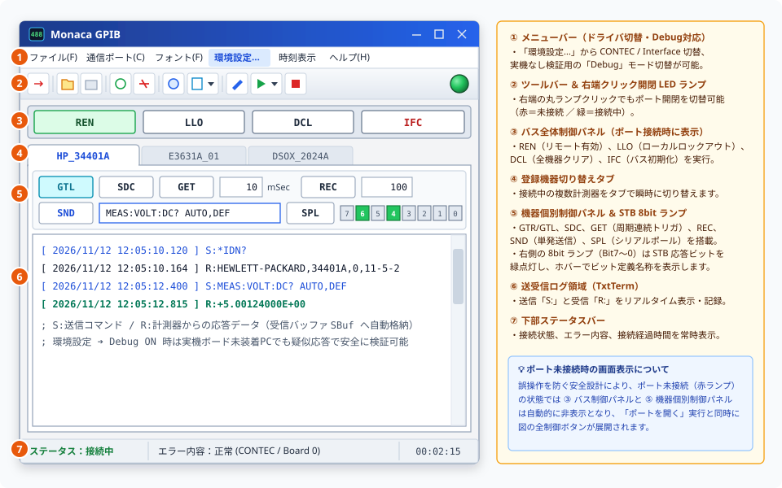

# メイン画面取扱説明書 (User Manual)

👉 [← GpibAddIn 製品トップに戻る](../README.md)  
👉 [→ プロパティ設定画面取扱説明書](./プロパティ設定画面取扱説明書.Md) ／ [→ コマンド編集画面取扱説明書](./コマンド編集画面取扱説明書.Md) ／ [→ Excelアドイン取扱説明書](./Excelアドイン取扱説明書.Md)

---

本書は、GPIB（IEEE-488）通信制御・自動測定システムの中心画面として、複数の接続計測器のタブ切替管理、直接コマンド送受信、GPIB バス信号制御、ステータスバイト監視、およびリアルタイム通信ログ記録を行う **「メイン画面（Monaca GPIB）」** の総合取扱説明書です。

初めて GPIB 計測器を操作する方でも迷わず扱えるよう、画面の開き方、全メニュー・ツールバー・制御ボタンの詳しい動作、実機ボードなしでのデバッグ確認手順、およびトラブルシューティングまで丁寧に解説します。

---

# 目次

- [第 1 章 概要と起動・終了の基本](#第-1-章-概要と起動終了の基本)
  - [1.1 メイン画面の役割と主な機能](#11-メイン画面の役割と主な機能)
  - [1.2 起動方法と多重起動禁止（シングルインスタンス保護）](#12-起動方法と多重起動禁止シングルインスタンス保護)
  - [1.3 安全な終了手順](#13-安全な終了手順)
- [第 2 章 メイン画面の全体構成と各部の詳細](#第-2-章-メイン画面の全体構成と各部の詳細)
  - [2.1 画面全体イメージ](#21-画面全体イメージ)
  - [2.2 上部メニューバーの詳細（全 6 分類）](#22-上部メニューバーの詳細全-6-分類)
  - [2.3 アイコンツールバー・LED ランプ・下部ステータスバーの詳細](#23-アイコンツールバーled-ランプ下部ステータスバーの詳細)
- [第 3 章 GPIB バス制御・機器個別制御・STB 監視の操作](#第-3-章-gpib-バス制御機器個別制御stb-監視の操作)
  - [3.1 バス全体制御パネル（REN / LLO / DCL / IFC）](#31-バス全体制御パネルren--llo--dcl--ifc)
  - [3.2 機器個別制御パネル（GTL/GTR・SDC・GET・SND/REC・SPL）](#32-機器個別制御パネルgtlgtrsdcgetsndrecspl)
  - [3.3 接続機器切り替えタブと送受信ログの見方](#33-接続機器切り替えタブと送受信ログの見方)
- [第 4 章 実践チュートリアル（目的別の操作手順）](#第-4-章-実践チュートリアル目的別の操作手順)
  - [4.1 手順 1：実機 GPIB ボードなしで「デバッグモード」を体験する](#41-手順-1実機-gpib-ボードなしでデバッグモードを体験する)
  - [4.2 手順 2：実機 GPIB 計測器へ `*IDN?` を送って応答を確認する](#42-手順-2実機-gpib-計測器へ-idn-を送って応答を確認する)
  - [4.3 手順 3：測定トリガー（GET）の周期送出とステータスバイト（SPL）の確認](#43-手順-3測定トリガーgetの周期送出とステータスバイトsplの確認)
- [第 5 章 設定の自動保存・復元とトラブルシューティング（FAQ）](#第-5-章-設定の自動保存復元とトラブルシューティングfaq)
  - [5.1 自動保存される設定と監査ログ](#51-自動保存される設定と監査ログ)
  - [5.2 よくある質問とトラブルシューティング（FAQ）](#52-よくある質問とトラブルシューティングfaq)

---

# 第 1 章 概要と起動・終了の基本

## 1.1 メイン画面の役割と主な機能

**メイン画面** は、直流安定化電源・デジタルマルチメータ・オシロスコープ・ファンクションジェネレータなどの GPIB（IEEE-488）対応計測器を一元管理・操作するための司令塔となる画面です。

* **複数計測器のタブ一元管理**: 登録された複数の計測器を画面中央のタブで瞬時に切り替え、機器ごとの送受信ログや制御状態を確認できます。
* **対話コマンド送受信とバス信号制御**: マクロスクリプトを登録していないコマンドでも、画面上の入力欄から `*IDN?` などを直接送信して応答を確認したり、`REN`・`LLO`・`DCL`・`IFC`・`GET`・`SPL` といった IEEE-488 標準バス信号を手動送出したりできます。
* **マクロスクリプトおよび Excel アドイン連携 **: 各機器の制御手順を GPIB マクロスクリプト（ **[マクロスクリプト取扱説明書](./マクロスクリプト取扱説明書.Md)** ）として登録しておけば、メイン画面のドロップダウンや Excel シートの実行ボタンから自動測定を実行できます。
* **実機不要のデバッグモード搭載**: GPIB ボードやドライバがインストールされていない事務用 PC でも、安全に画面操作や Excel シーケンスの事前確認を行えるシミュレーションモードを備えています。

## 1.2 起動方法と多重起動禁止（シングルインスタンス保護）

メイン画面は以下の 2 通りの方法で起動できます。
1. **Excel アドインから起動 **: Excel のリボンメニュー **`[アドイン]` ➔ `[GPIB制御]` ➔ `[ツール起動]`** をクリックします。
2. **単体アプリとして起動**: スタートメニューまたはインストールフォルダ内の実行ファイルから起動します。

> [!IMPORTANT]
> **多重起動禁止（シングルインスタンス保護）について**  
> 物理 GPIB バスの通信競合やドライバの排他エラーを防ぐため、本画面は **PC 上で 1 つだけ起動できる仕様** になっています。すでにメイン画面が起動している状態で再度起動操作を行うと、新しいウィンドウは開かず、既存のメイン画面が自動的に最前面へ表示されます（最小化されていた場合は通常サイズへ復元されます）。

## 1.3 安全な終了手順

メイン画面右上の **`[×]`** ボタン、ツールバー左端の ** 「終了」 ** アイコン、またはメニューバーの **`[ファイル(F)] ➔ [終了(X)]`** をクリックします。終了時には、開いている GPIB ポートと記録中の通信ログファイルが安全に閉じられ、ウィンドウの位置・サイズ・フォント・ドライバ設定が `Setting.xml` へ自動保存されます。

---

# 第 2 章 メイン画面の全体構成と各部の詳細

## 2.1 画面全体イメージ

メイン画面は、上から **① メニューバー ** 、 **② アイコンツールバー＆ポート切替 LED ランプ ** 、 **③ バス全体制御パネル ** 、 **④ 接続機器切り替えタブ ** 、 **⑤ 機器個別制御パネル（＋ STB 8 ビットランプ） ** 、 **⑥ 送受信ログ表示領域 ** 、 **⑦ 下部ステータスバー** で構成されています。なお、③・⑤ の制御パネルはポート接続中（緑 LED 点灯中）に展開されます。

---

## 2.2 上部メニューバーの詳細（全 6 分類）

### 1. `ファイル(F)` メニュー
通信ログファイルの記録操作、テキストファイル一括送信、およびアプリケーション終了を行います。

| メニュー項目 | 詳しい機能と操作手順 |
| :--- | :--- |
| **`ログファイルを開く(O)...`** | ファイル保存ダイアログが開きます。保存先フォルダとファイル名を指定して確定すると、それ以降の送受信ログがリアルタイムにファイルへ書き込まれます（記録中はツールバーのログアイコンも記録中表示になります）。 |
| **`ログファイルを閉じる(C)`** | 記録中の通信ログファイルを安全にフラッシュして閉じます。Excel やテキストエディタでログ内容を確認する前に必ず閉じてください。 |
| **`テキストファイルの送信(T)...`** | 外部テキストファイルを選択し、ファイル内に記述されたコマンド行を選択中の計測器へ順次送信します。繰り返し送信する初期化コマンド群などをテキストにまとめておくと便利です（送信履歴はツールバーの `▼` に最大 10 件自動保存されます）。 |
| **`終了(X)`** | 通信ポートとログファイルを安全に閉じてメイン画面を終了します。 |

### 2. `通信ポート(C)` メニュー
GPIB ボード・計測器との接続確立／切断、および機器登録・アドレス設定を行います。

| メニュー項目 | 詳しい機能と操作手順 |
| :--- | :--- |
| **`ポートを開く(O)`** | 選択中のドライバ（`CONTEC` / `Interface`）または `デバッグ` モードで GPIB ボードを初期化し、登録済み機器との接続を確立します。成功すると右端の LED ランプが ** 緑色** に変わり、中央のバス制御・機器個別制御パネルが展開されます。 |
| **`ポートを閉じる(C)`** | 接続中の GPIB ポートを切断してリソースを解放します。LED ランプが ** 赤色** に戻ります。ドライバ種別やデバッグモードを切り替える際は、必ず先にポートを閉じてください。 |
| **`プロパティ...(P)`** | 計測器の登録・有効化（機器リスト）およびボード番号・1 次アドレス・デリミタ・EOI を設定する ** 「プロパティ設定画面」** （[詳細](./プロパティ設定画面取扱説明書.Md)）を開きます。 |

### 3. `フォント(F)` メニュー
| メニュー項目 | 詳しい機能と操作手順 |
| :--- | :--- |
| **`フォント`** | Windows 標準のフォント選択ダイアログが開き、送受信ログ表示領域（図中 ⑥）のフォント種類・スタイル・文字サイズ・文字色を自由に変更できます。変更した設定は `Setting.xml` へ自動保存され、次回起動時も維持されます。 |

### 4. `環境設定...` メニュー
アプリ全体の表示言語・ログ出力先・GPIB ドライバ種別・デバッグモードを設定します。

| メニュー項目 | 詳しい機能と操作手順 |
| :--- | :--- |
| **`環境設定`** | Monaca 共通の環境設定ダイアログを開きます。設定ファイル保存先の確認のほか、 **UI 表示言語（`自動` / `日本語` / `英語`）をアプリを再起動せずにリアルタイムで切り替え** られます。 |
| **`エラー履歴`** | ログ設定・履歴ダイアログを開きます。ログファイルの保存先フォルダ・ファイル名（既定 `info.log`）および出力ログレベル（設定変更履歴のみを記録する **`Save`** 等）の確認・変更を行えます。 |
| **`CONTEC`** / **`Interface`** | 実機 GPIB ボードのメーカー別ドライバ（CONTEC 製 `CGPIB.DLL` または Interface 製 `gpc4304.dll`）を排他的に切り替えます。 ※安全のため、 ** ポート接続中（緑 LED 点灯中）は切り替えがブロックされます** 。必ず「ポートを閉じる」を実行してから切り替えてください。 |
| **`デバッグ`** | 実機 GPIB ボードやドライバが導入されていない PC でも画面操作・コマンド実行・Excel 連携を安全に試せる「動作シミュレーションモード」の ON / OFF を切り替えます。 ※実機ドライバ DLL が未導入の PC で `デバッグ` を OFF にしようとした場合は、安全防御のためエラー通知が表示され、実機モードへは移行しません。 |

### 5. `時刻表示` メニュー
| メニュー項目 | 詳しい機能と操作手順 |
| :--- | :--- |
| **`時刻有効`** / **`時刻無効`** | 送受信ログの各行先頭に、ミリ秒精度のタイムスタンプ（例: `[ 2026/09/30 23:55:00.000 ]`）を自動付与するかどうかを切り替えます。応答時間の計測やトラブル発生時刻の追跡に便利です。 |

### 6. `ヘルプ(H)` メニュー
| メニュー項目 | 詳しい機能と操作手順 |
| :--- | :--- |
| **`操作説明書(M)...`** | 同梱の HTML 版取扱説明書を既定の Web ブラウザで開きます。 |
| **`バージョン情報(A)...`** | アプリケーションのバージョン番号、著作権情報、ライセンス認証状態、および動作環境を確認できます。 |

---

## 2.3 アイコンツールバー・LED ランプ・下部ステータスバーの詳細

メニューバー直下のツールバー（図中 ②）には、よく使う機能がアイコンボタンとして並んでいます。

| 画面要素 | 操作可能タイミング・表示状態 | 詳しい機能と使い方 |
| :--- | :--- | :--- |
| **終了** | 常時クリック可能 | ポートとログを安全に閉じてメイン画面を終了します。 |
| **ログを開く / ログを閉じる** | 記録状態に応じて切替 | 通信ログファイルの記録開始・終了をワンクリックで切り替えます。 |
| **ポートを開く / ポートを閉じる** | 接続状態に応じて切替 | GPIB ポートの接続確立（オープン）と切断（クローズ）を行います。 |
| **プロパティ設定** | 常時クリック可能 | 「プロパティ設定画面」を開きます。 |
| **テキストファイルの送信（`▼` 付き） ** | 接続中に使用 | アイコンをクリックするとファイル選択ダイアログが開きます。右横の **`▼`** をクリックすると、過去に送信したテキストファイル履歴（ ** 最大 10 件** ）が表示され、ワンクリックで再送信できます。 |
| **コマンド実行（`▼` 付き） ** | 接続中に使用 | 右横の **`▼`** から選択中機器の公開コマンド一覧を選び、Excel を使わずにメイン画面から即座に単発非同期実行できます。 |
| **コマンド編集 ** | 常時クリック可能 | パラメータ編集・単発テスト実行を行う ** 「コマンド編集画面」** （[詳細](./コマンド編集画面取扱説明書.Md)）を開きます。 |
| **コマンド停止** | マクロ・連続トリガ実行中に有効 | 実行中のマクロスクリプト、`GET` 連続トリガ送出、または応答待機中の通信処理を緊急強制停止します。 |
| **ポート切替 LED ランプ ** （右端） | **赤色 ** ＝ 未接続 ** 緑色 ** ＝ 接続中 | 現在の GPIB 接続状態を一目で確認できます。 ** ランプ自体をクリックすることでも「ポートを開く／閉じる」を直接トグル切替** できます。 |
| **下部ステータスバー** （図中 ⑦） | 常時リアルタイム更新 | 現在の接続状態、エラー通知メッセージ、およびポートをオープンしてからの連続接続経過時間（`hh:mm:ss`）を表示します。 |

---

# 第 3 章 GPIB バス制御・機器個別制御・STB 監視の操作

ポートを開いて接続状態（緑 LED 点灯）にすると、画面中央に **バス全体制御パネル（図中 ③） ** と ** 機器個別制御パネル（図中 ⑤）** が表示されます。

## 3.1 バス全体制御パネル（REN / LLO / DCL / IFC）

GPIB バスに接続されている **すべての計測器に対して一括で作用する** 4 つの制御ボタンです。

| ボタン名 | 正式名称・信号 | 詳しい動作と現場での利用シーン |
| :---: | :--- | :--- |
| **`REN`** | Remote Enable（リモート許可） | GPIB バスの REN ラインの ON / OFF を切り替えます。計測器を PC からのリモート制御状態へ移行させるときに ON、バス上の全機器を一括で本体操作（ローカル）へ戻すときに OFF にします。 |
| **`LLO`** | Local Lockout（ローカルロックアウト） | バス上の全機器に対して本体フロントパネルのボタン操作をロックします。長時間の自動測定中に、誤って計測器本体のボタンを押して設定を変えてしまう事故を防ぐときに使用します。 |
| **`DCL`** | Device Clear（全機器デバイスクリア） | バス上のすべての機器へ一括デバイスクリアを送出します。テスト開始前に全計測器の送受信バッファやエラー状態を初期化したいときに使用します。 |
| **`IFC`** | Interface Clear（インターフェースクリア） | GPIB バス全体のインターフェースラインを初期化し、コントローラへ制御権を強制復帰させます。いずれかの計測器が応答不能になってバスがハングアップしたときのリカバリ操作として使用します。 |

---

## 3.2 機器個別制御パネル（GTL/GTR・SDC・GET・SND/REC・SPL）

画面中央の **「接続機器切り替えタブ」で現在選択している 1 台の計測器だけ** に対して作用する制御パネルです。

| ボタン / 入力欄 | 詳しい動作と操作手順 |
| :--- | :--- |
| **`GTL` / `GTR`** | 選択中機器のリモート状態（水色 **`GTL`** 表示）とローカル状態（灰色 **`GTR`** 表示）をトグル切替します。自動測定の合間に、特定の 1 台だけ本体パネルのダイヤルやボタンで手動調整したいときに `GTL` を押してローカルへ解放します。 |
| **`SDC`** | Selected Device Clear。選択中の 1 台（リモート状態）だけへ個別デバイスクリアを送出します。他の計測器の出力や設定に影響を与えずに、特定の 1 台だけ通信バッファをクリアしたいときに使います。 |
| **`GET` ＋ `実行周期`** | Group Execute Trigger（測定トリガー送出）。 ・ ** 単発トリガー**: `実行周期`（ms）が空欄または `0` の状態で **`GET`** を押すと、トリガーを 1 回だけ送出します。 ・ ** 周期連続トリガー**: `実行周期` に `1` 以上のミリ秒数（例: `1000` ＝ 1 秒間隔）を入力して **`GET`** を押すと、指定間隔でトリガーを連続送出し続けます。停止したいときはツールバーの ** 「コマンド停止」** ボタンを押します。 |
| **送信入力欄 ＋ `SND` / `REC`** | テキスト入力欄へ任意の SCPI / GPIB コマンド（例: `*IDN?`、`MEAS:VOLT:DC?`）を入力し、 **`SND`** をクリックすると選択中機器へ直接送信します（ログ欄に `S: *IDN?` と記録）。続けて **`REC`** をクリックすると機器からの応答データを受信し、ログ欄へ `R: ...` と表示します。マクロスクリプトを作る前のコマンド動作確認に最適です。 |
| **`SPL` ＋ `Bit7`〜`Bit0`** | Serial Poll（シリアルポール）。 **`SPL`** をクリックすると選択中機器から 8 ビットのステータスバイト（STB）を読み出し、横に並ぶ 8 個の LED ランプ（`Bit7`〜`Bit0`）へ反映します（ ** 赤色 ＝ ON [1] / 緑色 ＝ OFF [0]** ）。たとえば `Bit4`（MAV：応答データ準備完了）や `Bit6`（RQS/MSS：サービスリクエスト）の点灯を目視確認できます。 ※各ビットの LED ランプをクリックすると、表示状態を個別に消灯（リセット）できます。 |

---

## 3.3 接続機器切り替えタブと送受信ログの見方

画面中央のタブ（図中 ④）には、プロパティ設定画面の「選択中デバイス」に登録されているすべての計測器がタブとして並びます。

* **タブ切替時の完全自動同期**:
  タブを切り替えると、下部の **送受信ログ履歴（図中 ⑥） ** 、 **STB 8 ビットランプ状態 ** 、および **`GTL`/`GTR`・`LLO` の表示状態** が、選択した機器のものへ即座に切り替わります。
* **Excel シート実行時の自動追従**:
  Excel シート上の実行ボタンや `Start` 連続実行で複数台の計測器を順番に制御している場合、コマンドが実行されるたびに **メイン画面のタブも現在通信中の機器へ自動で切り替わります** 。これにより、どの機器とどんなコマンドをやり取りしているかをリアルタイムに追跡できます。
* **送受信ログの表記**:
  * **`S:`** … PC から計測器へ送信したデータ（Send）
  * **`R:`** … 計測器から受信したデータ（Receive）
  * `時刻有効` を ON にしている場合は、行頭に `[ YYYY/MM/DD HH:mm:ss.fff ]` が付加されます。

---

# 第 4 章 実践チュートリアル（目的別の操作手順）

## 4.1 手順 1：実機 GPIB ボードなしで「デバッグモード」を体験する

GPIB ボードや計測器が接続されていない事務用 PC でも、以下の手順で画面操作と通信の流れを確認できます。

1. メイン画面を起動します。
2. 上部メニューバーの **`[環境設定...] ➔ [デバッグ]`** をクリックしてチェックを **ON** にします。
3. ツールバー右端の **赤色 LED ランプ** （または `[通信ポート(C)] ➔ [ポートを開く(O)]`）をクリックします。
4. LED ランプが **緑色（接続中）** に変わり、画面中央にバス制御パネルと機器個別制御パネルが展開されます。
5. 送信入力欄に **`*IDN?`** と入力して **`SND`** ボタンをクリックし、続けて **`REC`** ボタンをクリックします。
6. 下部の送受信ログ表示領域に送信履歴（`S:`）とデバッグ応答（`R:`）が記録されることを確認します。
7. 終了時は再度 LED ランプをクリックして **赤色（未接続）** に戻します。

---

## 4.2 手順 2：実機 GPIB 計測器へ `*IDN?` を送って応答を確認する

実機の GPIB ボード（CONTEC または Interface 製）と計測器を接続して疎通確認する手順です。

1. ポートが閉じている状態（赤 LED）で、上部メニュー **`[環境設定...]`** を開き、お使いのボードメーカー（ **`CONTEC`** または **`Interface`** ）を選択し、 **`デバッグ`** のチェックが **OFF** になっていることを確認します。
2. **`[通信ポート(C)] ➔ [プロパティ...(P)]`** を開き、対象計測器が「選択中デバイス」に登録され、正しい `ボード番号`（通常 `0`）と `1次アドレス`（例: `22`）が設定されていることを確認します（詳細は [プロパティ設定画面取扱説明書](./プロパティ設定画面取扱説明書.Md)）。
3. ツールバーの **「ポートを開く」** （または赤 LED ランプ）をクリックして接続（緑 LED 点灯）します。
4. 画面中央の機器タブから、確認したい計測器のタブを選択します。
5. 送信入力欄に **`*IDN?`** と入力して **`SND`** をクリックし、続けて **`REC`** をクリックします。
6. ログ欄に `R: HEWLETT-PACKARD,34401A,...` のように計測器のメーカー名・型番・シリアル番号が返ってくれば疎通確認完了です。

---

## 4.3 手順 3：測定トリガー（GET）の周期送出とステータスバイト（SPL）の確認

1. 計測器を接続状態（緑 LED）にし、対象機器のタブを選択します。
2. 機器個別制御パネルの **`実行周期`** 欄に **`1000`** （1 秒間隔）と入力して **`GET`** をクリックすると、1 秒ごとにトリガーが送出されます。止めるときはツールバーの ** 「コマンド停止」** をクリックします。
3. 計測器が測定を完了してデータ準備ができているか確認したいときは、 **`SPL`** ボタンをクリックします。`Bit7`〜`Bit0` のランプにステータスバイトが反映され、たとえば `Bit4`（MAV）が赤点灯していれば読み出し可能なデータが計測器内に準備されていることがわかります。

---

# 第 5 章 設定の自動保存・復元とトラブルシューティング（FAQ）

## 5.1 自動保存される設定と監査ログ

* **自動保存先 **: ウィンドウの表示位置・サイズ、送受信ログのフォント・文字色、選択中のドライバメーカー（CONTEC / Interface）、デバッグモード状態、および UI 表示言語は、共通設定ファイル（既定 **`%USERPROFILE%\Desktop\Monaca\Setting.xml`** ）へ自動保存され、次回起動時に復元されます。
* **監査ログ（変更履歴） **: 環境設定やドライバ設定を変更して保存した際は、既定 **`%USERPROFILE%\Desktop\Monaca\info.log`** へ `[SAVE]` 区分で変更前後の履歴が自動記録されます。

## 5.2 よくある質問とトラブルシューティング（FAQ）

#### Q1. `CONTEC` / `Interface` や `デバッグ` メニューをクリックしても切り替わりません。
* 通信中の誤動作・クラッシュを防止するため、 **ポート接続中（緑 LED 点灯中）はドライバ種別およびデバッグモードの切り替えがブロックされます** 。一度ツールバーの「ポートを閉じる」（または緑 LED ランプをクリック）で赤 LED 状態にしてから切り替えてください。

#### Q2. 実機ボードが無い PC で `デバッグ` を OFF にするとエラーメッセージが出ます。
* CONTEC（`CGPIB.DLL`）または Interface（`gpc4304.dll`）の物理ドライバ DLL がインストールされていない環境では、安全防御のため実機モードへ移行しません。実機ボードが無い PC で操作・テストを行う場合は、 **`[環境設定...] ➔ [デバッグ]`** を ON のままご利用ください。

#### Q3. Excel 64bit 環境で Interface 製 GPIB ボードが使えません。
* Interface 製ドライバ（`gpc4304.dll`）は 32bit 専用ライブラリのため、64bit 版 Excel からは直接読み込めません。Interface 製ボードで実機測定を行う場合は **Excel 32bit 環境** をご利用ください（CONTEC 製ボードの場合は 64bit 対応版ドライバを導入することで 64bit Excel でも動作します）。

#### Q4. `REC` を押してもタイムアウトして応答が返ってきません。
* ① プロパティ設定画面で **`1次アドレス`** が計測器本体の設定と一致しているか確認してください。
* ② **`デリミタ`** （`CRLF` / `CR` / `LF`）および **`EOI 有効`** が計測器の仕様と合っているか確認してください。
* ③ 応答を返すコマンド（末尾に `?` が付くクエリコマンド）を `SND` で送った後に `REC` を押しているか確認してください。

#### Q5. メイン画面をもう 1 つ開こうとしても開きません。
* GPIB バスの排他保護のため、メイン画面は多重起動禁止（シングルインスタンス）設計です。すでに開いているメイン画面が最前面に表示されます。複数の計測器を扱う場合は、1 つのメイン画面内で **接続機器切り替えタブ** を切り替えてご利用ください。

#### Q6. ウィンドウの位置がおかしくなったり、設定を初期状態に戻したい場合は？
* メイン画面と Excel を終了した状態で、`%USERPROFILE%\Desktop\Monaca\Setting.xml` を別フォルダへ退避（または削除）して再起動すると、工場出荷時の初期設定で安全に再生成されます。
